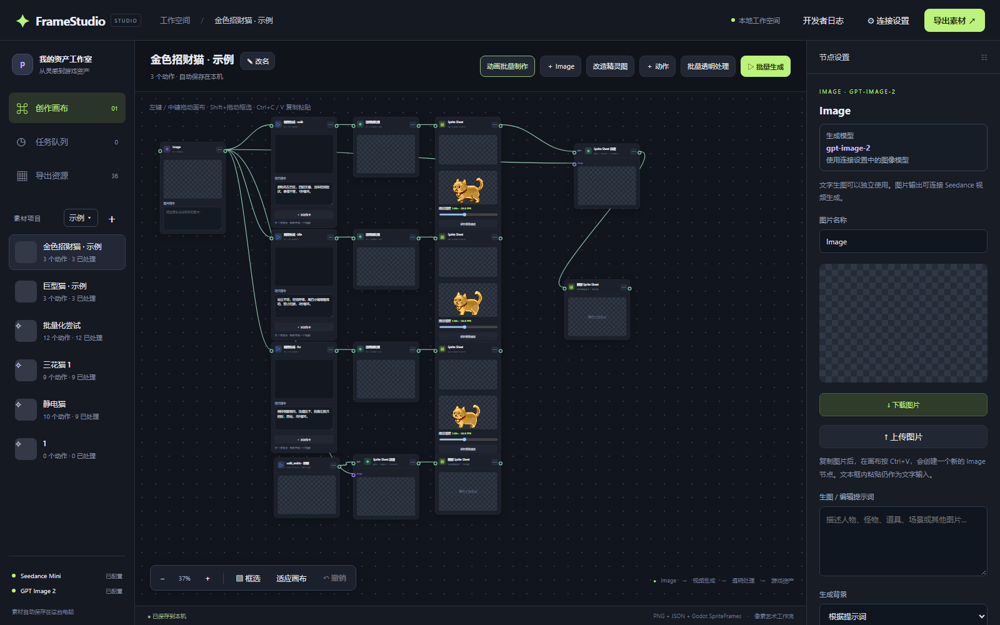
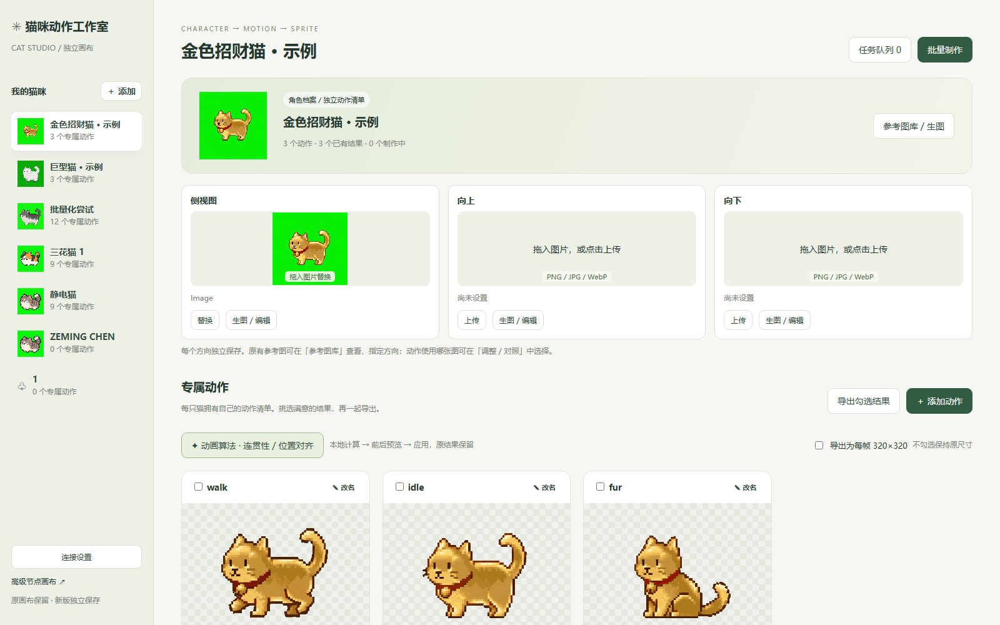

# 《毛球计划》技美日志

记录美术工具、视频处理和动画导出，之后按日期追加。FrameStudio 中未注明日期的迭代按本次指定归入 **9 月 24 日**。素材制作与入库见[美术日志](毛球计划_美术日志.md)。

## 2026年9月22日

FrameStudio 建立了“视频 → 抽帧 → 去绿幕 → 选帧 → 导出”的流程。处理整段动画时使用统一裁框，保留角色动作本来的跳跃和起伏，减少逐帧重新居中造成的抖动。

时间轴可对照原视频和透明帧，排除或恢复不合适的帧。导出 PNG、JSON、Godot `.tres` 和压缩包时，工具保留原始帧与选用帧，方便回溯；导出后仍须在游戏中检查。

## 2026年9月24日

FrameStudio 将参考图、视频、去背景和导出做成可保存的节点画布。按连线决定处理输入；一个视频也能分叉到不同处理节点，便于比较抠像和选帧效果。

*FrameStudio 本机界面截图，2026-10-08。图中的连线是参考图、动作处理和导出之间的数据流；截图日期是记录日期，不代表所有节点都在 9 月 24 日完成。*

工具保存项目、任务 ID 和处理版本。已有视频可直接重做本地处理；刷新后查询旧任务，不会重新提交付费生成。颜色、闪帧和像素稳定修正先给出预览候选，再决定是否应用。复杂绿边和原视频形变仍需人工检查。

这些迭代的原记录未逐项标明日期。代码快照已收入[工作流代码](../美术技美报告/工作流代码.md)，原项目数据仍在相邻 `Gaming` 工作区；详见[04 资产画布日志](../美术技美报告/04_资产画布制作日志.md)。

## 2026年9月29日

建立第二代“猫咪工作室”，按“猫 → 方向参考图 → 动作 → 视频 → 处理版本 → 导出”组织工作。制作时先核对侧面、向上、向下参考图，再查看每个动作的原视频、透明帧与导出结果；原节点画布仍可使用。

*猫咪工作室本机界面截图，2026-10-08。上方按方向管理参考图，下方按动作管理处理和导出；画面中的示例资产不等于游戏已接入资源。*

批量处理会跳过已有导出，已有视频优先走本地流程。连贯性和脚底位置修正先生成候选、对照预览，确认后才应用；旧候选不能覆盖更新的版本。动作改名会同步到 JSON 和 Godot 资源。

第二代从 FrameStudio 复制初始数据，此后独立保存。工具数据在相邻 `Gaming` 工作区；导出动画仍需手动导入游戏并检查方向、透明边、脚底和速度。详见[05 猫咪工作室日志](../美术技美报告/05_猫咪工作室制作日志.md)。

## 2026年10月13日

**1. 规范自然语言制作流程。** 建立并安装 FrameStudio 制作 Skill，复用 htalk 调用入口。Agent 接单时主动给出需求表，预填已有信息，并提前说明方案、实际参考图、重做、超额度与最终验收等决策环节。动作与方向分别确认，提示词写入画布；默认非像素二维勾线卡通、10 FPS，建议5–20帧，320×320单帧尺寸需确认。

**2. 补齐执行与质量约束。** 每任务上限15张图、10段视频，包含重做和可能扣费的失败请求；通过本地台账防止重复提交。视频前检查真实绿幕图片，不能仅靠提示词；侧面动作直接使用原参考图，不额外生成侧脸。每段视频独立绑定透明帧处理和导出节点，核对来源，避免后一个动作覆盖前一个。质量问题先做一轮算法修复，再由需求方决定重做；这些是流程约束，不代表所有生成缺陷已经自动解决。

**3. 建立集中素材展厅。** 自动汇总动作与2D图片项目，支持搜索、筛选、原视频和精灵动画预览、历史版本、速度调整及单项/打包下载。使用已有素材，按需加载播放，不需要每个任务重建网站，也不增加模型调用。浏览器实测走路与待机打包得到2段视频、2张精灵图和2个GIF，文件校验通过。

**4. 统一内网制作平台。** 查明原8765与新版8766运行不同服务和数据，完成独立目录合并、去重、冲突版本保留和切换。现在统一使用内网8765，包含节点画布、角色工作室、2D制图、思维导图与素材展厅。保留10个可见项目、2个归档项目、1个2D项目和2张思维导图；两份静电猫分别保留，原始数据与备份未覆盖。页面/接口/连线检查通过，抽查6项媒体哈希一致，切换后通过内网地址读取视频、PNG和GIF成功。

当前展厅展示画布实际处理版本，512母版不等于最终确认的320成品；任务目录中的最终交付包尚未自动入展厅。当前视频接口仍固定4秒原片，需向需求方说明；导出后仍需游戏内验收。本次工具开发与合并未新增模型生成请求，也未改游戏玩法或运行素材。

详细过程与证据见[11｜FrameStudio规范化与统一平台](../美术技美报告/11_2026-10-13_FrameStudio规范化与统一平台.md)。原“美术日志”资料目录已更名为“美术技美报告”，历史编号和内容保留。

## 记录依据

依据[04 资产画布](../美术技美报告/04_资产画布制作日志.md)与[05 猫咪工作室](../美术技美报告/05_猫咪工作室制作日志.md)整理。工具导出不等于素材已接入游戏。

## 2026年10月16日

**双猫动画生产与返修。** 普通猫／乱毛猫、机械猫／旧化机械猫分别组织独立参考、动作、处理与导出分支。行走6帧／6 FPS／1秒，待机10帧／5 FPS／2秒，单帧320×320，原片4秒，朝右镜像。依据旧版静电猫动画检查步态；普通朝下因尺寸和动作问题多轮返工，最后一版仍待用户验收，不能以生成完成代替质量通过。

**定位中文提示词传输损坏。** 本地接收端确认Windows PowerShell 5.1发送中文JSON字符串出现问号替换，实际Seedance桥接脚本改为显式UTF-8 Content-Type与UTF-8字节Body，5.1／7对照均恢复原文。不是仅靠增删提示词解决；本轮未同步仓库历史代码快照。

**增加逐帧质量证据。** 放大检查乱毛朝左鼻子与双侧嘴线；用双眼暗色连通区域和眼线附近宽度辅助检测尺寸漂移。最后普通朝下可测88/97帧，宽度范围约首帧3.37%，眼距范围约6.82%；眨眼帧不计入有效测量，指标不代表步态验收。

**柔化去绿与导出。** 原阈值5／柔化0会硬切混色边缘。本批改为10／30并保留去绿溢色，24动作本地重新处理，采样时间、索引、帧数、FPS一致，无新增模型生成。用户随后因质量不足撤出机械猫上下8动作，最终项目目录保留普通猫12动作＋机械猫朝左4动作，固定文件名便于替换。16张PNG、16个GIF、16段MP4已本地校验；完整资源尚未随报告上传、未修改场景动画引用，无新EXE。

详细过程、代表性动画及检查证据见[15｜双猫动画返修与透明边缘处理](../美术技美报告/15_2026-10-16_双猫动画返修与透明边缘处理.md)。同日美术场景上传另见[14号报告](../美术技美报告/14_2026-10-16_场景上传与美容室接手附件.md)。
