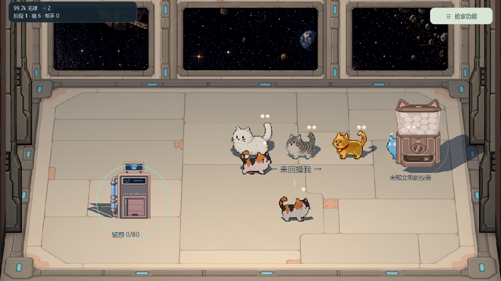
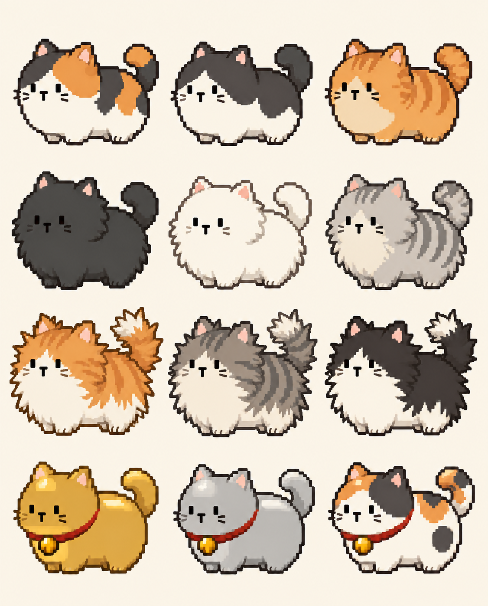
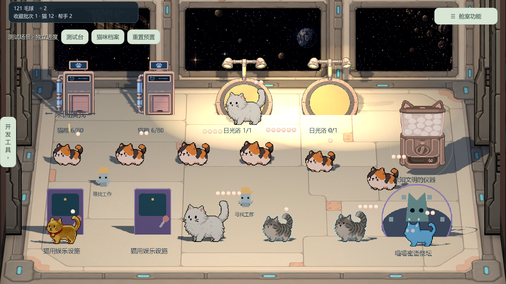
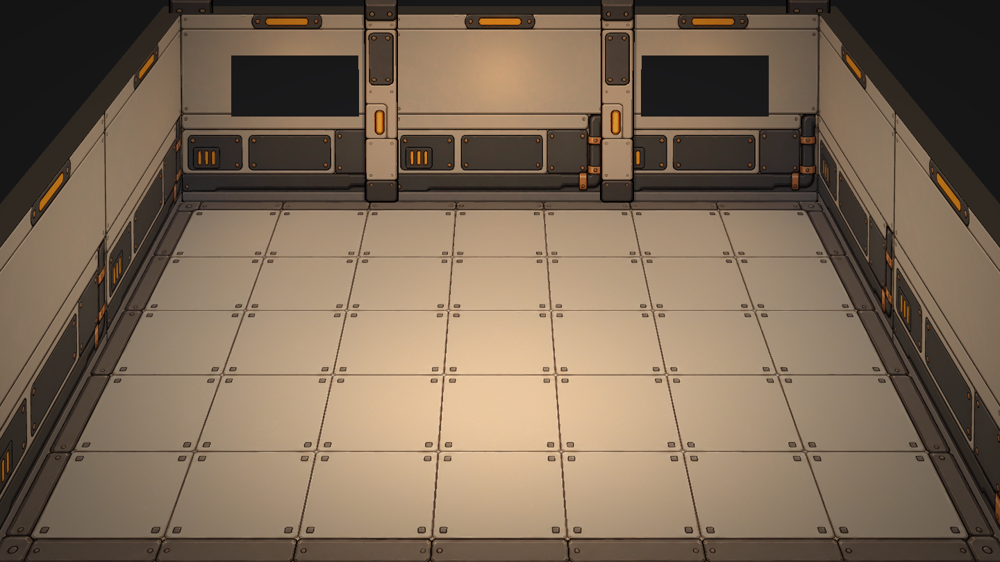
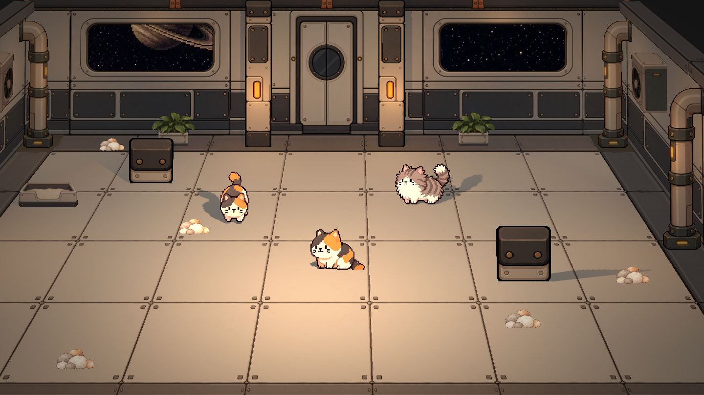
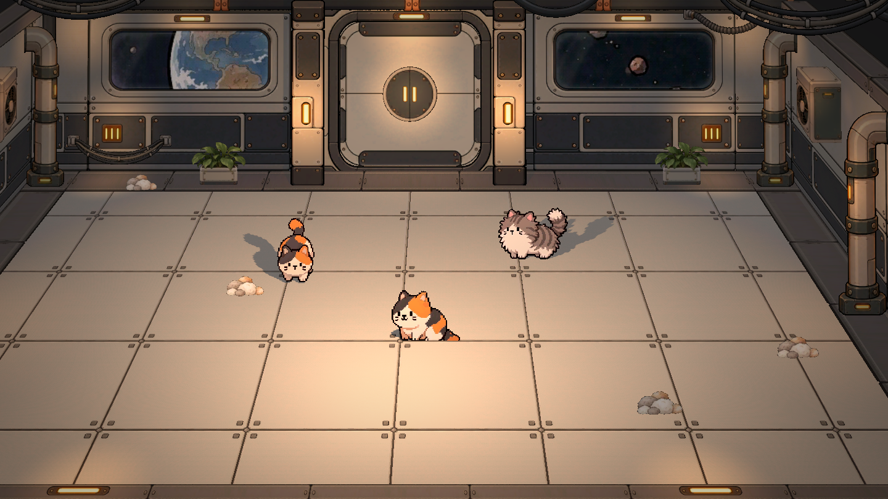
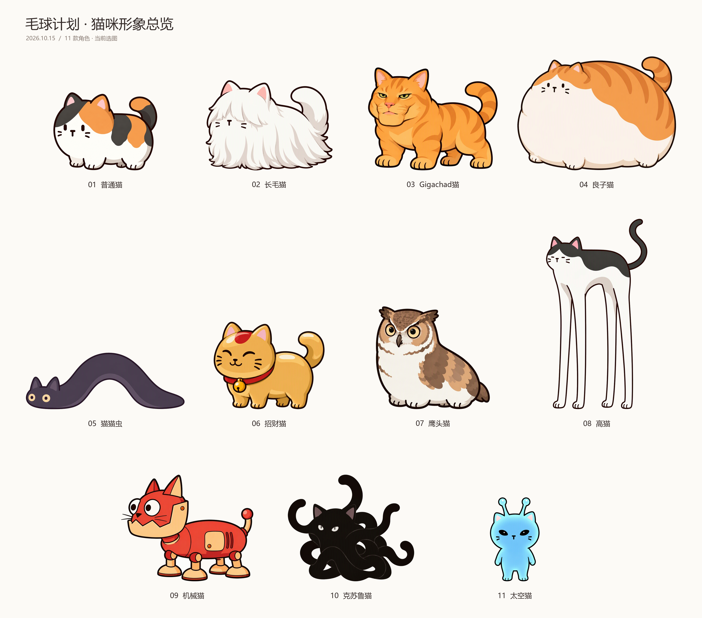
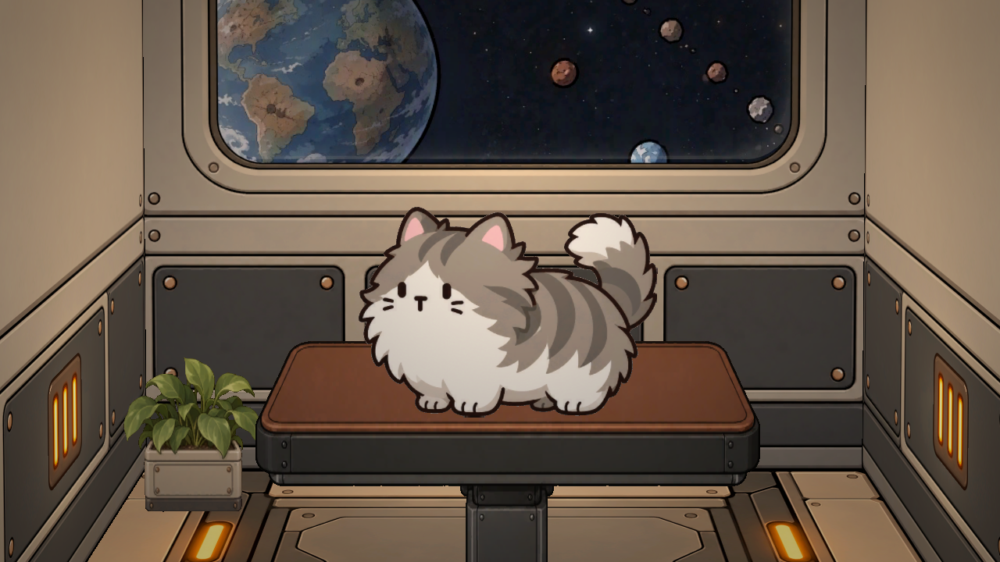

# 《毛球计划》美术日志

记录猫咪和空间站素材的制作与入库，之后按日期追加。概念图和绿幕图按本次指定归入 **9 月 28 日**；原文件没有具体制作日期。工具制作见[技美日志](毛球计划_技美日志.md)。

## 2026年9月21日

将短毛、巨型、静电、招财四种猫的待机、行走、产毛序列接入游戏，并配置动画。画面按猫的状态切换动作，脚底定位保持稳定。

加入空间站、标题、窗外宇宙、设施、资源和光标图像。窗洞遮罩让宇宙只显示在窗内；玩家可通过图标辨认设施与资源。

摸猫时会显示毛层和收获特效，获得代币时也有飞入界面的反馈。整合后核对了素材完整性、鼠标位置和实际显示，见[美术合并验证](../毛球满屋/reports/art_merge/README.md)。

## 2026年9月28日

1. **猫咪概念设计。**制作正常、长毛、最大毛量三种状态，重点用身体外轮廓表现毛量，并修正花纹、表情和像素边。这批概念图保存在本机 `Purr Orbit/output/imagegen/`，尚未接入游戏。
2. **绿幕单图。**把三花、白猫、灰刺毛、金猫各三个状态导出为独立绿底图，修正脸颊线条越界，方便后续抠像和制帧。纯绿背景、轮廓和跨状态一致性仍需逐张检查。
3. **3D 空间站。**布置地面、墙、窗、相机与灯光，填入墙地贴图和窗洞效果。猫与设施仍是平面素材，但能在 3D 场景中受光、投影；点击和拖动位置与画面对应。新增外星猫的行走、产毛动画。
4. **四向三花猫。**制作侧面、向上、向下的行走、待机，以及抚摸、舔爪、产毛图集。多次调整朝上尺寸、脚底和播放节奏；当前游戏使用 `cat1new2`。

*游戏内：9 月 28 日 3D 场景报告截图。可看地面、窗户、平面猫和设施在同一空间中的摆放。*

*游戏外：正常毛量概念图，供花纹和轮廓对照；没有作为运行图集接入。长毛对照见[修正版](../美术技美报告/图示/cat-growth-grown-v2.png)。*

概念与绿幕图是本机候选；3D 场景和四向图集的入库记录见[01 制作日志](../美术技美报告/01_制作与整合日志.md)和[3D 场景报告](../毛球满屋/reports/3d_scene/README.md)。

## 2026年9月29日

调整猫的勾边、静电亮边、补光、脚底对齐和休息动作，让猫在浅色地面和转向时更清楚、更稳定。补光只照猫，不改变墙面和设施亮度。

加入静电猫 `Cat2new` 图集，并修整空间站窗户的遮罩与浅灰内沿。游戏当前使用 `cat1new2` 和 `Cat2new`；`cat1new3`、`Cat1new4` 保留为候选。

*游戏内：9 月 29 日报告截图，用于核对多只猫、设施、补光与 UI 的整体观感；画面保留当时的测试界面。*

整合后完成动作、描边、移动和窗户检查；[报告](../毛球满屋/reports/merge_art_929/README.md)记录 7374 项自动检查通过。本次没有重导 Windows 执行文件。

## 记录依据

详见[01 制作与整合](../美术技美报告/01_制作与整合日志.md)、[02 当前素材](../美术技美报告/02_素材与场景索引.md)、[03 猫咪素材](../美术技美报告/03_猫咪素材制作日志.md)。本机实验图不等于已入库素材。

## 2026年10月9日｜场景美术、面片搭建与镜头调整

本条汇总本次对话截至10月9日的制作和整合过程，包含此前概念与素材迭代的整理；不将历史候选全部认定为当天首次制作。

1. **确定场景视觉方向。**以《饥荒：哈姆雷特》的室内围合、前景层次，以及《咩咩启示录》的勾线贴片观感为参考，制作温馨科幻空间站。采用米灰、暖褐与琥珀灯光，减少宇宙窗景占比、蓝绿与暖色的强烈对撞及厚重前景遮挡。保留铆钉、管道和检修板，减弱脏污、噪声和过深接缝。

2. **精简资产清单并整理中文提示词。**保留01地面、02基础墙、03窗墙、04轨道回收接口、06宇宙、10装饰、11前景；05暂缓，07—09不制作。固定小零件合并在所属模块中。后续按贴片搭建需要，将柱子从墙体独立出来。完整清单、历史版本及中文提示词已随07附件入库。

3. **制作与修订地面、墙体和柱子。**地面从v01迭代至v04，在减少纹理噪声的同时保留板块分割与铆钉。墙体移除两侧柱子，采用无柱墙v03；柱子使用透明PNG v01。窗墙与门墙仍是候选，需要继续处理顶部绘制透视、光影、透明区域和控制台，不标记为已完成运行素材。

4. **搭建独立纯面片场景。**新建Godot的Concept Whitebox，地面、墙体、柱子及厚度展示均使用面片。创建Asset文件夹，以Floor_01、Wall_Base_01、Wall_Column_01命名运行素材。按模块设置墙面UV，窗洞周围保持连续，柱子通过UV排除透明留白。当前没有移植猫、UI和玩法，窗后宇宙尚未接入；用户移除的门与装饰占位保持移除。

5. **反复调整游戏视角。**比较完整盒体展示与室内取景，随后保留用户手调结构，对比三轮七组相机，让前端墙体、柱子和地面边缘可见。为改善柱子向上收拢的问题，采用水平相机配合Frustum偏移，保留前后近大远小。之后用户再次微调相机，最终上传保留其最新状态；这是一种视觉实现方案，不代表已确认参考游戏使用相同技术。

6. **调整墙高、厚度与光影。**在确认结构上将墙体小幅加高约8%，同步抬高墙顶。厚度面片由0.3加宽至0.5，向外延伸并衔接后墙转角。保留最新暖色主光和补光，加入可调柔和暗角，使画面边缘渐暗、中央保持清晰。

7. **整合工程并上传。**同批上传Godot工程此前未提交的C_Floor、C_Window、窗洞黑区遮罩与去旧勾边，以及猫咪动画资源当前保存版本。正式whitebox_room与新的Concept Whitebox分别保留。Godot4.7.1导入通过，并生成1440×810和1280×800最新实机截图；未重跑完整玩法流程、未重新导出Windows包，玩法蓝图没有修改。

*本次入库的独立美术场景，包含用户最新保存的结构、相机和灯光。*

- [07号详细美术日志](../美术技美报告/07_2026-10-09_场景美术与面片搭建.md)
- [精简资产清单与中文提示词](../美术技美报告/07_附件_20261009/PurrOrbit_场景资产清单与中文提示词_v3_确认范围.md)
- [素材迭代原稿与提示词](../美术技美报告/07_附件_20261009/素材原稿/)
- [Godot场景](../毛球满屋/scenes/Concept%20Whitebox.tscn)
- [工程与07日志提交 db2cd8c7](https://github.com/Dr-Doge/PURR_ORBIT/commit/db2cd8c7)

## 2026年10月10日｜模块化房间、道具面片与光照整合

继续制作独立美术场景Concept Whitebox，保留用户手调的相机与资产布置。以下为本地已实现内容；本次归档日志和截图，今日工程与新增素材尚未随之上传。

1. **调整房间布局。**地面经历4×8、4×6调整后确定为4×7，共28块正方形模块，修正拉伸和侧面空隙。拆出浅色地板与深色边框，降低接缝对比度，保留铆钉；后方边框随侧边框加宽，调整墙柱衔接。
2. **重排墙与窗。**简化基础墙的多余灯具和管道，调整柱宽与高度。制作中央门墙，保留圆形观察窗，去掉旁置操作板。门保持正中，两边窗户分别在各自墙段居中，接入原有旋转宇宙背景。
3. **从白模制作道具面片。**先在场景中核对框架、风机和管道的轮廓、尺寸与可见侧面，再生成勾线素材。最终移除试装白模，使用独立透明图片面片；框架下宽上窄、顶部无横向突出。按左侧布置复制对侧，并保留用户后续摆位。
4. **补齐墙顶结构。**两侧方管采用顶面和内侧面两张面片，不做不可见前端封口，使用深色地面边框贴图，高度降为0.375。后墙使用用户提供的直管图分4段拼接。
5. **加入猫与装饰预览。**两只普通猫分别循环向下walk、舔毛，一只静电猫循环idle；普通猫放大20%。生成正面的绿植花盆、猫砂盆、毛球堆并试装，用户随后复制和摆放为2盆植物、1个猫砂盆、5堆毛球。毛球关闭投影，猫与装饰均未接入新玩法。
6. **修正受光并添加补光。**处理右侧镜像墙窗和道具的法线、UV问题。最终前方补光为暖白平行光、能量0.65、无投影，只作用于3只猫和5堆毛球；修正毛球受光，其他物体继续使用原场景灯光。
7. **完善镜头查看。**普通视角仅左右平移，鼠标进入左右各三分之一范围触发，限制在X±2.2。新增P键切换自由视角：右键转向、WASD移动、Q/E升降、Shift加速，再按P恢复原镜头和边缘移动。

运行截图及灯光对比已完成，P键切换与恢复检查通过。最后一次完整场景检查仍有1项左右道具位置镜像断言未通过，源于用户后续手动摆位，保留现状并登记待调整验收规则。本轮未重跑完整玩法、未导出新安装包，也没有修改玩法蓝图。

*17:18本地运行截图，记录布局和选择性补光；截图早于P键功能加入。*

详细过程、最终状态、本地资产路径和验证限制见[08号美术日志](../美术技美报告/08_2026-10-10_模块化场景与装饰整合.md)。

## 2026年10月12日｜场景美术完成80%—90%，进入收尾

当前空间站独立场景的美术完成度约 **80%—90%**，主体风格、结构和主要素材已经基本成形，后续集中处理摆位、衔接、光照及最终验收。此比例仅针对本场景美术，不代表全游戏开发完成度。

1. **统一窗外与室内画风。**宇宙改用勾线地球背景，缩小20%并保留旋转；窗户加入柔和玻璃反光和边缘层次，比较后恢复较合适的旧反光素材。
2. **完善地面与墙面。**地面保持4×7总体尺寸，中间3×6整格、四周浅色半格，切割边朝外。完成三种灯光贴片，并同步左右灯具和场景灯光布置。
3. **完成中央舱门视觉与演出。**调整门扇轮廓、高度和倒角，统一米灰、暖褐配色与勾线细节；改为上下对称开合。中央圆形锁从竖直接缝旋转90°至水平，再随上下门分开；两盏小灯随结构旋转和移动，尺寸、居中和间距已调整。
4. **补充舱室与线缆层次。**加深门后舱室，加入独立地板和可看宇宙的后壁窗。完成三款两头高、中间下垂的线缆，作为2D面片加入，保留用户最新复制与摆位结果。
5. **交付独立美术场景包。**导出Windows可运行ZIP，不包含新玩法移植。资源导入、导出、EXE实际启动，以及舱门旋转、上下开合、重复输入保护和复位检查通过；归档最新运行截图。

下一步继续调整装饰疏密、模块衔接、阴影与反光，完成各镜头范围下的美术验收。完整玩法流程未在本轮回归。本次上传日志及截图，当前新增美术工程源码未随日志提交上传；运行资源随本地场景ZIP交付。

详细记录与开门效果见[09号美术日志](../美术技美报告/09_2026-10-12_场景收尾与舱门装饰整合.md)。

## 2026年10月13日｜20种猫阵容与非像素美术设计

角色形象从普通猫逐步发展到表情包和荒诞概念，先建立静态视觉记忆点，再依据形象探索交互。已完成普通猫、静电猫非像素参考图及其余18种中文制图Prompt；目前按用户分批反馈修订，不将初版Prompt视为最终定稿。

整体采用非像素的二维勾线卡通风格，以流畅的深色轮廓、干净的大色块和少量块面阴影表现结构，避免繁琐毛发与写实纹理。猫的基础形象圆润、表情简洁，通过比例、材质和概念融合逐渐变得抽象荒诞，同时保留明确的猫形特征，让每只猫仅靠外观就有独特记忆点。

共20种猫：**1–7（7种）仍是猫的形象但越来越怪；8–12（5种）为表情包猫；13–20（8种）越发荒诞、脱离现实。**

**全部猫统一：脚掌为角色最低点，尾巴、毛发、腹部及附属结构不得低于脚掌接地基线。** 本批更新长尾猫、长毛猫、良子猫和高猫；无毛猫个体设计保持不变，其他猫仅同步共同规则。

| 编号 | 猫种 | 当前形象设定 | 制作／修订状态 |
|---|---|---|---|
| 1 | 普通猫 | 胖胖的普通猫。 | 已有非像素参考图，未接入动画 |
| 2 | 长尾猫 | 深灰猫，巨大长尾向上翘，尾巴有毛发纹理。 | 本批配色与上翘毛尾Prompt已更新 |
| 3 | 长毛猫 | 纯白长毛猫，长眉毛遮住眼睛，毛裙向后延伸但不低于脚掌。 | 本批白毛、长眉遮眼Prompt已更新 |
| 4 | 良子猫 | 特别胖的橘猫，肚子下垂接近地面但不低于脚掌，行动缓慢且可爱。 | 本批橘色Prompt已更新，其余保留 |
| 5 | 静电猫 | 炸毛，身边带有浅蓝色勾边。 | 已有非像素参考图，浅蓝勾边待补 |
| 6 | 高猫 | 上黑下白的奶牛猫，四肢很长很高；具体视觉参考待补。 | 奶牛配色Prompt已更新，视觉参考待补 |
| 7 | 无毛猫 | 普通无毛猫，功能待定。 | 个体方案保留，仅同步脚掌最低点规则 |
| 8 | 思考猫 | 参考思考猫meme，思考时可能产生神奇事件。 | 已有初版Prompt，待后续个性化修订 |
| 9 | Gigachad猫 | 很英俊、很强壮的猫。 | 已有初版Prompt，待后续个性化修订 |
| 10 | Nerd猫 | 书呆子猫，戴眼镜、有龅牙。 | 已有初版Prompt，待后续个性化修订 |
| 11 | 橘子猫 | 身上套着一个橘子的猫。 | 已有初版Prompt，待后续个性化修订 |
| 12 | 太空猫 | 头上有两个触角，身体发光。 | 已有初版Prompt，待后续个性化修订 |
| 13 | 机械猫 | 身体参考现有机械狗，搭配猫头。 | 已有初版Prompt，待后续个性化修订 |
| 14 | 机械猫（猫和老鼠） | 参考《猫和老鼠》中的机械猫。 | 已有初版Prompt，待后续个性化修订 |
| 15 | 招财猫 | 身体有金属光泽，挂着铃铛，形象类似招财猫。 | 已有初版Prompt，待后续个性化修订 |
| 16 | 猫猫虫 | 像毛毛虫一样移动的猫猫虫。 | 已有初版Prompt，待后续个性化修订 |
| 17 | 巫术布偶猫 | 布料拼接的猫身，以粗线缝合。 | 已有初版Prompt，待后续个性化修订 |
| 18 | 遗迹猫 | 数块圆钝石块悬浮拼成猫形，缝隙透出微光。 | 已有初版Prompt，待后续个性化修订 |
| 19 | 植物猫 | 由植物构成的猫。 | 已有初版Prompt，待后续个性化修订 |
| 20 | 克苏鲁猫 | 不可名状的猫形，行动诡异。 | 已有初版Prompt，待后续个性化修订 |

本轮交付为设计表、参考图和Prompt，未批量生成其余18种猫，未制作新动作图集或替换游戏运行素材。高猫的具体视觉参考尚未收到；静电猫浅蓝勾边后续补齐。此前空间站场景80%—90%的进度不用于衡量本轮新猫阵容。

- [美术技美报告：角色设计与当前修订](../美术技美报告/10_2026-10-13_猫咪阵容与非像素形象设计.md)
- [18种猫中文Prompt与使用说明](../美术技美报告/10_附件_20261013/18种猫_中文制图Prompt.md)
- [普通猫参考](../美术技美报告/10_附件_20261013/01_普通猫_非像素参考.png)／[静电猫参考](../美术技美报告/10_附件_20261013/05_静电猫_非像素参考.png)

## 2026年10月14日｜Gigachad猫形象修订

| 编号 | 猫种 | 当前形象设定 | 参考分工与进度 |
|---|---|---|---|
| 9 | Gigachad猫 | 全身橘色的橘猫，胸肩、四肢和腰腹肌肉线条明显，保留四足猫形与脚掌最低点 | 普通猫图参考画风；另附面部图参考脸型、五官与神态。Prompt已更新，面部参考待提供，未生成新图。 |

本条更新10月13日表格中09号的初版状态，其余猫不变。详见[Gigachad猫Prompt](../美术技美报告/10_附件_20261013/09_Gigachad猫_prompt.txt)。

## 2026年10月14日｜猫咪个性化视觉迭代与11款阵容总览

完成Gigachad、招财、蓝色外星猫、机械猫、克苏鲁猫与思考猫的视觉迭代，修订猫猫虫及思考猫中文Prompt。重点从行为描述转向脸型、身体比例、材质与概念融合，维持非像素勾线、大色块与简洁阴影。

按照用户最新目录的11张图片，制作三排总览，逐排脚底／接地点对齐，按要求调整相对大小，高猫明显高于同排角色。采用抠底、等比缩放和图层拼合，保留原始造型；交付高清PNG、可编辑SVG及独立图层。目录实际11张，本图序号独立于旧20猫设计编号。

| 本图序号 | 名称 | 当前选图特征 | 排版调整 |
|---|---|---|---|
| 1 | 普通猫 | 10月15日替换为用户最新三花普通猫，流畅轮廓与简洁色块。 | 缩小 |
| 2 | 长毛猫 | 白色长毛，长眉遮眼。 | 默认 |
| 3 | Gigachad猫 | 橘色肌肉猫，保留宽下颌与窄眼。 | 略放大 |
| 4 | 良子猫 | 极胖橘猫，饱满腹部与短腿。 | 放大 |
| 5 | 猫猫虫 | 深紫灰、无四肢、身体细长，中段拱起。 | 放大 |
| 6 | 招财猫 | 金色身体、红项圈、金铃铛。 | 略缩小 |
| 7 | 鹰头猫 | 猫头鹰头部与猫身融合，棕白配色。 | 略放大 |
| 8 | 高猫 | 上黑下白、极长四肢；原文件误名“8长毛猫.jpg”，展示名为高猫。 | 显著增高 |
| 9 | 机械猫 | 红色外壳、浅橘部件，复古大圆眼机械头。 | 放大 |
| 10 | 克苏鲁猫 | 近黑混乱团块与圆钝触手；本批选图含小耳，保留用户最新文件。 | 放大 |
| 11 | 太空猫 | 蓝色身体、黑色外星眼与圆头触角；本批选图为直立造型。 | 缩小 |

现代机器狗屏幕猫脸方案和思考猫过程图单独存档；最新阵容使用用户选图，包括含耳的克苏鲁和直立的蓝色太空猫。当前为静态设计／排版成果，未制作新动画或接入游戏，不更新玩法完成度。早前本日志“面部参考待提供、未生成”的Gigachad状态已由本条制作进展更新。

详细迭代与文件见[12号美术技美报告](../美术技美报告/12_2026-10-14_猫咪个性化设计与阵容排版.md)；[高清图](../美术技美报告/12_附件_20261014/20261015_普通猫替换/猫咪形象总览_20261015.png)／[可编辑图层](../美术技美报告/12_附件_20261014/20261015_普通猫替换/猫咪形象总览_可编辑.svg)。

## 2026-10-15｜第一只普通猫替换

按用户更新的1普通猫.jpg，将总览第一只替换为三花普通猫；保留原来的缩小倍率和第一排接地基线，其余10只的图像、尺寸及位置与上一版一致。更新高清总览及可编辑SVG；10月14日原版附件继续保留。

## 2026-10-15｜猫咪美容舱室与双状态美术制作

今天主要搭建猫咪美容用的近景舱室，并推进常态／第二形态的视觉制作。舱室直接放在本地 `Concept Whitebox.tscn` 主场景左侧，使用独立近景相机，保留可编辑素材；整合水平深色墙脚框架、方形墙顶管道、左右对称墙面与后窗、连续玻璃反光，以及褐色台面／深灰框架的加高操作台。灰白01普通猫已去底放到台面，11猫总览中的01也同步恢复。

O键已接通开门、推近、黑屏切镜头和返回后可见的关门流程：开门0.8秒，第0.5秒开始推近0.5秒，随后全黑停顿0.2秒再亮起；返回亮起后等0.4秒，播放0.8秒关门。P键直接切镜头已删除。完成本地加载、预览与过渡检查；未移植其他玩法。

| 猫种 | 双状态制作内容 | 当前进度 |
|---|---|---|
| 普通猫 | 灰白虎斑常态；乱毛由原有大毛束错向翻折、交叠表现，体型不膨胀 | 基础图已接入舱室，乱毛Prompt继续迭代 |
| 长毛猫 | 白色长眉遮眼；眉毛、胸前、身体和尾毛更加凌乱 | 乱毛方向已获认可并要求加乱，进一步Prompt已整理 |
| 机械猫 | 常态→浅脏污、下垂尾巴、双眼分别偏转；瞳孔恢复原比例 | 第二形态单图已生成，减轻损坏感 |
| Gigachad猫 | 肌肉身体不变；下巴大一圈、毛束轮廓明显，眼睛微眯困倦 | 第二形态单图已生成，恢复正式大头比例 |

第二形态仍为静态美术设计／Prompt成果，未制作动作图集、未接入游戏内状态切换。本条不覆盖其他美容玩法原型的开发状态。今天较早场景包不含后续操作台、01恢复及窗户修正，需后续重打包才能代表当前版。

完整图文与对照见[13号美术技美报告](../美术技美报告/13_2026-10-15_猫咪美容舱室与双状态制作.md)；[双状态Prompt](../美术技美报告/13_附件_20261015/猫咪双状态_当前Prompt.md)；[更新总览](../美术技美报告/13_附件_20261015/10_猫咪形象总览_01恢复灰白猫.png)。

## 2026-10-16｜美术场景源码上传与Agent接手入口

已同步 `毛球满屋/scenes/Concept Whitebox.tscn` 及当前门、窗、灯、装饰、操作台、灰白01猫和镜头过渡的完整资源依赖。大厅与美容室处于同一个主TSCN；美容室节点组为 `23_CloseupChamber`，约位于X=-40，使用 `CloseupCamera`。入口O键，P键切换已删除。已用独立依赖集验证导入、双镜头画面及进出／关门流程。

**其他Agent先读：[14号场景接手附件](../美术技美报告/14_2026-10-16_场景上传与美容室接手附件.md)**。附件列出场景打开方法、主场景／美容室位置、相机、关键节点、素材路径及依赖哈希，并特别标出：美容室窗户实际在`03_BackWall_Windows`组下；不要与`prototype_grooming`独立玩法原型混淆。本次未新打包EXE，默认启动入口和其他玩法保持原状。

## 2026-10-16｜当前11只猫咪表格（以最新形象总览为准）

本表是当前11只猫的制作与展示名单，编号与最新总览一致。它更新当前选图说明，不等于删除或重排早期20猫概念库，也不把未制作的第二形态补写成已完成。共同画风为非像素2D勾线、深棕色轮廓、大色块及少量阴影，毛发用宽大毛束表达。

| 编号 | 猫咪名称 | 当前基础形象 | 第二形态／制作进度 |
|---|---|---|---|
| 01 | 普通猫 | 灰白虎斑，圆胖四足猫身，白色脸颊与胸腹，蓬松上翘尾巴。当前已由三花换回灰白版本。 | 乱毛：原有大毛束歪斜、逆翘、翻折和交叠；保持体型与毛量。Prompt迭代中，最终图待定。 |
| 02 | 长毛猫 | 白色长毛，长眉毛遮住眼睛，毛发沿身体垂下并拖向身后。 | 乱毛：遮眼眉毛、胸前、身体及尾毛错向交叠、局部压塌。已有迭代参考，待进一步加乱。 |
| 03 | Gigachad猫 | 全身橘色虎斑，头大、四足肌肉明显，宽硬下颌，眼神坚毅。 | 身体不变；下巴扩大一圈，以宽大毛束形成圆润清晰的毛发轮廓；眼睛微眯、困倦。已有第二形态单图。 |
| 04 | 良子猫 | 极胖的橘猫，圆鼓身体、腹部低垂、短腿，整体饱满可爱。 | 第二形态尚未设计。 |
| 05 | 猫猫虫 | 深紫偏灰，连续细长身体、没有四肢，中段像尺蠖一样拱起，保留猫头与猫耳。 | 第二形态尚未设计；此处描述静态造型，不代表爬行动画已制作。 |
| 06 | 招财猫 | 金色猫身，红色项圈和金色铃铛，保留少量金属光泽。 | 第二形态尚未设计。 |
| 07 | 鹰头猫 | **猫头鹰的头、猫的身体**。棕白配色，圆眼、短喙与猫头鹰面盘，搭配四足猫身；名称中的“鹰”指猫头鹰。 | 新增概念已明确，已有基础选图；第二形态尚未设计。 |
| 08 | 高猫 | 上黑下白的奶牛猫，头部与身体连成整体，四肢特别细长，尾巴向上翘。 | 第二形态尚未设计。原始文件误名“8长毛猫.jpg”，按本表统一称高猫。 |
| 09 | 机械猫 | 复古红色机械猫，浅橘色部件，大圆眼机械头，横向机身、四条短腿，上翘圆球尾巴。 | 浅色尘土／泥印，两眼较大竖椭圆瞳孔各看不同方向，圆球尾巴下垂；避免深色破损感。已有第二形态单图。 |
| 10 | 克苏鲁猫 | 近乎纯黑的混乱团块，抽象纠缠的圆钝触手，末端不分叉，脸部以浅色眼睛为主要识别点；当前总览选图含小耳。 | 第二形态尚未设计；当前选图与早期去耳方案有差异，后续定稿以用户最新选择为准。 |
| 11 | 太空猫（外星猫） | 蓝色身体，头顶两根圆头触角，黑色外星眼；当前选图为直立小猫。 | 第二形态尚未设计。 |

基础图与总览见[12号阵容制作报告](../美术技美报告/12_2026-10-14_猫咪个性化设计与阵容排版.md)，第二形态过程与图例见[13号双状态报告](../美术技美报告/13_2026-10-15_猫咪美容舱室与双状态制作.md)。当前仅普通猫基础图已放入美容室；本表不表示全部11只或第二形态已接入场景、制作动作图集。
