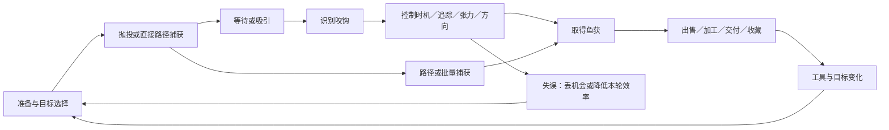

# 钓鱼游戏交互：54款市场样本与12类机制

调研日期：2026-10-14｜项目快照：main `409031bb44f3940ec0e2e855329eecc6048ba9da`｜用途：参考游戏交互研究＋《Purr Orbit／毛球计划》当前项目适配。

**结论：有可借鉴之处。当前最值得用的是风险提示可读、同一输入配不同对象规则、失误后保留局部成果并能继续完成。鱼钩路径、主动／后台捕鱼和完整装备经济适合后续研究。**项目当前已确认主交互为猫咪美容梳理和划线修甲，独立Demo待实装；这轮候选不替换已确认规则，也不创建开发任务。[项目依据](../../玩法方案讨论/2026-10-14_毛球计划_美容梳理与修甲Demo交互规则.md)

## 覆盖与证据边界

- 登记**54款游戏／系统**：41款Steam游戏，13款主机、移动、浏览器、Roblox、VR及街机样本；其中24款给出代表交互卡，详细程度依实际证据而异。Scale的Jam／Steam两版作为同一作品内的版本差异，不重复计数。
- 研究PC／主机模拟、休闲钓鱼、增量／放置、触屏、VR／街机、商业捕捞，以及综合游戏中的钓鱼。**这是代表性市场样本，不能证明穷尽全球已发行与在运营的全部钓鱼作品。**各国移动长尾、已下架游戏、Roblox大量衍生作、其他历史街机型号未逐一覆盖；Fishing Sim World、Fishing Adventure等系列亦有补充空间。
- 本轮为资料研究：官方商店、说明书、帮助页、版本公告优先，规则缺口用注明版本的社区资料。**没有完成实玩或观看连续实机验证。**尝试浏览器试玩因工具启动失败未进入游戏；不产生手感、时长、失败率或“好玩”结论。Scale Steam操作的补充来自仓库中的用户实玩记录。
- “较详”表示能还原关键链条，仍可能有参数／平台未知；“概况”只能说明玩法结构；“不足”不支持实际操作拆解。精确数值、所有移植键位和当期默认设置不跨版本推定。

建议阅读：[24款代表交互卡](代表游戏_交互拆解.md) → [当前项目融入判断](项目适配与融入建议.md) → [策划Agent输入](agent_input.json)。完整来源见[证据索引](evidence/来源与版本边界.md)。

## 12类交互图谱

同一游戏可以跨多个类别。这是控制与判断方式的分类，不是按“有没有鱼竿”贴题材标签。

| 机制 | 玩家持续做什么 | 代表 | 判断负担 | 对当前项目的意义 |
|---|---|---|---|---|
| M01 识别咬钩后按一次 | 看／听真正咬钩，及时提交 | 动森、Minecraft、Terraria、Hades | 几乎无持续拉扯；难度来自信号和窗口 | 提示音、对象动画可借鉴；等待时间不照搬 |
| M02 对准时机／序列输入 | 点击移动标记或按提示顺序 | DREDGE、Dreamlight Valley、Black Desert | 时机精度，或连续阶段的记忆／反应 | 完美区间的可读性；不往梳理中插入独立QTE |
| M03 按住／松开追踪区域 | 控制条的位置，让目标保持在范围内 | Stardew Valley、Fisch、Genshin | 预判目标运动，平衡追踪和进度 | 同输入配不同对象运动；不要把实体服务变成盯条 |
| M04 控制张力，收放交替 | 按住、释放、滑杆或放线，维持有效范围 | Fishing Clash、Cast n Chill、Spiritfarer、Coral Island | 张力上下限／鱼的疲劳；一直用力并不总是更快 | 服务速度可做可读舒适窗口，但无需新增收放键 |
| M05 方向对抗与疲劳周期 | 观察鱼游向，调整鱼竿并择机收线 | Sea of Thieves、SEGA Bass Fishing、RDR2、FFXV | 方向、风险与收线时机同时判断；规则各有不同 | 猫反应应指示原因；多轴拉扯当前负担偏大 |
| M06 拟真准备、抛投与拟饵操控 | 选钓点／钓组，控制抛距、拟饵、泄力与提竿 | Fishing Planet、Russian Fishing 4、Bassmaster、Euro Fishing | 准备决策与多参数动态系统 | 选择和成长留后续；首版不引入整套装备模拟 |
| M07 扫过目标的批量捕获 | 光标经过或操控网，捕获成群目标 | Captain Whiskers、Meow Squad | 移动路径、目标分布与多单位产出 | 即时局部反馈；不能省略猫身对象的处理规则 |
| M08 控制鱼钩路径与容量 | 下潜／回收时移动鱼钩，选取路径上的目标 | Tiny Fishing、Cat Goes Fishing、Scale Jam、Ridiculous Fishing EX | 取舍在空间路径与容量／深度，未必有咬钩等待 | 未来打捞可优先试一屏路线选择 |
| M09 直接捕猎与捕后加工 | 瞄准／潜水捕获，再加工、交付或经营 | DAVE THE DIVER、Scale Steam、Moonglow Bay | 动作与处理工序形成任务循环 | 对象处理变化和顾客完成结算更贴近美容 |
| M10 手动与自动并行 | 主动操作获取额外收益，或配置后台捕鱼 | Idle Fishing、Cat Fishing、DonEatFish、Cast n Chill、No Man’s Sky | 注意力分配与成长；自动化不必自动替代全部选择 | 当前暂缓，后期才考虑替代机械重复 |
| M11 VR／街机实体操控 | 手持杆、转动／模拟卷线、动作与专用按钮 | Real VR Fishing、Bait!、Ace Angler | 身体动作和设备反馈 | 演出与声音可借；硬件输入不能直接移植 |
| M12 商业捕鱼与工具调度 | 路线、渔具部署、起网、船员与航次管理 | Fishing: North Atlantic、Fishing: Barents Sea | 多段航次的生产规划，不是单鱼微操作 | 商业经营观察；首版美容无需航线、配额模拟 |

## 把一次捕鱼拆成六个环节

| 环节 | 市场中常见变化 | 真正需要拆清的问题 |
|---|---|---|
| 准备／抛投 | 直接点击、蓄力、拖动甩竿、VR动作、选择饵具／位置 | 控制是选择目标还是操作熟练？抛歪只是慢，还是丢资源？ |
| 等待／吸引 | 自动等、主动Shake、移动拟饵、无等待直接捕获 | 等待能否做其他事？主动吸引有没有重复点击负担？ |
| 咬钩 | 单次确认、真假信号、自动咬钩、直接碰鱼 | 视听提示是否区分试探与真正触发？时间窗可否调整？ |
| 回收／捕获 | 定时点击、追踪条、张力、方向对抗、路径容量、批量扫取 | 玩家究竟看哪个状态、改变哪个状态？错误是否先给预警？ |
| 失败／恢复 | 丢本次机会、进度下降、时间变长、品质减少、装备损失 | 什么被扣，什么被保留，如何再尝试？不能统称“失败归零”。 |
| 结算／下一轮 | 入背包、卖鱼、交顾客、做菜、图鉴、买升级 | 捕获并不一定立刻等于货币；哪一步才最终入账？下一轮有何不同？ |

图中是可选分支，不能当作每款游戏都必须经历的统一状态机。Tiny Fishing无需逐鱼等咬钩，商业捕鱼也不属于一条鱼的张力条流程。

## 54款清单

证据只支持概况的条目明确保留未知；不能把这些行直接当程序实现说明。最后一列是**本项目适配推断**，不是原作质量排名。

| ID／游戏 | 类别 | 已证实输入／过程 | 决策、失败或证据缺口 | 下一轮成长 | 深度／适配推断 | 来源 |
|---|---|---|---|---|---|---|
| G01 Fishing Planet | M06 | 选钓组与钓点；拟饵／泄力；收线时提竿 | 动态张力与准备匹配；5.0后操作变化 | 装备、地区、任务 | 较详／暂缓 | [ST380600](https://store.steampowered.com/app/380600/)、[S43](https://steamstore-a.akamaihd.net/news/externalpost/steam_community_announcements/1814942955104014)、[S44](https://steamstore-a.akamaihd.net/news/externalpost/steam_community_announcements/5746109972545475232) |
| G02 Russian Fishing 4 | M06 | 浮漂、路亚、底钓多钓法；精确键位待核 | 装备与环境选择；完整断线规则未复核 | 装备／生活技能／地区 | 概况／暂缓 | [ST766570](https://store.steampowered.com/app/766570/) |
| G03 Ultimate Fishing® Simulator 2 | M06 | 多钓法模拟；具体输入与辅助模式待核 | 规则与工具负担需实玩 | 装备／地区 | 概况／暂缓 | [ST1136380](https://store.steampowered.com/app/1136380/) |
| G04 Call of the Wild: The Angler™ | M06 | 开放世界定位、鱼种／钓具选择；键位待核 | 探索与捕获条件；当前细节待核 | 任务／装备／图鉴 | 概况／暂缓 | [ST1408610](https://store.steampowered.com/app/1408610/) |
| G05 Bassmaster® Fishing | M06 | 基础蓄力抛投／完整抛投；抽饵、卷速、泄力 | 抛投红区精度；张力显示 | 比赛与装备 | 较详／局部反馈 | [ST1449500](https://store.steampowered.com/app/1449500/)、[S07](https://media.dovetailgames.com/manuals/Bassmaster%20Fishing%202022%20Manual.pdf) |
| G06 Euro Fishing | M06 | 抛投、泄力、多个钓竿切换、抄网 | 多工具注意力分配；失败细节待核 | 比赛／钓点 | 概况／暂缓 | [ST314520](https://store.steampowered.com/app/314520/)、[S08](https://shared.fastly.steamstatic.com/store_item_assets/steam/apps/314520/manuals/Fishing_Quick_Start_Guide_EN.pdf?t=1750778236) |
| G07 SEGA Bass Fishing | M05 | 选饵抛投；鱼咬时扬竿；两档收线及反向控竿 | 红张力停收线；鱼逃逸／断线 | 重量目标／锦标赛 | 较详／局部反馈 | [ST71240](https://store.steampowered.com/app/71240/)、[S06](https://shared.akamai.steamstatic.com/store_item_assets/steam/apps/71240/manuals/DC_SBF_PC_MG_EFIGS_FINAL.pdf?t=1733765152) |
| G08 Real VR Fishing | M11 | VR竿与收线动作；逐设备映射待核 | 硬件、难度模式改变信息呈现 | 地点／装备／图鉴 | 概况／演出可借 | [ST1266470](https://store.steampowered.com/app/1266470/)、[S35](https://www.realvrfishing.com/) |
| G09 DREDGE | M02 | 钓鱼标记／区域时机；疏浚为另一套避障交互 | 错按成本和宽松设置需分开；金色时机快收 | 鱼货／船舱／船与钓具 | 较详／可局部借鉴 | [ST1562430](https://store.steampowered.com/app/1562430/)、[S04](https://gamefaqs.gamespot.com/pc/326052-dredge/faqs/81335) |
| G10 DAVE THE DIVER | M09 | 潜水探索、鱼叉／武器捕获，再经营餐厅 | 氧气和负重等出海限制；具体鱼叉QTE待核 | 鱼获加工／菜单／装备 | 概况／循环可借 | [ST1868140](https://store.steampowered.com/app/1868140/) |
| G11 Scale the Depths | M08、M09 | Jam：A/D导向碰鱼；Steam加工操作见用户记录 | 捕获→去鳞→喂顾客；版本键位不混用 | 处理工具／深度／区域 | 较详／优先参考 | [ST3198890](https://store.steampowered.com/app/3198890/)、[S15](https://serpexnessie.itch.io/scale-the-depths)、[P02](https://github.com/Dr-Doge/PURR_ORBIT/blob/409031bb44f3940ec0e2e855329eecc6048ba9da/玩法方案讨论/2026-10-14_毛球计划_美容梳理与修甲Demo交互规则.md) |
| G12 Cat Goes Fishing | M08 | 抛线、鱼钩路线，鱼可出售或作更大鱼饵 | 卖掉换现钱，或保留作为升级捕获机会 | 鱼竿／任务／船／鱼图鉴 | 较详／未来打捞 | [ST343780](https://store.steampowered.com/app/343780/)、[S16](https://steamcommunity.com/sharedfiles/filedetails/?id=1272884938) |
| G13 WEBFISHING | M03 | 按住收线，在阻挡处点击；完整辅助设置待核 | 追赶条／阻挡制造压力；点击负担明显 | 鱼货／钓具／外观与社交 | 较详／输入不宜直接借 | [ST3146520](https://store.steampowered.com/app/3146520/)、[S13](https://gamefaqs.gamespot.com/pc/480764-webfishing/reviews/177911) |
| G14 Cast n Chill | M04、M10 | 主动抛投；收／放线；也有Passive Mode | 疲劳时收线；背景模式注意力更低 | 鱼货／地点／装备／鱼记录 | 较详／节奏可借 | [ST3483740](https://store.steampowered.com/app/3483740/)、[S14](https://www.noobfeed.com/reviews/cast-n-chill-review)、[S45](https://steamstore-a.akamaihd.net/news/externalpost/steam_community_announcements/1800991756309203) |
| G15 Intergalactic Fishing | M06 | 探索星球并配置自定义拟饵；实际操竿待核 | 鱼个体偏好和环境匹配；收线细节未知 | 拟饵改件／探索／任务 | 概况／信息选择可借 | [ST949600](https://store.steampowered.com/app/949600/) |
| G16 Luna's Fishing Garden | M03、M04 | 评测描述挑战条与简易收线两种风格 | 模式选择让挑战程度可调 | 卖鱼／花园建设 | 概况／可局部借鉴 | [ST1477790](https://store.steampowered.com/app/1477790/)、[S27](https://findthestrawberry.com/lunas-fishing-garden-review/) |
| G17 Fishing Paradiso | M04 | 简化抛投／收线；具体状态及失败条件待核 | 故事任务与简化动作并行 | 鱼任务／装备／故事 | 概况／暂缓判定 | [ST1781030](https://store.steampowered.com/app/1781030/)、[S28](https://gamefaqs.gamespot.com/switch/336301-fishing-paradiso/reviews/173708) |
| G18 Moonglow Bay | M09 | 鱼竿、网、陷阱等工具；加工与出售 | 工具任务不同；没有完整按钮链证据 | 烹饪／经营／社区修复 | 概况／任务循环可借 | [ST1361400](https://store.steampowered.com/app/1361400/)、[S40](https://coatsink.com/blog/moonglow-bay-sets-sail-october-26-copy) |
| G19 Stardew Valley | M03 | 蓄力抛竿；咬钩提交；按住上升、放开下降 | 鱼在绿条内增加进度；宝箱与鱼争同一控制条 | 技能／钓具／食物／图鉴 | 较详／优先研究 | [ST413150](https://store.steampowered.com/app/413150/)、[S03](https://stardewvalleywiki.com/Fishing) |
| G20 Sea of Thieves: 2026 Edition | M05 | 反鱼游向控竿，鱼疲劳时收线 | 错误方向声画预警；断线丢本次捕获 | 卖鱼／烹饪／声望 | 较详／反馈可借 | [ST1172620](https://store.steampowered.com/app/1172620/)、[S09](https://seaofthieves.wiki.gg/wiki/Fishing) |
| G21 Red Dead Redemption 2 | M05 | 观察咬钩；对抗游向；择机卷线／提竿 | 挣扎与休息区分；Hold to Reel可替代摇杆转圈 | 食物／出售／挑战 | 较详／辅助输入可借 | [ST1174180](https://store.steampowered.com/app/1174180/)、[S10](https://reddead.fandom.com/wiki/Fishing)、[S11](https://support.rockstargames.com/articles/28AmlyPGLVKsJ8OpdN8myn/red-dead-redemption-2-title-update-1-15-notes-ps4-xbox-one-pc-stadia) |
| G22 Spiritfarer®: Farewell Edition | M04 | 按住收线、观察线色、释放缓压 | 高强度鱼可能需点按保距离；不要泛化所有鱼 | 烹饪／旅程任务 | 概况／提示可借 | [ST972660](https://store.steampowered.com/app/972660/)、[S29](https://steamcommunity.com/app/972660/discussions/0/4336358006705487665/) |
| G23 No Man's Sky | M01、M10 | 手钓等待咬钩；亦可部署自动陷阱 | 环境、鱼饵与收集；精确落鱼输入待核 | 鱼记录／烹饪／陷阱／探索 | 概况／成长后置 | [ST275850](https://store.steampowered.com/app/275850/)、[S26](https://www.nomanssky.com/2024/09/aquarius-update/) |
| G24 Terraria | M01 | 装备竿饵；浮标咬钩后再次使用 | 断线可能是随机检查，并非控张力失误 | 装备／任务／材料 | 较详／提示可借 | [ST105600](https://store.steampowered.com/app/105600/)、[S25](https://terraria.wiki.gg/wiki/Fishing) |
| G25 Disney Dreamlight Valley | M02 | 钓鱼时机输入；官方加入按住替代选项 | 输入辅助减少重复按键；默认详细节奏待核 | 食材／任务／地区 | 概况／辅助输入可借 | [ST1401590](https://store.steampowered.com/app/1401590/)、[S23](https://disneydreamlightvalley.com/news/update-aug-21-2024) |
| G26 FINAL FANTASY XV WINDOWS EDITION | M05 | 随鱼游向控竿，挣扎时减收，休息时卷线 | 线耐久与鱼体力；方向规则不同于Sea of Thieves | 钓具／鱼种／钓鱼技能 | 较详／局部参考 | [ST637650](https://store.steampowered.com/app/637650/)、[S12](https://samurai-gamers.com/final-fantasy-15-ffxv/fishing-skill-final-fantasy-15-ffxv/) |
| G27 FINAL FANTASY XIV Online | M01、M06 | 竿饵和时地选择；技能提钩种类 | 7.0鱼图鉴提示Hookset；现行全部技能未核 | 生活技能／鱼图鉴／任务 | 概况／首版不引入 | [ST39210](https://store.steampowered.com/app/39210/)、[S39](https://na.finalfantasyxiv.com/lodestone/topics/detail/c807875c5f8f7529887c86d2955f709eae0231ef) |
| G28 Warframe | M09 | 装备捕鱼矛、选择诱饵／染料并瞄准 | 属于直接投矛；不同矛完整规则未核 | 制造材料／地区／声望 | 概况／直接瞄准参考 | [ST230410](https://store.steampowered.com/app/230410/)、[S38](https://www.warframe.com/en/news/the-remote-observer-vol-31) |
| G29 Hades | M01 | 等真正咬钩后迅速确认，注意假动静 | 快反应可得更优捕获；不是持续张力游戏 | 鱼换资源／区域图鉴 | 较详／声画信号可借 | [ST1145360](https://store.steampowered.com/app/1145360/)、[S24](https://hades.fandom.com/wiki/Fishing) |
| G30 Coral Island | M04 | 收线并控制张力；最大张力随工具变化 | 当前按钮映射和失误处理待实玩 | 生活技能／工具／鱼图鉴 | 概况／提示可借 | [ST1158160](https://store.steampowered.com/app/1158160/)、[S30](https://coralisland.fandom.com/wiki/Fishing_pole) |
| G31 A Short Hike | M05 | 向后拉并重复Use Item完成收线 | 攻略中的重复按键对鼠标长期操作负担高 | 探索／鱼类收集 | 概况／不直接借输入 | [ST1055540](https://store.steampowered.com/app/1055540/)、[S31](https://www.neoseeker.com/a-short-hike/walkthrough/Fishing_Guide) |
| G32 Core Keeper | M01、M03 | 1.0移除旧小游戏；1.0.0.10增加Legacy开关 | 旧小游戏可选，不能只按早期版拆解 | 食材／装备／区域 | 较详／模式取舍参考 | [ST1621690](https://store.steampowered.com/app/1621690/)、[S41](https://steamstore-a.akamaihd.net/news/externalpost/steam_community_announcements/5875595438705775228)、[S42](https://steamstore-a.akamaihd.net/news/externalpost/steam_community_announcements/6339469370177903827) |
| G33 Meow Squad: Incremental Fishing | M07、M10 | 主动捕鱼网＋猫炮台自动捕鱼；键位待核 | 限时捕鱼回合；手动与自动职责不同 | 升级网格／区域／Boss | 概况／反馈可借 | [ST4753960](https://store.steampowered.com/app/4753960/) |
| G34 Captain Whiskers: Incremental Seas | M07 | 光标悬停经过鱼群即捕获 | 无逐鱼咬钩拉扯；路径与鱼群分布重要 | 收益／技能树／队员／区域 | 较详／局部反馈 | [ST4249770](https://store.steampowered.com/app/4249770/) |
| G35 Just Keep Fishing | M10 | 商店只概述捕鱼、买升级；详细输入未知 | 未取得规则，不能归为张力或追踪条 | 捕鱼收益／升级 | 不足／证据不足 | [ST4601160](https://store.steampowered.com/app/4601160/) |
| G36 猫猫爱钓鱼 Cat Fishing | M10 | 放置捕鱼、出售、开箱与天赋装备 | 离线收益；手动张力微操作未证实 | 装备／稀有度／天赋／地区 | 概况／暂缓 | [ST5206820](https://store.steampowered.com/app/5206820/) |
| G37 Fishing Inc | M03 | 在鱼逃前点击推进到目标 | 点击频率与截止压力；与当前少连点方向冲突 | 鱼熟练度／品质／装备 | 概况／不适合当前 | [ST4126480](https://store.steampowered.com/app/4126480/) |
| G38 Desktop Pet: DonEatFish | M10 | 桌面宠物自动捕鱼、宝箱与换装 | 手动收鱼全过程资料不足 | 外观／放置收获 | 概况／陪伴演出参考 | [ST4515550](https://store.steampowered.com/app/4515550/) |
| G39 Idle Fishing | M10 | 队伍挂机捕鱼；亦有主动技巧小游戏 | 不能把整作描述成完全没有手动操作 | 队伍／升级／地区／长期成长 | 概况／自动化暂缓 | [ST2725560](https://store.steampowered.com/app/2725560/) |
| G40 Fishing: North Atlantic - Enhanced Edition | M12 | 鱼叉、延绳钓、笼具、网、拖网等航次工具 | 路线与生产工具；精确各阶段键位未核 | 船／船员／航次收益 | 概况／商业规划暂缓 | [ST1264250](https://store.steampowered.com/app/1264250/) |
| G41 Fishing: Barents Sea | M12 | 商业船、网具、声呐与航次 | 作业安排与设备管理；不是单鱼条游戏 | 船／船员／配额／收入 | 概况／商业规划暂缓 | [ST501080](https://store.steampowered.com/app/501080/) |
| G42 Animal Crossing: New Horizons | M01 | 将浮标投在鱼影前，真正下沉时按A | 过早提竿鱼逃；声效可辅助判断 | 季节／天气／图鉴 | 较详／反馈可借 | [S01](https://play.nintendo.com/news-tips/tips-tricks/fishing-new-horizons-tips-and-tricks/) |
| G43 Minecraft | M01 | 使用抛竿；浮标下沉时再次使用 | 错过会继续等下一次；非长时间拉扯 | 附魔／宝藏／食物 | 较详／信号可借 | [S02](https://www.minecraft.net/en-us/article/fishing-rod) |
| G44 Fishing Clash | M04 | 按钮按住收线，或滑杆保持中心张力 | 高低张力都可失败；中心连击带分数收益 | 鱼重量／评分／装备 | 较详／优先研究 | [S05](https://tensquaregames.helpshift.com/hc/en/3-fishing-clash/faq/42-casting-the-line-and-catching-fish/) |
| G45 Ace Fishing: Wild Catch | M04 | 官方称一触捕鱼；精确手势链待核 | 手游收线工具与反馈需实测 | 装备／鱼种／竞技 | 概况／暂缓判定 | [S33](https://play.google.com/store/apps/details?hl=en&id=com.com2us.acefishing.normal.freefull.google.global.android.common) |
| G46 Fishing Hook | M04 | 拉按钮使鱼受作用并靠近 | 距离、张力关联；精确判败与输入细节待核 | 地区／装备／鱼种 | 概况／暂缓判定 | [S32](https://play.google.com/store/apps/details?hl=en&id=com.mobirix.fishinghook) |
| G47 Fishing and Life（Nexelon） | M08 | 简化触屏钓鱼；具体过程待核 | 休闲海面表现；不能冒充完整规则已读 | 钓具／鱼饵／鱼类 | 概况／表现可借 | [S34](https://play.google.com/store/apps/details?id=com.nexelon.fishinglife) |
| G48 Ridiculous Fishing EX | M08、M09 | 下降避鱼→上升抓鱼→空中射击 | 同一路径去程与回程目标相反 | 收益／鱼线深度／武器 | 较详／阶段规则可借 | [S18](https://apps.apple.com/tr/app/ridiculous-fishing-ex/id1610164691)、[S19](https://twit.tv/posts/transcripts/macbreak-weekly-879-transcript) |
| G49 Tiny Fishing | M08 | 点转盘下钩，拖鱼钩捕多个鱼 | 容量与路径决定本轮鱼获；无逐鱼张力链 | 现金／容量／深度／离线 | 较详／未来打捞 | [S17](https://www.coolmathgames.com/0-tiny-fishing) |
| G50 Fisch（Roblox） | M03 | 按住抛投、Shake吸引，咬钩后控制白条 | 具体失败数值与移动端映射需另查 | 鱼货／钓竿／地点 | 较详／对象变化参考 | [S21](https://www.roblox.com/games/9050835756/Fisch) |
| G51 Genshin Impact／原神 | M03 | 瞄准鱼饵、提钩；按住／松开保持理想张力区 | 太远难吸引、太近惊鱼；捕获进度随区间变化 | 鱼饵／鱼类／兑换 | 较详／提示可借 | [S22](https://genshin-impact.fandom.com/wiki/Tutorial/Fishing) |
| G52 Black Desert／黑色沙漠 | M02、M10 | Space抛投及咬钩，定点停表，再按WASD序列 | 手动两段小游戏；不操作可等自动捕鱼 | 鱼货／技能／自动时间／贸易 | 较详／模式取舍参考 | [S20](https://www.sa.playblackdesert.com/PT-BR/Wiki?wikiNo=38) |
| G53 Bait! VR | M11 | VR钓鱼与装备；逐设备操作待核 | 手部操控和体验装置是成本 | 任务／鱼类／装备 | 概况／演出可借 | [S36](https://www.resolutiongames.com/bait/) |
| G54 Ace Angler（街机系列） | M11 | 实体竿抛浮标、卷线；雷击按钮削弱鱼 | 专用设备与街机得分；成本参数未知 | 得分／设备游玩循环 | 较详／不直接借硬件 | [S37](https://bandainamco-am.co.jp/am/english/aa/pdf/Aceangler.pdf) |

## 跨游戏观察：事实和推断分开

1. **事实：少按键仍可有不同学习任务。**动森主要是辨咬钩，Stardew主要是动态追踪，Tiny Fishing主要是路径和容量；操作键数量不能单独衡量复杂度。**推断：**本项目可以用对象要求和反馈差异扩大可玩性，不必扩大输入种类。
2. **事实：类似张力图形不保证同一规则。**Fishing Clash张力过高／过低都可能失败；Sea of Thieves强调反向控竿，FFXV攻略强调顺向。**推断：**迁移时要保留因果关系，不照搬视觉外壳。
3. **事实：官方产品会改变输入和默认微操作。**Fishing Clash有按钮／滑杆，RDR2有Hold to Reel，Core Keeper移除旧小游戏后提供Legacy开关。**推断：**可读反馈、容错与低负担输入应随原型一起验证，不能只靠加速成长解决手部疲劳。
4. **事实：捕获后的用途决定外层循环。**卖鱼、作饵、做菜、交顾客与放置收益不是同一结算。**推断：**美容Demo应坚持已确认的整单一次结算，过程局部反馈无需都发最终货币。
5. **未知：这些机制对我们的玩家是否更舒服、更耐重复。**本轮没有真实体验对比；收益、留存、耐玩度与节奏结论都需要原型及真人观察。

下一步优先体验：Fishing Clash（张力与替代输入）、Stardew Valley（同控制不同对象）、Scale the Depths Steam（捕获与处理闭环；已有用户记录可复核）。未来打捞专题再体验Tiny Fishing与Cat Goes Fishing。选择是本项目研究优先级，不代表销量或市场热度排行。
