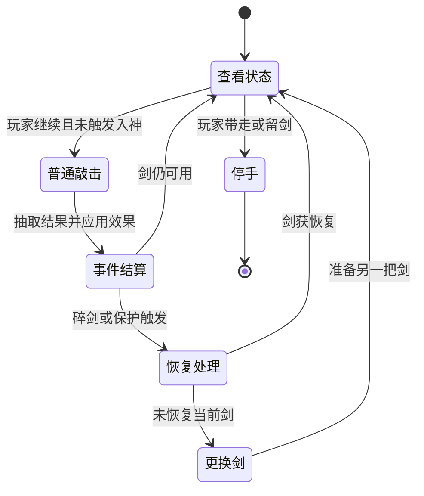
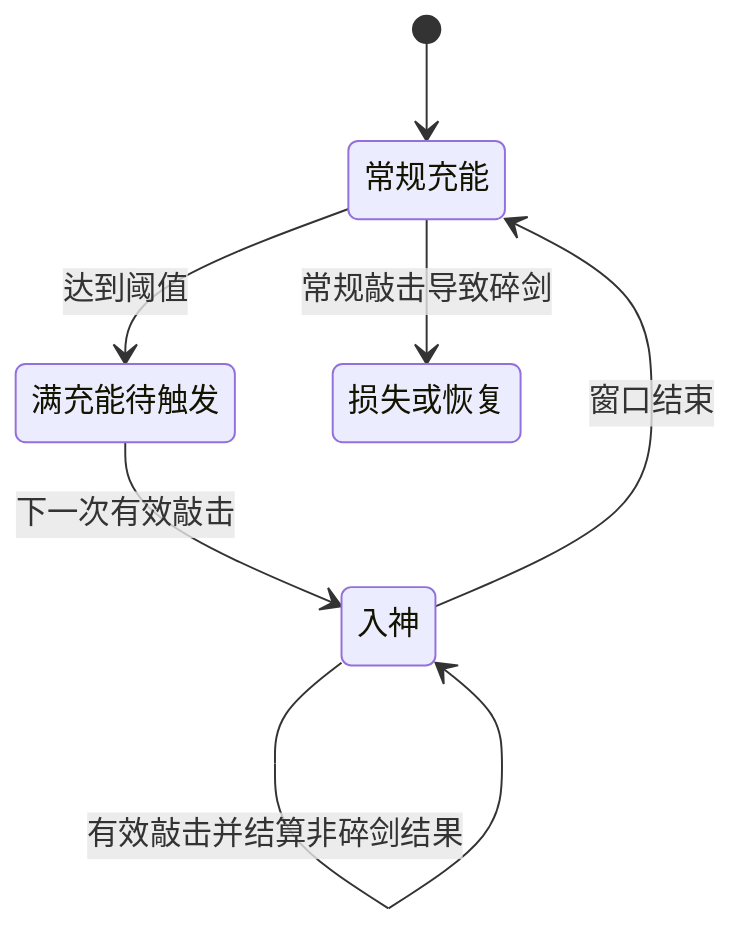
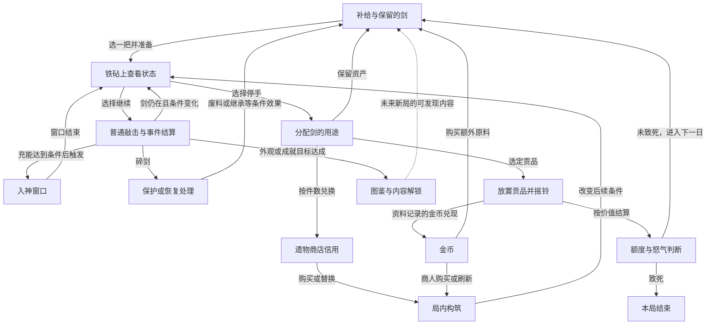

# 《ForgeTax／铸剑纳贡》玩法拆解

分析日期：2026-10-13。目标：给《Purr Orbit／毛球计划》的策划 Agent 提供可追溯的玩法研究输入。

配套机器输入：[agent_input.json](agent_input.json)。本报告遵循[游戏玩法拆解 Prompt](../skill/gameplay-research/references/research-prompt.md)的0—8结构。2026-10-13归档后补充[当前项目借鉴判断与融入建议](项目适配与融入建议.md)，项目基准`9679a7bc`见[开发快照](../2026-10-13_项目开发快照.md)；下文首轮参考游戏研究的证据日期与版本保留。

## 0. 分析范围与简要结论

对象已由用户确认：GraveYardDev的Steam Windows单人游戏ForgeTax，App ID 5245810。研究依据为官方规则说明、9月30日至10月12日公告、三张官方商店截图，以及标明Steam build 25755699的非官方代码提取资料和社区指南。没有启动游戏实玩，没有观看可核查时间戳的连续实机录像；下文操作链是按资料重建，不是一次真实游玩的逐帧记录。

**一句话核心体验：【推断】玩家经营一组有限的可锻造资产，决定何时承受下一锤的损失风险、何时兑现，并通过遗物改变后续尝试的条件。**

五条值得研究的结论：

1. 【推断｜M02】“再敲一次”的吸引力取决于已经积累的资产、下一锤的信息和停手后可兑现的用途。只有随机成功／失败，未必形成有意义的选择。
2. 【推断｜M03】入神将相同点击从“要不要冒险”转换为“怎样利用短暂机会”，形成操作节奏变化。它还有一个作用：让玩家在进入安全窗口前承担充能风险。
3. 【推断｜M04、M05】同一把剑按价值用于纳贡，按件数用于购买遗物，构成两种估值体系。玩家管理的是剑的用途，不能将它简化为不停赚钱再升级。
4. 【推断｜M06、M07】遗物能改变某种结果的意义：降级可能准备下一次大成功，碎剑可能给下一把剑留下资产。构筑因此改变玩家对失败的判断。
5. 【事实＋推断｜M07】开发者已调整早期恢复能力，且仍在处理早期连败和构筑完成后的重复体验。这款游戏能提供研究原理，也提供需要继续验证的设计问题，不能把它整体视为已校准的答案。[开发进展公告](https://steamcommunity.com/gid/103582791475828607/announcements/detail/712288859283524589)

### 版本边界

| 信息 | 本报告采用的口径 | 需要排除的混用 |
|---|---|---|
| 合同 | 21个游戏内日，结束后可继续 | 早期30日规则 |
| 纳贡失败后的基础补给 | 10月6日后仍给3把基础剑 | 9月30日公告中的少给1把 |
| Great价值倍率 | 10月6日公告改为2.5倍 | 商店截图仍显示的3倍 |
| 入神速度 | 入神本身不再提高基础锤速 | 把旧版加速当当前默认规则 |
| 强化上限／外观 | 上限+99；外观到+20后不再新增 | 把外观数量等同于等级数量 |
| 第21日基础要求 | 10月6日公告为232,000G | 9月30日145,000G |
| 打龙战斗 | 开发中的后续内容 | 把预告原型当作当前核心循环 |

上述数值用于识别版本，不建议直接迁移到本项目。[合同更新](https://steamcommunity.com/gid/103582791475828607/announcements/detail/712288224875118771)、[10月6日平衡调整](https://steamcommunity.com/gid/103582791475828607/announcements/detail/712288224875120852)、[当天恢复调整](https://steamcommunity.com/gid/103582791475828607/announcements/detail/712288224875121056)。

**证据标签说明：**【事实】表示资料明确支持，不等于本轮引擎实测；非官方数据会注明其版本与来源。【推断】表示分析判断。【未知】表示尚不能确认。社区网站声称从游戏代码提取，不等于本轮独立验证了原代码。

## 1. 玩家实际上在做什么

### 操作对象与目标

【事实｜S01、S11】玩家是被巨龙囚禁的铁匠，以第一人称在工坊内移动，直接拿取剑并与炉子、铁砧、贡台、铃铛、遗物机器及商人交互。社区指南记录了移动、观察、E交互、左键敲击，以及带剑离开或留剑在铁砧的区别；后两项也见官方操作说明。[商店规则](https://store.steampowered.com/app/5245810/ForgeTax/?l=schinese)、[操作指南](https://grindnstrat.com/forgetax-beginner-guide-and-walkthrough-controls-tips/)、[官方操作提示更新](https://steamcommunity.com/gid/103582791475828607/announcements/detail/712288224875120567)。

| 时间尺度 | 玩家要解决的问题 | 直接操作 |
|---|---|---|
| 下一锤 | 当前收益值得再承担一次风险吗？ | 查看板、敲击、使用物品、停手 |
| 当前游戏日 | 留哪些剑，献哪些剑，买什么遗物？ | 搬运、存放、兑换、放上贡台、摇铃 |
| 当前合同 | 怎样让产能和风险管理赶上逐日要求？ | 构筑、选择剑、准备恢复资源 |
| 跨局 | 下一次有何不同的可选内容，能发现什么外观？ | 成就解锁、图鉴发现、重新尝试 |

后两行的体验解释为【推断】；合同与跨局发现规则分别由S02、S03、S04支持。游戏内“日”由结算推进；不要将“每天纳贡”理解为现实日历任务。本轮也没有证据证明存在强制结束工作日的现实时间倒计时。

### 一个完整片段的资料重建

以下不假定某次具体随机结果，不填写未经观察的操作时长。

1. 看见当日额度、已有剑和遗物，确定还差多少价值。
2. 选一把基础剑，拿到炉子处理，再放到铁砧。
3. 查看当前等级、价值、下一锤各结果概率和充能。
4. 敲一次，接收结果，重新判断。升级、降级、停滞与碎剑产生不同的新状态。
5. 如果继续，重复第3—4步；若触发入神，则在其窗口内利用不会碎剑的条件。
6. 停手后，把剑留下、存作后备、用于纳贡，或者兑换购买遗物的信用。
7. 改造下一次尝试的条件：购入遗物／物品，或换一把剑再锻造。
8. 将选定贡品放好，摇铃结算；额度是否达标改变怒气和后续局势。
9. 接收下一日补给，带着保留资产和局内构筑进入下一轮。

【事实依据｜S01、S02、S05、S12、S17】[官方核心流程](https://store.steampowered.com/app/5245810/ForgeTax/?l=schinese)、[社区首日流程](https://www.forgetax.tools/guides/how-to-play)、[纳贡与怒气资料](https://www.forgetax.tools/guides/tribute)。流程中的“先保障额度再投资”是一种可行策略，不是游戏强制顺序。

## 2. 关键机制与交互卡片

### M01：拿取—加热—铁砧的工坊操作

【事实｜S01、S03、S08】锻造前需要把剑烧热并放到铁砧；操作提示区分E带走剑与右键将剑留在铁砧。Lifetime Contract可以免去加热步骤。[操作提示](https://steamcommunity.com/gid/103582791475828607/announcements/detail/712288224875120567)、[10月12日说明](https://steamcommunity.com/gid/103582791475828607/announcements/detail/712288859283524782)。

- **入口与状态**：有一把可用剑，找到炉子与铁砧。加热所需精确时间不采用未经实测的值。
- **操作与反馈**：移动视角、拿取、搬运和摆放把抽象强化表现为对一件实体物品加工；官方截图能直接看到铁砧上的剑及侧面的锤。
- **成本／选择**：处理和搬运占用注意力；判断主要在选哪把剑和加工到哪里，而不是本轮已验证的打击瞄准技巧。
- **退出与边界**：留在台上与带走是不同动作。加热状态的全部存档边界、其他占用情况需实测。
- **【推断】体验作用**：同一个资产可被拿在手上、放到贡台或投进机器，可能增加兑现和损失的具象感。搬运过频也可能成为冗余劳动。
- **依赖**：物品定位、放置容错、清晰提示；后续连接M02、M04、M05、M08。

### M02：下一锤的概率判定与停手

【事实｜S11、S13】社区资料记录五种基础结果：Success升1级、Great升2级、Hold停滞、Damage降1级且不低于+0、Break销毁剑，保护效果可改写后果。官方明确下一锤最终概率可在铁砧显示中查看。[概率显示说明](https://steamcommunity.com/gid/103582791475828607/announcements/detail/712288859283521584)、[社区概率资料](https://www.forgetax.tools/guides/forging-odds)。

- **入口**：剑在铁砧且可操作。输入是敲击，不把时机条、按键精度或“敲得准就增加成功率”写成现有规则。
- **判定链**：查看状态→选择敲或停→随机结果及遗物事件→更新等级、价值、充能和保护状态→再选择。
- **成本**：暴露当前剑的累积价值和继续利用这把剑的机会。本轮没有确认“每锤直接扣金币”的规则。
- **停手用途**：保留资产，将它用于纳贡、留作后备或兑换。停手本身不等于已经取得金币，兑现渠道见M04／M05。
- **反馈**：截图中的同一块板显示剑名、等级、价值、五种概率、充能与最近结果。该布局让风险信息靠近操作对象；实际音画时序没有逐帧验证。
- **失败恢复**：Damage与Break不是同一损失。Break后是否残留价值、能否撤销、下一把剑继承多少，取决于M07。
- **变化来源**：剑的等级、遗物、一次性物品和入神改变下一锤的条件。
- **【推断】关键体验**：玩家对风险的态度会随剩余剑、距额度的差额、保护次数和充能而变化。同一个碎剑概率不能单独决定该不该敲。

图中的事件应用先后是抽象化表示。遗物转换、阻止损失和撤销的精确执行顺序仍需原版验证。

### M03：充能—入神—回到风险

【事实｜S01、S04、S15】常规描述为同一把剑锻造10次充满，下一锤触发短暂不会碎剑的入神。10月6日后入神本身不额外提高基础锤速。社区build资料记录基础窗口4秒，并仍可能出现Damage／Hold；4秒不是本轮当前build实测值。[官方触发规则](https://store.steampowered.com/app/5245810/ForgeTax/?l=schinese)、[平衡调整](https://steamcommunity.com/gid/103582791475828607/announcements/detail/712288224875120852)、[社区入神资料](https://www.forgetax.tools/guides/frenzy)。

- **入口条件**：同剑的充能达到要求；遗物或物品可能改变准备过程。
- **操作链**：积累→准备触发→入神→利用窗口→窗口结束→重看当前风险。
- **收益／损失**：窗口暂时移除碎剑风险；不能据此推定每锤成功、不会降级或没有其他成本。
- **信息与决策**：充能条给出“离机会还有多远”。离触发近也不代表下一次普通锤无风险，必须看最终显示。
- **反馈与节奏**：【推断】等待结果、再判断的节奏可转换为窗口内的密集操作，再回到谨慎选择。结束提示如果不清楚，玩家可能把安全窗口里的习惯延续到风险恢复之后。
- **边界／未知**：取下同一把剑后保留充能在社区资料中有说明；窗口暂停、保存、到期边缘输入以及触发锤的精确时序尚未实测。
- **依赖**：M02的可见风险、充能反馈、M06的速度／充能效果和M07的准备能力。

### M04：贡品结算、怒气与合同

【事实｜S01、S02、S05、S17】玩家放好剑并摇铃结算，达标按贡品总价值判断；不足会增加怒气，达到第三阶段会致死，特定效果可缓解。合同为21个游戏日。最新恢复公告规定不足后仍获得3把基础剑。[合同规则](https://steamcommunity.com/gid/103582791475828607/announcements/detail/712288224875118771)、[恢复调整](https://steamcommunity.com/gid/103582791475828607/announcements/detail/712288224875121056)、[社区怒气资料](https://www.forgetax.tools/guides/tribute)。

- **入口与操作**：在贡台放置选定资产，核对总价值和额度，决定是否摇铃。
- **成本／收益**：献出的剑退出可锻造库存；换来合同推进及金币渠道，具体经济见M08。
- **决策**：达标后是否保留多余剑？当前额度是否值得再冒险？不足时是否使用怒气缓解而接受一次短缺？后者需要有对应资源，并不是免费跳关。
- **反馈**：贡台和铃把结算与普通敲击分开；龙的警告、墙上的怒气标记和补给演出表达局势变化。音效与光照改进有官方记录，实际强度未测。
- **恢复／退出**：单剑失败可更换剑，合同失败会结束本局，两种范围应分清。最后一日短缺但未致死可以完成合同，这是官方合同更新说明中的边界。
- **【推断】系统作用**：额度提供“够不够”的参照，使停手有实际目的。逐日压力让构筑投资有必要，而不是无期限低风险点击。
- **未知**：每一日所有新旧存档分支及清关后的所有选项未完整审计；不能从“第三阶段致死”推导“三次连续失败才死”。

### M05：用剑买遗物、管理有限槽位

【事实｜S01、S04、S08、S12】遗物兑换以剑为成本；社区资料记录任意等级一把剑换1个购买信用、遗物架8槽。新局可免费三选一；满槽需要先移除已有遗物，官方最新提示也明确提醒此事。[官方构筑说明](https://store.steampowered.com/app/5245810/ForgeTax/?l=schinese)、[社区兑换资料](https://www.forgetax.tools/guides/how-to-play)、[界面更新](https://steamcommunity.com/gid/103582791475828607/announcements/detail/712288859283524782)。

- **操作链**：看报价与效果→取得剑信用→选择遗物→放入构筑；满槽时先决定舍弃哪件。
- **竞争成本**：投入一把剑意味着少一份可锻造原料或贡品；成本必须按机会成本理解。
- **【推断】两种估值**：高等级剑用于贡品价值更大，但按件数兑换并不会获得同等比例收益。因此“哪把剑去干什么”有结构性差异。
- **选择深度**：购买眼前效果、刷新寻找组合、保留原料，分别牺牲不同机会。槽位限制让组合选择与替换有代价。
- **反馈／边界**：需要明确区分实体剑、贡品价值、金币和商店信用。弃置退款规则仅见社区资料，当前原版应复核。
- **依赖**：M04的近期要求、M06的协同效果、M08的刷新成本。

### M06：把结果变成构筑事件

【事实｜S04、S05、S06】遗物可调整抽签票和条件效果。官方举例包括Damage之后降低风险或加强下次Great，Hold之后为下次Great积累加成，以及将损失转到下一把剑。[遗物调整](https://steamcommunity.com/gid/103582791475828607/announcements/detail/712288224875120852)、[票数与最终概率显示](https://steamcommunity.com/gid/103582791475828607/announcements/detail/712288859283521584)。

| 事件链示例 | 玩家行为可能怎样改变【推断】 | 依赖与风险 |
|---|---|---|
| Damage→后续风险降低／Great加强 | 不再把所有降级结果等同于纯浪费，可能继续利用这把剑 | 补偿效果须足以抵消成本；不保证每次继续都有利 |
| Hold→下一次Great的收益提高 | 等待状态也可能成为蓄力 | 如果只有不可见计数，玩家可能感受不到构筑作用 |
| Break→下一把剑继承 | 投资从单剑扩展到一系列尝试 | 恢复资源如果很难获得，早期仍可能连续失去行动空间 |

- **操作对象**：玩家主要调整组合、次序和资源准备；本轮未发现要求按节奏命中来改变票池的证据。
- **反馈要求**：显示当前剑的临时票、局内累积票、继承和效果激活，帮助玩家理解为何概率改变。
- **【推断】持续变化**：构筑可以改写某种结果的功能；这比只加一个收益倍率更可能改变决策。但若组合令全部风险失去意义，普通锻造也可能变为固定重复。
- **未知**：完整遗物集合、相互覆盖顺序和所有占优组合未穷举；不能据列举示例宣称平衡已通过。

### M07：碎剑后的恢复、物品与撤销

【事实｜S03、S05、S07】恢复可以保留废料价值、为新剑继承部分进度、阻止某次损失或撤销。官方当前示例：Undertaker's Chalice使碎剑峰值的30%转为贡台废料；Broken Holy Sword与Dawn Scabbard可组合继承。Incense of Oblivion能降低一次怒气。10月10日修复了有撤销机会时按E会丢掉机会的问题。[恢复公告](https://steamcommunity.com/gid/103582791475828607/announcements/detail/712288224875121056)、[物品整理](https://steamcommunity.com/gid/103582791475828607/announcements/detail/712288224875120567)、[撤销修复](https://steamcommunity.com/gid/103582791475828607/announcements/detail/712288859283524553)。

- **入口**：事前准备保护，或结果发生后仍满足恢复／撤销条件。
- **成本与选择**：消耗有限机会，决定是保住当前剑、准备下一把还是保留工具到更关键时刻。
- **失败范围**：当前剑的损失、剩余原料的减少、纳贡不足和局结束是逐层传导，不应合并成“失败全部归零”。
- **反馈／边界**：应能看到剩余保护次数、当前是否可撤销及继承去向。10月12日公告专门改善剩余保护和充能显示。
- **【推断】体验作用**：损失之后仍存在新的可选行动，玩家更容易重新组织尝试；反之，恢复完全依赖罕见遗物可能使“再来一次”失去可执行条件。
- **未知**：所有物品的当前价格、每一保护触发顺序、离开／加载后的撤销有效期。本报告不补成通用无限撤销。

### M08：金币、商人与资源再投资

【事实｜S11、S12、S17】社区资料记录献出的价值在结算后转为金币，金币用于商人货物和遗物刷新；普通商人从第3日起每3日出现，出售剑与物品。原版当前经济细节尚未本机验证。[社区经济说明](https://www.forgetax.tools/guides/tribute)、[首日与商人说明](https://www.forgetax.tools/guides/how-to-play)。

- **操作链**：兑现剑价值→获得购买力→买原料／一次性物品或刷新→为下一轮锻造准备。
- **【推断】资源竞争**：买更多尝试、买保护和寻找协同组合，分别解决数量、失败代价和长期收益；如果任意一种压倒其他用途，金币分配会失去选择。
- **时机**：商人出现时点和当前库存形成准备问题；它与普通锻造的逐锤判断不同。
- **未知**：完整价格曲线、库存刷新、纳贡金币的全部特例及最优购买策略，不据本轮资料给出最佳通关build。

### M09：剑形变化、图鉴与跨局解锁

【事实｜S03、S04、S16】剑有随等级变化的外观家族；+20以后没有新增外观。图鉴发现跨局保留，成就能让新的遗物加入出现池。社区剑形资料还记录受损不会回退已经到达的外观，这一点未在原版复测。[新增外观与解锁](https://steamcommunity.com/gid/103582791475828607/announcements/detail/712288224875120567)、[跨局图鉴说明](https://steamcommunity.com/gid/103582791475828607/announcements/detail/712288224875120852)、[社区外观资料](https://www.forgetax.tools/swords)。

- **选择与反馈**：更高等级既给出价值，也揭示新形态；某些外观成为“想再看下一段”的目标。
- **持久性边界**：图鉴／解锁和本局资产不是同一种进度；不能据跨局图鉴保留，推断金币和全部剑也跨新局保留。
- **【推断】成本提示**：外观变化可能支撑早期发现动力，但+20后继续涨等级主要需要靠数字、构筑或其他目标。不能假定+99代表99份独特内容。
- **当前范围**：本轮没有查证当前战斗系统；开发者明确把持剑打龙列为后续开发，因此不放进现在的循环图。

## 3. 不同时间尺度的循环

| 循环 | 入口→行动→结算 | 下一轮真正改变什么 | 退出／失效 |
|---|---|---|---|
| L01：逐锤 | 有可锻造剑→查状态并敲→随机结果与效果 | 等级、价值、充能、概率或保护状态 | 停手、碎剑、无恢复机会 |
| L02：单剑尝试 | 取剑与准备→逐锤／入神→选择用途 | 兑现资产或将部分进度传给下一把 | 献出、兑换、保留、破坏 |
| L03：游戏日 | 有补给／库存与额度→锻造及分配→摇铃 | 金币、怒气、库存、构筑与下一日要求 | 怒气致死；仍可短缺但继续 |
| L04：局内构筑 | 剑信用／金币→购遗物、物品或原料→再生产 | 后续结果分布、损失范围和收益事件 | 投入后无剑可用；组合未成形；局结束 |
| L05：跨局发现 | 尝试某种目标→获得外观／成就发现→记录或解锁 | 可认识的内容与遗物池 | 未确认存在永久数值升级树 |

流程事实见前文对应机制；“改变选择空间”的解释属于【推断】。L04不是必须按顺序运行的单线任务。

图中恢复分支都是条件分支，未装备相应能力时不会自动出现。金币分支基于社区资料；新的原版版本应复核。最后一条是跨新局的内容变化，不表示把旧局剑带入新局。

【推断】该游戏同时提供即时“值不值这一锤”与中期“该把剑投到哪里”的判断。下一轮变的不只是数字：遗物可以让原本讨厌的结果变成后续成长事件。不过，若玩家已经稳定地消除了损失，循环会有退化成重复执行的可能；开发者10月11日的后续计划也正在处理这个问题。

## 4. 资源、经济、成长与自动化

### 资源地图

| 编号 | 资源／约束 | 主要来源与用途 | 持久性与未知 |
|---|---|---|---|
| R01 | 实体剑／可尝试原料 | 每日补给、商人或条件效果；锻造、储备、贡品、兑换 | 未献出的剑可跨日保留；跨新局资产规则未全部验证 |
| R02 | 剑上价值 | 强化和条件加成；贡品额度与金币兑现 | 未兑现时暴露于剑的风险；并非现成金币余额 |
| R03 | 金币 | 社区资料中的纳贡兑现及特定效果；商人／刷新 | 完整现金规则与跨新局余额未知 |
| R04 | 遗物商店信用 | 剑兑换与特定效果；购买遗物 | 区别于实体剑；旧移除遗物的退款也可能变成信用 |
| R05 | 入神充能 | 常规敲击、物品或继承等效果；触发窗口 | 单剑状态，不能当作全局永久进度 |
| R06 | 保护／撤销机会及物品 | 商人、遗物；改写一次结果或恢复 | 次数、触发及消耗条件须读当前说明 |
| R07 | 怒气／失败容错 | 纳贡不足增加，条件效果缓解 | 达到致死阶段结束局，不是普通购买货币 |
| R08 | 遗物槽位与构筑 | 购买及替换；约束组合 | 社区记录8槽；能力通常局内有效 |
| R09 | 图鉴发现／内容解锁 | 成就与外观发现；未来可选内容 | 官方确认跨局发现保留；不同于通用永久数值增益 |

### 定量小例子：为什么“升一级赚很多”仍不等于该一直敲

【社区数据事实｜S13、S14】针对该站所标build、普通剑和无遗物状态，资料给出普通基础价值近似为`320×1.5^等级`，并列出逐级碎剑概率。这里只取三个等级说明关系，不给整张表：[价值资料](https://www.forgetax.tools/guides/sword-value)、[概率资料](https://www.forgetax.tools/guides/forging-odds)。

| 当前等级 | 普通基础价值示例 | 下一锤碎剑概率示例 |
|---|---:|---:|
| +0 | 320G | 0% |
| +5 | 2,430G | 29.7% |
| +10 | 18,453G | 46.7% |

这些是社区版本数据，不是当前完整构筑的实际报价与概率。官方已说明应看铁砧的最终显示。

【推断／分析模型】忽略遗物、物品、未来充能、额度效用和固定加成，只看普通单锤价值，可以构建：

`下一锤价值期望／当前价值 ≈ 1.5pSuccess + 2.5pGreat + pHold + (1/1.5)pDamage`。

Break在这个简化模型里给0。用S13的+5显示概率代入，比例约为0.982；这仅表示在此假设下，一锤即时货币期望略低于现在停手的价值。**它不是最优停止策略**：差一锤就触发入神、距离纳贡还差多少、备用剑数量和失败继承都可能改变选择。

本例要表达的设计原则是：继续行动必须按完整后果估值；不能只看成功时乘了多少。移植时也不应直接照搬这条概率曲线。

### 成长究竟发生在哪里

- **数值成长**：剑等级、价值和产出条件改变。
- **策略成长**：【推断】获取不同事件效果后，目标从“保住当前剑”扩展到利用一串剑、充能与恢复链。
- **内容发现**：剑形态和图鉴、成就解锁；并非每个等级都扩展新玩法。
- **操作掌握**：【推断】主要在识别状态、分配资产、切换动作和利用窗口。本轮无证据支持通过更精准的普通敲击直接提高随机概率。

### 自动化与停滞

【未知】本轮没有查得正式游戏的挂机锻造、离线收入或自动操作系统。社区模拟器的自动测试按钮不能作为原游戏自动化的证据。因此“自动化后玩家做什么”在本游戏不能照搬事实答案，只能作为本项目的额外设计问题。

【事实＋推断｜S05、S09】开发者加强恢复与早期选择，仍在关注连败导致缺少可用剑，以及成型构筑后的重复问题。这提示需要分别测试“不能继续”与“继续但没有新判断”两类停滞。[恢复说明](https://steamcommunity.com/gid/103582791475828607/announcements/detail/712288224875121056)、[后续研究方向](https://steamcommunity.com/gid/103582791475828607/announcements/detail/712288859283524589)。

## 5. 决策、节奏与持续动力

### 五个可辨识的决策点

| 决策 | 可用信息 | 竞争选项与机会成本 | 判断后果【推断】 |
|---|---|---|---|
| 继续敲／停手 | 价值、下一锤概率、充能、保护与库存 | 继续暴露当前资产；停手放弃更高收益和窗口机会 | 应在状态改变后重新判断，而非永远固定敲到某一级 |
| 当前剑拿去做什么 | 额度差额、剑价值、兑换信用规则 | 贡品、后备或遗物投入 | 保存当下产能与改善以后产能竞争 |
| 买哪件遗物／刷新 | 当前组合、报价、信用和金币 | 拿眼前效果，或付钱寻找协同 | 不同事件链改变后续的继续条件 |
| 保护何时用 | 剩余次数、剑的价值、危险和充能 | 现在救局，或留给关键高值尝试 | 保护有明确消耗时才形成时机判断 |
| 何时摇铃 | 已准备贡品、怒气和后备 | 兑现推进、再处理库存、条件允许时接受短缺 | 推进压力要与恢复资源一起理解 |

选项来自M02—M08的资料支持；这里没有声称其中某条是已验证的最优策略。

### 阶段节奏

- **开局**：【事实】教程解释加工、充能、贡品和兑换，新局提供起始遗物选择。【推断】玩家先学“物品在哪里、动作做什么”，然后理解概率和用途。
- **核心循环形成**：【推断】库存、贡品需求和首批效果让玩家尝试留后备、补偿失败、争取入神。是状态变化阶段，不填写未经实玩的分钟数。
- **构筑成熟**：【推断】协同效果可能放大窗口收益、降低失败代价；关键判断转向组合和资源投入。也可能减少逐锤判断的必要。
- **合同后与跨局**：【事实】可以继续锻造，图鉴与解锁提供内容目标。【未知】完整长期内容量、重复局长度和实际续玩动机尚未测量。

### 为什么可能想继续

【推断】持续动力可能来自四件事：眼前资产增加，离入神更近，构筑将新的结果变成有利事件，以及下一段剑形／内容尚未发现。这些是可检验的体验假设，不是销量、留存或全体玩家反馈。

### 已有问题与潜在疲劳

**官方已指出的问题**：投入遗物后缺剑、连碎后恢复不足、构筑成型后的重复。[10月11日开发说明](https://steamcommunity.com/gid/103582791475828607/announcements/detail/712288859283524589)。

**本轮推断的风险**：固定搬运可能遮住核心选择；概率与条件显示不清可能让结果显得任意；入神结束反馈弱可能造成误操作；唯一保护组合若不可替代，构筑会变成找指定道具；单纯提高额度可能只提高重复次数。上述风险都需要观察原版行为，不能写成已发生的普遍抱怨。

## 6. 可复用的设计原理

| 编号 | 因果链【推断】 | 依赖与适用边界 | 反事实检验 |
|---|---|---|---|
| P01 | 可见的累积资产＋下一步风险＋可兑现出口→玩家主动选择继续或停→承担自己的选择后果 | M02、M04；风险信息应可理解，停手收益必须真的可用 | 无停手出口时，再敲会退化成必做；毫无风险信息时可能成为盲抽 |
| P02 | 在危险状态中接近机会→主动准备触发→短窗口内密集操作→恢复谨慎 | M03；进入和结束要可辨识，不能无理由接管输入 | 若始终不会失败，紧张阶段消失；若窗口并不改变规则，只剩演出 |
| P03 | 一资产有不同估值与用途→选择保留、兑现或投资→下一轮的能力与库存同时改变 | M04、M05；几种用途必须有真实机会成本 | 若所有用途都等价或总有唯一解，资产分配失去判断 |
| P04 | 相同随机结果可被不同构筑转换→玩家重估失败／停滞→改变尝试策略 | M06；补偿可见且需要准备，不能无代价覆盖所有后果 | 若所有升级只是同一收益倍率，行为可能始终不变 |
| P05 | 限定范围的损失＋可恢复资产→失败后还能做新决定→继续尝试 | M07；基础恢复与稀有强保护应区分 | 若损失吞掉全部行动资源，再来一次没有可执行入口；若失败更赚钱，也可能刷失败 |

可局部迁移的是单次风险决策、结果反馈、条件补偿和窗口节奏。双估值资产、遗物组合和合同压力依赖完整经济，不能只搬一个按钮就期待同样体验。剑的荒诞外观与囚禁巨龙的主题属于表现／目标包装，应和机制区分。

## 7. 对《Purr Orbit／毛球计划》的候选适配

项目背景以2026-10-13已更正日会为准：摸猫研究继续／停手与哈气；锻造放在盲盒上；打捞与盲盒锻造采用独立界面。具体规则仍待验证。本节全部为候选，不修改正式策划或开发待办。[项目日会纪要](https://github.com/Dr-Doge/PURR_ORBIT/blob/a864c1d3/会议纪要/2026-10-12_日会_整理纪要.md)。

### T01：单猫摸猫的累积收益与收手

- **来源**：M02的可见累积资产与主动停手，P01／P05。
- **解决问题**：让同一套短交互包含判断，避免只增加抚摸次数或为每只猫做独立小游戏。
- **映射**：当前剑→当前互动中的未结算毛球；下一锤→下一次有效抚摸；停手兑现→结束并到账；碎剑→哈气造成限定于本次互动的损失。猫本体不作为消耗品。
- **保留的因果关系**：继续有更高收益，也有可理解的后果；玩家有真实停手出口。
- **最小原型**：一只猫、一个共享界面、可调收益曲线与风险状态、继续／停手、哈气结果、明确结算及冷却。先比较“明确数值概率”与“稳定含义的状态提示”，不假定哪种更好。
- **变量与依赖**：风险是否随次数变化、提示是否足够、一次时限、失败损失范围、保留多少基础收益。当前讨论的全额本次损失是一个版本；任何保底或部分结算都需标为新候选。
- **假设**：玩家能解释自己的停手理由，且不同状态会改变停手位置。
- **观察指标**：各状态的继续／停手分布、失败后是否再尝试、是否理解只损失本次、单位有效操作的思考与等待比例。
- **推翻信号**：玩家永远第一下就走、永远摸到失败、只看固定次数不看状态，或看不懂风险来源。
- **负担**：低—中，取决于猫反馈与动画；不需要先生产10套独立玩法。

### T02：盲盒锻造中的“继续升级／现在开盒”

- **来源**：M02／M03／M07；保持P01的兑现出口，P02窗口节奏先作为独立变量。
- **解决问题**：让品质提高带来主动选择，而不是只有反复花钱看随机揭晓。
- **映射**：一把在锻造中的剑→一个待开盲盒；当前价值→当前品质的奖励信息；继续→消耗毛球尝试提高品质；停手→以当前品质开盒或保存。
- **最小原型**：一个盲盒、3个品质示意档、继续／兑现、一次失败规则、一个保护选项及实际奖励回流。品质数量是原型建议，不是正式确认。
- **依赖与冲突**：原游戏未确认每锤付钱，而项目的盲盒锻造讨论是消耗毛球；这是迁移后的额外成本，必须重算。还需决定失败是损失盒、品质下降还是其他结果，不能从剑的破坏直接推出项目规则。
- **风险提示**：锻造结果与开盒内容可能形成两层随机性。先让当前品质的价值／奖励范围可理解，再验证是否需要第二层强随机。
- **假设**：玩家会在不同品质和资金状态下做出不同的继续／开盒选择，开盒后仍有再次进入循环的理由。
- **指标／推翻信号**：中间品质的兑现率、失败恢复成本、是否所有人只追顶级或只开最低级；若中间档无价值，就没有真正的停手选择。
- **负担**：中，核心成本在品质与奖励经济、损失演出和信息清晰度。是否加入Fever需另做对照，不把它作为必需。

### T03：保留基础收入，允许风险投资反哺生产

- **来源**：M04—M08与P03／P05。
- **解决问题**：毛球增长后缺少用途，以及玩家失败后可能失去继续摸猫／打捞的动力。
- **映射**：稳定猫咪生产提供恢复入口，毛球在稳定研究、打捞和盲盒尝试之间竞争，永久加成再改善下一轮生产。可以保留“当前消耗与后续能力竞争”，不要求复制两种剑货币。
- **最小原型**：一条可恢复的基础收入、一个确定收益的研究和一个有失败风险的盲盒选择；奖励实际回流。先闭合这个循环，再加入完整打捞界面。
- **依赖**：收入速度、投入成本和永久增益要放在同一预算里比较；自动化效率和手动收益必须纳入。不可把ForgeTax当作自动化已验证的参考。
- **假设**：玩家失败后仍能恢复投入，并会在研究与风险尝试之间改变选择。
- **指标／推翻信号**：失败后再次负担一次尝试的时间、资金用途分布、恢复期的有效操作。若唯一理性选择长期压倒另一条路线，竞争循环未成立。
- **负担**：中；主要是经济与状态衔接，素材规模可先压低。

### 暂不直接迁移

1. **龙的强制合同与整局致死**：它给ForgeTax停手目标与压力，但《毛球计划》目前的持续经营、猫咪关系和失败范围不同。引入同等惩罚会改变整体体验，需要单独决定。
2. **大量遗物＋长剑等级曲线整套照搬**：组合依赖供应、额度、退款、恢复和内容池。先验证少量能改变行为的规则，比先堆数量更能判断核心是否成立。

【候选验证顺序】先T01验证风险是否可理解，再T02验证中间品质是否有兑现价值，最后T03把消耗与永久收益闭合。这个顺序是分析建议，不是项目排期。

## 8. Agent交接、缺口与来源

### 交接摘要

**事实骨架**：加工剑→敲击随机结果→在停手／继续与入神之间切换→将剑用于贡品／遗物／储备→用构筑与恢复改变后续尝试→推进合同；图鉴和解锁提供跨局内容变化。

**最有价值的推断**：玩家在管理有损失风险的资产，并投资改变风险结构。参考价值集中在“可理解的收手”“窗口前后规则转换”“结果事件化”和“失败后的新行动”。

**迁移边界**：猫是关系与基础收入对象；盲盒是当前锻造对象；原游戏的致死合同、实体剑信用和实际概率曲线都不是本项目已确认规则。

### 按影响排序的待核查项

| 问题 | 影响的结论 | 需要的验证 |
|---|---|---|
| Q01 当前Steam build的入神触发锤、窗口和到期输入如何执行？ | M03、P02；是否真能形成明确节奏变化 | 同剑充能→触发→到期的连续录屏，含结果和时间 |
| Q02 当前真实成本、库存、贡品金币与信用如何结算？ | M04、M05、M08、T03的机会成本 | 一整个工作日，记录剑数、信用、金币、贡品前后 |
| Q03 无保护／有保护时，连续失败后还剩哪些可行行动？ | M07、P05；是否实际存在恢复入口 | 起始构筑到早期数日的多次原版尝试，记录恢复成本 |
| Q04 数据提取build与当前版的概率／价值／物品顺序是否一致？ | 定量例子与所有精确参数 | 原版界面逐项对照；不能只验证网页模拟器 |
| Q05 不同构筑是否真的改变停手，而非都追同一组合？ | M06、P04；策略空间是否成立 | 对照几种事件链，记录停手与资源分配 |
| Q06 音画反馈是否及时显示扣费、触发、成功和风险恢复？ | M01—M03；点击反馈与误操作风险 | 连续录屏和输入记录；截图不足以确认时序 |
| Q07 构筑成熟后重复多久，跨局内容提供什么新选择？ | L05与长期动力 | 合同后／多局体验，分别记录新内容与重复行为 |

本轮能支持机制结构与候选原型设计，不能支持精确通关策略、真人节奏、最优数值、长期留存或“已经验证好玩”的结论。

### 来源清单

所有网页于2026-10-13查看。官方公告正文通过Steam官方新闻接口与社区页面读取；以下深链接来自官方新闻页。社区定量资料按该站声明的build 25755699使用，未独立认证其代码提取。

| ID | 来源／定位 | 类型与版本 |
|---|---|---|
| S01 | [Steam商店：关于此游戏](https://store.steampowered.com/app/5245810/ForgeTax/?l=schinese) | 官方规则说明；检索日当前页面 |
| S02 | [21-Day Contract Update](https://steamcommunity.com/gid/103582791475828607/announcements/detail/712288224875118771)；A 21-day contract／Interactions | 官方公告，2026-09-30；部分恢复规则被S05覆盖 |
| S03 | [New Relics and the Funerary Sword](https://steamcommunity.com/gid/103582791475828607/announcements/detail/712288224875120567)；Consumables／Feedback／Unlocks | 官方公告，2026-10-04 |
| S04 | [Relic & Balance Overhaul](https://steamcommunity.com/gid/103582791475828607/announcements/detail/712288224875120852)；Relics／Frenzy／Codex | 官方公告，2026-10-06；部分恢复值被S05覆盖 |
| S05 | [Recovery Relic Improvements](https://steamcommunity.com/gid/103582791475828607/announcements/detail/712288224875121056)；Recovery／Inheritance | 官方公告，2026-10-06后续热修 |
| S06 | [Clearer Relic Effect Displays](https://steamcommunity.com/gid/103582791475828607/announcements/detail/712288859283521584)；Draw tickets | 官方公告，2026-10-07 |
| S07 | [Save Loading and Rewind Fixes](https://steamcommunity.com/gid/103582791475828607/announcements/detail/712288859283524553)；Rewind after a sword breaks | 官方公告，2026-10-10 |
| S08 | [Interface Improvements](https://steamcommunity.com/gid/103582791475828607/announcements/detail/712288859283524782)；Relic interface improvements | 官方公告，2026-10-12 |
| S09 | [November Update Development News](https://steamcommunity.com/gid/103582791475828607/announcements/detail/712288859283524589)；Choices／Development schedule | 官方开发计划，2026-10-11；不能当已上线规则 |
| S10 | [已查看的铁砧截图](steam_screenshot_1.jpg)、[贡台与遗物机器截图](steam_screenshot_2.jpg)、[龙与铃截图](steam_screenshot_0.jpg)；Steam官方App详情中的图片 | 官方静态图；拍摄build未知，3倍Great画面与当前数值不一致 |
| S11 | [Grindnstrat首日指南](https://grindnstrat.com/forgetax-beginner-guide-and-walkthrough-controls-tips/)；Controls／Anvil／Ring the Bell | 社区指南，2026-10-07；非本轮实玩证据 |
| S12 | [ForgeTax.tools：How to play](https://www.forgetax.tools/guides/how-to-play)；First day／Relics | 非官方代码提取资料，声明build 25755699 |
| S13 | [ForgeTax.tools：Forging odds](https://www.forgetax.tools/guides/forging-odds)；Five outcomes／Curve | 同上；只引用小量数据说明结构 |
| S14 | [ForgeTax.tools：Sword value](https://www.forgetax.tools/guides/sword-value)；Formula | 同上；用于限定假设的分析模型 |
| S15 | [ForgeTax.tools：Frenzy](https://www.forgetax.tools/guides/frenzy)；Charge／Duration | 同上；精确时长未当前原版复测 |
| S16 | [ForgeTax.tools：Sword forms](https://www.forgetax.tools/swords)；Before +10／Families | 同上；不是完整当前内容审计 |
| S17 | [ForgeTax.tools：Tribute and anger](https://www.forgetax.tools/guides/tribute)；What counts／Falling short | 同上；与官方明确规则交叉区分 |
| S18 | [毛球计划10-12日会整理纪要](https://github.com/Dr-Doge/PURR_ORBIT/blob/a864c1d3/会议纪要/2026-10-12_日会_整理纪要.md) | 用户项目资料，2026-10-13更正，已于前轮读取 |

未采用来源：把旧补给当现版的非官方网页移植；把“10次锻造”改写成“连续10次成功”的混淆攻略；声称游戏有试玩版、操作命中时机或已上线打龙但没有相应证据的泛化内容。Bilibili视频页无法用于本轮连续画面验证，因此不作为已观察的实机来源。
