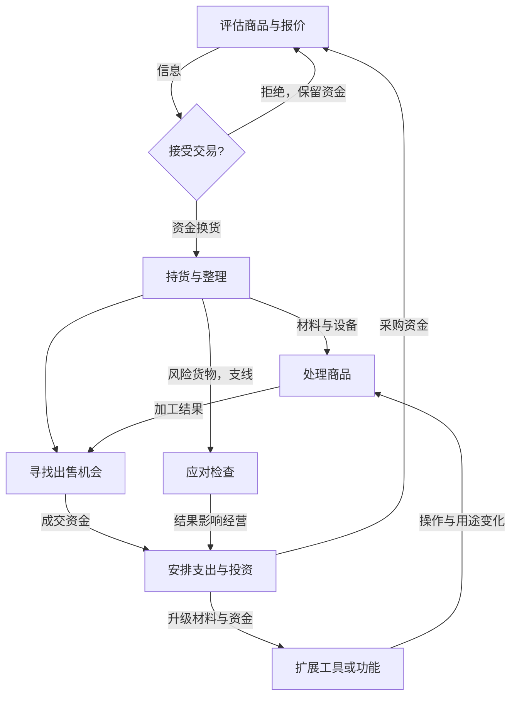

# 《深空当铺：可能是偷的》玩法研究

分析日期：2026-10-13。英文名 Probably Stolen – Cyberpunk Shopkeeper Sim；官方中文页面也使用“可能是偷得”。开发 Questing Goose Studio，发行 tinyBuild；PC／Windows、单人。正式版计划10月28日发行，本报告研究公开资料及9月14日 UPDATE 049 Demo，不代表正式版实测。[S01][S02][S03]

**结论：有局部借鉴价值，最值得研究的是“观察改变判断”和“成长改变操作”，整套当铺经营不建议当前移植。** 项目映射见[融入建议](项目适配与融入建议.md)，机器可读交接见[agent_input.json](agent_input.json)。

## 0. 范围与证据边界

依据是官方商店说明、官方补丁和项目文档／代码；没有实际试玩，没有观看可还原完整交易的连续录像。商店只能证明设计定位；补丁能证明具体功能或修正，不能证明所有边界和体验质量。关键缺口：鉴定判定、议价界面、夜间活动完整过程、失败恢复和当前Demo终点。

微信原文[S00]访问返回环境异常／验证页，未取得正文；不声称已经读过文章。检索出现大量相似非官方Wiki，未用其具体数值和规则填补空白。

本项目为 Purr Orbit／毛球计划，main，`b156a051eb0e9d1bc7331c6dfba1dd60ce516bba`；已fetch确认本地与origin/main相同。正式3D入口、旧采毛原型、已入案回收舱和最新摸猫／打捞／盲盒讨论是四种不同状态。最新有效更正为10月12日日会、10月13日补充：删除额外摸猫小游戏；锻造用于盲盒，没有锻猫。[P01—P08]

### 关键事实账本

- 【事实】商店设计包含进货、鉴定、议价、加工、出售；不同商品关联不同风险，信誉影响交易机会，租金形成现金压力；还包含识别异常顾客的支线。[S01，About This Game]
- 【事实】049加入工具装备与快捷工具箱、批量物品操作、购买前查看容器／机器；瓶子打印机可升级，清洁机器人焚烧升级增加耗电。[S03，Content／Quality of Life]
- 【事实】48.3.12取消“主动摆违禁品引来检查、藏好后获得安保信誉”的刷取路径。[S04，Changes]
- 【事实】48.3.10明确清洁机器人夜间与手动功能的提示，调整部分困难模式失败条件。[S05，Changes]
- 【推断】它的策略深度来自信息、资金、加工与关系彼此制约，并非只靠随机高价奖励。

下文对上述事实做机制建模；凡资料不能确定的转移、扣费或反馈均保留未知。机制卡不是经过实机确认的操作说明书。

## 1. 玩家实际上在做什么

【事实】玩家经营空间站店铺，主要操作对象是顾客、商品、库存和机器；049确认鼠标拖拽、框选和工具数字键。直接操控角色的移动方式不在本次证据范围。[S01][S03]

【推断】即时目标是做一笔可负担的交易；经营目标是保住现金流、扩大可售商品与加工能力；长期叙事目标是拥有店铺。买断在当前Demo是否可达【未知】，不能将商店目标当可玩终点。

操作动词：检查商品；比较货物与报价；接受／拒绝交易；拖放库存；对目标使用工具；投入机器材料；查看加工结果；出售货物；购买升级。具体点击顺序、交易确认按钮及成本结算时点【未知】。

**交易小循环的规则重建（推断，不是录像片段）：**看见商品与报价 → 考虑是否检查以及有没有资金／库存余地 → 决定买或拒绝 → 若购买则形成持货与现金占用 → 加工或寻找出售机会 → 销售结果影响下次采购能力。事实支持交易与处理的组成部分，但没有连续观察可证明该顺序是唯一流程；拒绝后的下一顾客、中断、撤单与退款【未知】。

## 2. 机制卡片

### M01 鉴定与信息补足

用途／入口：交易前后认识货物，决定是否承担成本。【事实基础】商品检视与鉴定存在。[S01]

建模操作链：【推断】获得报价或待检物 → 查看可用信息／使用适配工具 → 形成判断 → 接受、拒绝或改变处理方案 → 持货或保留资金。工具会揭示哪些属性、能否撤回判断及错误惩罚【未知】。

成本／收益：【推断】额外注意力可能换取较少误判；没有证据证明鉴定固定收费或固定耗时。可见外观与部分工具信息、真实价值与潜在问题构成信息差，但每项隐藏字段【未知】。

反馈：049明确扫描器面板置前、扫描结果提示修复，证明检测需要可见反馈；不据此推定扫描完成音效。[S03，Quality of Life／Liquids]

边界：哪些物品可检查、工具可否作用未购买商品、重复检验收益以及对质流程【未知】。变化来自商品类别及工具能力。依赖内容差异、可信线索和交易后果；若线索不预测结果，玩家只能猜。

### M02 报价、议价与成交

用途：在商品与交易对象之间形成收益选择。【事实基础】议价存在；049调整顾客预算与买卖方向的信誉乘数显示。[S01][S03，Trading & economy]

建模操作链：【推断】报价 → 评估 → 议价或直接接受／拒绝 → 对方回应 → 成交或不成交 → 改变资金／货物。报价范围、反复议价、退出后价格恢复【未知】；不把“每笔交易有风险”解释为隐藏掷骰概率。

成本／收益：【推断】利润、流动资金与关系可能竞争。可见报价和预算UI，但何时揭示全部预算【未知】。反馈至少有议价面板与乘数显示；音效／动画未知。依赖M01判断、M03商品用途及M06关系。

### M03 加工与功能升级

用途：将原料变成可用商品，扩展处理能力。【事实基础】存在生产链，打印机与机器人功能升级得到049直接支持。[S01][S03]

建模操作链：【推断】有机器／材料 → 选输入与用途 → 执行加工 → 获得结果 → 售卖或再投入。准确配方、启动键、加工时间、停电时恢复、损耗与失败【未知】。

状态序列（仅保留已证实功能状态）：打印机现有规格 → 使用电子零件升级 → 新瓶规格可用；机器人清理功能 → 升级解锁焚烧 → 开启后以更高电耗消除储存废物。[S03] 不额外加入“概率升级失败”状态。

成本／收益：升级材料与电力有事实依据；具体价格与功率未知。策略解释【推断】：升级价值可以体现为新增用途或减少后续整理，而不是单纯倍率。反馈、容器满后的停机和撤销升级未知。

### M04 库存空间与工具操作

用途：组织持货并降低反复操作的负担。049确认框选批量移动／使用、排序、旋转翻转、快捷装备，以及购买前预览。[S03]

可确认输入序列：拖出框选 → 多选物品 → 移动到目标库存或共同作用于目标；工具箱内工具 → 按对应数字键 → 装备。具体无效格、重叠拒绝、选区取消和购买未拥有物品的可用性须实机核查。

成本／收益：【推断】空间占用和整理注意力与备货量竞争；批量操作减少搬运，但不会自动替玩家做交易判断。反馈有明亮选框、面板和状态色；音效未知。变化来自库存规模与工具种类，依赖清晰所有权、目标合法性和UI遮挡处理。

### M05 高收益货物与检查风险

用途：给商品处置附加后果。官方描述灰色交易和执法；历史补丁确认展示违禁品能引来检查，以及藏入走私仓通过检查的路径。[S01][S04]

观察到的补丁状态链：展示违禁品 → 引来检查 → 隐藏货物 → 检查通过；48.3.12后这种主动诱发的通过不再奖励安保信誉。这里只确认特定路径，不能推出检查范围、搜查概率和处罚表。

成本／收益：【推断】高收益与潜在损失竞争；接受、避开、隐藏等选择受检查规则制约。检查预警、可否临时藏货、失败罚款／没收／结束条件均待核查。核心启发是避免“无净风险却无限得奖”的支配策略，而非把执法主题搬到猫游戏。

### M06 顾客与信誉改变机会

用途：使同一交易动作面对不同对象有不同意义。商店描述信誉、派系和顾客身份；049确认部分供货受黑市信誉影响。[S01][S03]

建模操作链：【推断】遇到对象 → 根据信息选择交易／拒绝／报告 → 关系变化 → 后续货源或机会改变。并非所有这些行为都会改变所有信誉，具体矩阵未知。识别异常AI顾客是另一个判断支线，武器输入与误杀后果细则未观察。

成本／收益、反馈和恢复：机会与关系的交换为推断；实际阈值、衰减、赎回和支线终点未知。依赖足够多且能区分的顾客内容，制作负担显著。

### M07 租金与现金流约束

用途：持续支出让库存投资必须考虑可兑现时间。【事实基础】官方说明租金压力及经营恶化后果。[S01]

建模操作链：【推断】保留现金或采购 → 等待销售兑现 → 应付支出 → 继续经营或寻求恢复。准确周期、公式、债务宽限、贷款流程、破产和读档规则未知。

策略作用【推断】：持有高价值库存不等于有支付能力；没有及时买家时，纸面利润可能让现金更紧。恢复路径只能说资料设计鼓励更冒险的交易，不能保证每种负债状态均可恢复。

## 3. 循环与下一轮的变化

- L01动作：【推断】目标可操作 → 检视／工具／拖放 → 属性或位置反馈 → 更易判断与处理。无效目标的实际退出规则未知。
- L02交易：【推断】可支配资金／待交易商品 → 判断、议价、持货、处理与出售 → 资金和关系改变 → 下一笔交易的能力变化；拒绝形成保留资金的退出支路。
- L03成长：【推断】经营积累 → 买工具／功能升级 → 操作负担或可加工类别改变 → 获得不同经营机会 → 再投资。
- L04长期：【推断】现金积累与持续压力 → 扩大生意及关系 → 追求店铺所有权。跨存档继承／周目重置、Demo买断终点未知，不写成已确认跨局循环。

这是基于资料的分析图，非实际UI流程图。成长既可能改变数值，也可能改变产品用途与整理方式；每种升级的全部效果不能从泛化模型反推。

## 4. 资源、经济与自动化

| 资源 | 来源／用途 | 持久性、上限与缺口 |
|---|---|---|
| R01信用资金 | 交易收入／采购、升级与支出 | 存档保留细则、上限未知 |
| R02商品与材料 | 采购、处理产出／出售、加工、升级 | 所有权与容器相关；损坏及跨日保存待核查 |
| R03库存空间 | 容器与管理能力／容纳商品工具 | 具体尺寸、升级成本未知 |
| R04信誉 | 交易与事件影响／关系、供货机会 | 方向矩阵和阈值未知 |
| R05电力 | 供电能力／机器工作 | 049确认焚烧增加电耗；所有功率和供电成本未知 |

【推断】竞争性投资是“备货扩大机会、设备扩展用途、留现金抵御支出”。仅用变量表达概念账本：可支配现金＝余额－计划支出－拟投入采购；这不是原游戏公式，也不据此估利润或回本时长。

自动化只确认清洁机器的功能变化[S03][S05]，不推定全店能无人交易。批量整理和快捷工具是减操作；生产设备是加工能力；这三者不等价。潜在失效点【推断】：产品卖不掉、投入占现金、库存拥堵、关系封锁。实际破产恢复与是否存在稳定无风险赚钱策略需试玩。

## 5. 决策、节奏与持续动力

分析出的决策点（均为依据规则的推断）：①直接接受报价还是先补信息；②保留现金还是占用在货物；③购处理设备还是购库存／材料；④选择更高收益货物还是规避风险；⑤追求单笔议价利润还是后续关系机会。每点的精确边界和最优策略不能从商店文案判定。

本次没有证据证明核心交易是“连续押注、随时收手、失败清空本次收益”，因此不能把摸猫哈气机制直接归因于本作。

【推断】早期学习交易与工具，中期面临产品和库存扩展，成熟期注意力转向经营组合与关系；没有阶段时长证据。持续动力可能来自辨识能力、处理能力、新内容和经营目标。潜在疲劳是反复整理、扫描和面板切换；049的操作便利改进支持这些负担受到关注，但不证明本次玩家普遍厌烦。[S03] 教学顺序只确认48.3.10对首日展示柜做了保护，不补写完整教程。[S05]

## 6. 可复用原理（设计推断）

1. **信息有后果。** M01／M02：线索与真实状态相关 → 玩家先观察再选择 → 结果验证判断 → 可能产生“我学会看懂了”的体验。依赖有效且可学习的线索。反事实：去掉相关性，观察退化成等待装饰。
2. **升级改动作或用途。** M03／M04：新增功能或批量能力 → 玩家改处理方式 → 减少旧劳动并产生新选择 → 成长可被感知。依赖新能力有实际目标。反事实：只有倍率，操作内容不变。
3. **收益必须能兑现。** M02／M07：投入占现金且销售不保证立即兑现 → 玩家比较周转与价值 → 投资影响下一轮 → 经营选择有代价。强依赖市场和持续支出，不能直接迁移完整租金压力。
4. **多内容共享一套动作。** M01／M06：同一检查和选择框架，替换对象与后果 → 规则可复用而判断不同 → 减少独立小游戏负担。依赖对象差异真的改变选择。反事实：只换图标仍是重复。
5. **自动化搬走劳动，保留判断。** M03／M04：降低操作步骤 → 注意力可转向目标和投资 → 成长可能减疲劳。若把判断一起移走且不提供新决策，主动游玩也可能失去价值。

## 7. 本项目判断入口

详见[项目适配与融入建议](项目适配与融入建议.md)：T01优先验证猫的可学习情绪线索；T02局部借鉴打捞后物品用途与信息揭晓；T03暂缓实现、先定义自动化后的主动价值。没有证据支持当前引入当铺、执法、租金和派系全套系统。

## 8. 交接与缺口

下游先读有效日会[P02]，再读融入报告和JSON；旧“锻猫”视频稿不作为当前方向。调研候选不等于采纳、开发授权或18号实装任务。

待核查顺序：①完整鉴定—交易录像，验证工具如何改变信息及错误后果；②Demo加工—升级录像，验证功能成长和停机恢复；③库存规模增大后的连续操作，验证便利性是否确实减少劳动；④支出、亏损和恢复链；⑤正式版上线后的机制变化。缺口主要限制原游戏的精细操作还原，不阻止候选原理的低成本设计验证。

## 来源登记

外部来源为实际读取的官方页面或Steam新闻API；微信仅登记访问失败，不作为机制证据。未下载游戏，也未验证当前Demo内部修订号。

| ID | 标题／位置 | 日期与定位 |
|---|---|---|
| S00 | [用户微信原文](https://mp.weixin.qq.com/s/S7B87_s6QD-FNQgEmCCdug) | 2026-10-13访问失败，正文未读 |
| S01 | [官方Steam本体商店](https://store.steampowered.com/app/4348910/?l=english) | 2026-10-13读取，About This Game／平台／发行信息 |
| S02 | [官方Steam Demo](https://store.steampowered.com/app/4349200/Probably_Stolen_Demo/?l=english) | 2026-10-13读取，Demo身份与平台 |
| S03 | [UPDATE 049](https://store.steampowered.com/news/app/4348910/view/1843481262702145) | 2026-09-14，Content／QoL／Trading & economy；通过官方新闻流及API读取 |
| S04 | [Playtest 48.3.12](https://store.steampowered.com/news/app/4348910/view/1840310314345942) | 历史Playtest，Changes；API完整条目读取 |
| S05 | [Playtest 48.3.10](https://store.steampowered.com/news/app/4348910/view/1840310314342898) | 历史Playtest，Changes／New Content；API完整条目读取 |
| S06 | [Steam官方新闻流](https://steamcommunity.com/app/4348910/allnews/) | 2026-10-13读取，049与Playtest Ledger；社区用户贴不作为结论 |
| P01 | [项目AGENTS](../../AGENTS.md) | 当前边界及游戏调研工作流 |
| P02 | [10-12日会含10-13更正](../../会议纪要/2026-10-12_日会_整理纪要.md) | 核心玩法、摸猫、打捞与盲盒、待办 |
| P03 | [策划索引](../../摸猫增量策划案/00_索引.md) | 正式、原型和新策划入口 |
| P04 | [实装日志](../../摸猫增量策划案/18_实装变更日志.md) | IMP-20261009-001／002与撤回记录 |
| P05 | [正式项目配置](../../毛球满屋/project.godot)及[正式模型](../../毛球满屋/scripts/model.gd) | 配置15行；模型pool／draw_capsule／advance_stage |
| P06 | [独立原型报告](../../毛球满屋/reports/prototype_20261009/README.md)及[controller](../../毛球满屋/scripts/prototype_harvest/controller.gd) | 运行与限制；select_cat／zoom，143—154行 |
| P07 | [19号轨道回收舱](../../摸猫增量策划案/19_背景故事与轨道回收舱盲盒系统.md) | 单次回收、收藏收益、待实施迁移 |
| P08 | [10-12长线规划含更正](../../会议纪要/2026-10-12_长线规划讨论_整理纪要.md) | 一期与远期候选边界 |

上述本地项目资料基于同一提交。原型历史测试与参数不作为本轮真人体验结论。
