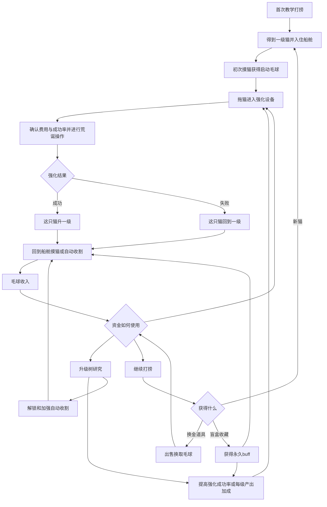

# 《Purr Orbit》／《毛球计划》：打捞、猫咪强化与摸猫循环方案

2026年10月12日｜玩法与效果视频讨论稿

本文整理本轮用户提出的改动，并补充循环、交互和展示建议。新方案尚未进入引擎实装；不覆盖现有正式策划或旧原型。猫咪强化借用用户所述《锻剑模拟器》的操作与风险成长思路，不在本文推定参考游戏的具体数值。

## 1. 一句话介绍

玩家驾驶太空打捞船，捞回各种表情包猫，把猫放进一台用途可疑的强化设备，通过荒诞操作尝试提升等级。高等级猫在日常摸猫时产出更多毛球，玩家再用毛球研究更可靠的强化技术、扩大收割能力，或继续打捞新的猫与收藏。

**短期想让眼前这只猫更能赚钱，长期想找到更奇怪的猫、得到更多永久加成。** 摸猫是主要收入和个体互动；猫咪强化承接风险与成长；打捞承接探索与发现。

## 2. 本轮确定的方向与未定边界

| 内容 | 本轮讨论采用的方向 |
| --- | --- |
| 主基调 | 抽象、直接、诙谐、让人觉得莫名其妙；猫咪与设备的异常反应是主要笑点 |
| 普通摸猫 | 猫在船舱自由活动，玩家主动摸猫获得毛球；各猫有符合自身meme的反馈 |
| 猫咪强化 | 拖入固定设备，完成对应猫种的强化操作，再揭晓结果 |
| 成功与失败 | 成功升一级；失败该猫直接回到一级，不只是退一级 |
| 强化与收益 | 猫的等级影响日常产出，强化不是一次性的换金操作 |
| 升级树 | 毛球购买；研究强化成功率、等级带来的产出加成及自动收割能力 |
| 猫咪获取 | 来自打捞；重复猫种也可以形成不同等级、不同培养经历的个体 |
| 打捞结果 | 仍为猫咪、可出售的换金道具、不可出售的永久buff盲盒收藏 |
| 失败消耗猫咪 | 用户仍在考虑，未采用为基础方案；表现方式不得使用死亡 |
| 抚摸视角 | 是否必须点击聚焦后才能摸仍待定，不将此文写成已经选定 |
| 精确数值 | 等级上限、成功率、产出曲线、费用与整体时长均待验证 |

此前“手动调猫、疑问问答、长度对准”等独立摸猫小游戏不直接沿用为必做流程。新的组织方式是：日常摸猫看各猫的独特反馈，主动投资时才进入强化操作。强化本身也需要避免成为每次都要重复的开锁式考核。

## 3. 完整循环

用户描述的主流程为“打捞—得到猫—升级猫—摸猫—升级树—再升级猫—再摸猫—继续打捞”。开局需要解决强化费用从哪里来的问题：建议在第一次强化之前安排一次极短的初次摸猫，直接产出启动资金，并以这笔钱支付首次强化。也可以改为首次强化免费，但不能同时默认为两种方案都已采用。

形成循环后，升级树、强化与打捞都是玩家可选择的投资，不强迫每轮依次操作全部环节。玩家可以先保留稳定收入，也可以冒险冲高一只猫，或者先找新的猫与收藏。

## 4. 猫咪强化设备如何使用

设备暂名“猫咪校准机”，为讨论用名。一台固定设施承接不同猫种的强化，具体造型可采用检查台、机械夹具和一个异常认真的操作面板，表现为猫在接受某种莫名其妙的校准。

| 步骤 | 玩家操作 | 画面与状态 |
| --- | --- | --- |
| 选择 | 把一只猫拖入设备 | 显示这只猫的名字、当前等级及待提升等级 |
| 判断 | 查看费用、成功率和收益预览 | 明示“失败回到Lv.1”，并展示成功后的单次产出变化 |
| 开始 | 点击确认后扣除一次毛球 | 锁定本次条件，进入该猫的强化动作 |
| 操作 | 完成一个简单、直接的动作 | 猫种决定表现与手法，不叠加多轮解谜或复杂时机条 |
| 揭晓 | 操作结束后揭晓一次结果 | 成功升一级；失败回一级，同一过程不得重复扣费或结算 |
| 返回 | 猫离开设备回到船舱 | 新等级立即用于之后的日常产出 |

补充建议：进入设备但尚未确认时可以无损退出；确认后按一次完整尝试处理。猫在设备内暂停日常收割，其他猫和已有自动化继续运行。等级变化不重置名字、外观、人设或已获得的全局研究与收藏。

这些是为衔接流程提出的规则，具体占用时间、取消方式和未完成产出的保存办法仍需验证。设备不应成为长时间挂机等待才能揭晓的排队机器。

## 5. 交互如何与猫咪梗结合

以下是三种猫的强化操作与日常反馈候选。操作负责让玩家参与，并把猫的梗演出来；本稿建议成功率由已显示的强化条件决定，不额外塞入未说明的精准操作惩罚。

| 猫种 | 日常摸猫反馈 | 强化设备中的操作候选 | 成功演出 | 失败演出 |
| --- | --- | --- | --- | --- |
| 外星猫 | 抚摸时黑眼直盯玩家，触角闪动，发出听不懂的外星话；满足后突然广播并弹出毛球 | 设备接上两根触角，玩家按住“发送”按钮，触角像电话拨号般发送一串怪声；松开完成发送，不要求解码或寻找隐藏频率 | 猫短暂悬浮，接收到一声严肃回应，等级跳升，触角发出更强的信号 | 通讯突然断线，触角耷拉，猫平静地说一句短促怪话，面板回到Lv.1 |
| 疑问猫 | 抚摸后顿住、抬头发出“哈？”，再以笨重但满足的体态产毛 | 玩家连续按压设备上的大按钮，台面随每次操作轻晃，猫每次都同步点头“哈？”；达到少量固定次数即结束 | 机器盖上“已理解”印章，猫郑重点头，等级提升后仍补一句“哈？” | 机器显示“未理解”，猫和面板各出现一个问号，Lv.1重新亮起 |
| 长猫 | 顺着背摸会拉长，停手后回缩，毛球沿身体依次鼓起并弹出 | 玩家按住拖动一个大把手，设备将猫舒展成夸张长度；拉到明确终点即可完成，不使用狭窄判定区或松手时机考核 | 猫像卷尺一样回收，机器标注“长度验收通过”，等级提高 | 测量结果回跳，猫缩回短短一团，设备吐出“重新测量”标签，等级回一级 |

这里的失败是强化概率判定的表现，不是因为玩家没点准一个小窗口。成功与失败都应有值得观看的反应，日常抚摸也要保留这些猫的识别特征，避免特色全部集中在机器中。

不认识原梗的玩家也应能看懂：外星猫在通信、疑问猫没听懂、长猫长得离谱。本文是对形象特征的游戏改编，不把这些动作写成原meme中已经存在的情节。

同猫种可以沿用相同操作框架，用不同声音、停顿、机械反馈和等级表现增加变化。熟悉后允许缩短常规演出；首次新猫和关键等级保留较完整的展示。

## 6. 猫的等级与产出如何挂钩

建议先把等级收益放在“每次完成摸猫能得到多少毛球”上，让玩家容易比较强化前后。产毛速度、互动行程和等级收益不在第一版同时大幅改变，避免玩家无法判断哪个升级起作用。

| 数据 | 主要来源 | 作用 |
| --- | --- | --- |
| 猫的基础产出 | 猫种与个体设定 | 决定这只猫的基础收入特点 |
| 猫的等级 | 设备成功强化 | 提高该猫的日常产出 |
| 每级产出加成 | 升级树研究 | 同一级别的猫也能因研究而变强 |
| 强化成功率 | 目标等级与相关研究 | 决定一次尝试成功的概率 |
| 正常收割频率 | 手动操作或自动设备效率 | 决定潜在产能实际兑现多少 |
| 收藏加成 | 打捞获得盲盒 | 提供可持续保留的全局收益 |

可以先采用易读的试算结构：

- 猫咪等级倍率：`1＋（等级－1）×每级加成`。
- 单次产出：`该猫基础产出×等级倍率×适用的其他加成`。
- 单位时间实际收入：`平均单次产出×单位时间有效收割次数`。

以上只是便于试算的候选公式，不是本轮确定的最终数值。设备占用、未收割时间和特殊反馈会影响实际效率；所谓“日产量”在这里是生产能力描述，不自动引入现实每日重置或日历系统。

猫的等级作用于日常基础收入，人工与自动化都能受益；专属互动可以另外提供奖励，但不要求每次完成小游戏才能兑现等级加成。升级成功后，最好立即安排一次摸猫对照，让玩家看见同样操作产出更多毛球。

## 7. 升级树如何组织

仍采用一张毛球支付的升级树。猫咪个体等级是树研究支持的培养结果，不为每只猫再复制一整张付费树；成功率研究和等级收益研究是这轮的新核心。

| 研究方向 | 可以分段出现的节点 | 对循环的帮助 |
| --- | --- | --- |
| 强化可靠性 | 低等级成功率、高等级成功率、某类猫适配研究 | 提高成功机会，降低反复回一级的恢复成本 |
| 等级收益 | 每级产出加成、特定猫种等级加成、特定等级区间强化收益 | 让升一级更值得投入，直接作用于日常收入 |
| 强化成本与便利 | 尝试费用优化、操作步骤简化、常规演出加速 | 缓解培养的资金与重复操作负担，不默认取消概率风险 |
| 基础收割与自动化 | 收割设备解锁、效率、工作CD、适用猫种 | 稳定兑现猫的产能，让玩家有时间打捞和培养 |
| 打捞与共用能力 | 牵引能力、目标线索、猫咪寻找方向、两侧共用收益 | 支持找新猫与收藏，并让发现反哺船舱 |

节点仍可以按同主题重复出现、逐步升级的形式组织，旁支不必满级才推进主体。猫种、设备、研究与两侧成长共处一张树，不拆成互不相干的系统树。

成功率研究应该清楚写明作用等级与猫种，例如“低阶强化更可靠”，不能购买后才发现它对当前目标无效。显示最终成功率时，必须把树与收藏贡献算进去；不以隐藏惩罚使界面数值失真。

自动化载体是收割设备、专职小帮手还是两者搭配，留作后续选择。本稿只规定它们承担日常基础收割，不默认恢复旧多岗位工人，也不默认替玩家选择猫、付费强化或连续打捞。

## 8. 失败回一级的风险与缓冲

**这轮最需要验证的是：风险是否让玩家想再试一次，还是让玩家不敢培养。** 猫一边承载名字与个性，一边成为持续收入来源，全等级归零会同时影响情感和资金。

基础讨论版本采用失败回一级、猫仍保留。树研究、收藏、其他猫和库存都不被清空。“全盘皆输”限定为这只猫本次积累的等级，不扩大为整个经营进度归零。

| 风险 | 补充建议 | 需要验证的点 |
| --- | --- | --- |
| 高等级越来越难，一次失败抹去很长时间 | 先试验少量等级，费用与收益共同校准；完整展示失败规则 | 玩家是否愿意继续培养，而不是一直停在低级 |
| 主收入猫进入设备或回一级，资金链中断 | 一级猫仍能正常赚毛球；常规摸猫不需要付费；让其他猫可以继续工作 | 能否用普通生产恢复，而非只能反复花钱打捞 |
| 每次都要完整操作，变成另一种开锁劳动 | 常规尝试短促，已熟悉动作可逐渐简化，关键结果保留演出 | 玩家是在期待结果还是厌烦操作 |
| 成功率研究让冲级完全没有风险 | 各等级分别测试实际到达成本与收益，不预先把全部节点设到100% | 研究是否有价值，同时保留投资选择 |
| 高级猫收益过强，所有资源只用于反复冲级 | 与打捞、收藏和自动化的回报对比，避免单一投资长期压倒其他选择 | 玩家是否仍愿意打捞与认识新猫 |
| 为了短视频夸张而让失败变得过于羞辱 | 猫与机器共同制造笑点，猫保持安全且仍能继续生产 | 失败能否令人想再看一次，而非只感到被惩罚 |

早期低阶成功保障、连续失败补偿、有限次数的费用返还都可以作为候选，但不在本轮自动采用。若以后讨论保级或检查点，它们会改变“失败回一级”的当前设定，必须单独决定，不能悄悄加入。

评估时不能只比较一次强化的费用。若每一级成功率分别为`p1、p2、…`，从一级连续成功冲到目标等级的概率为这些概率的乘积；这不是最终必定到达的概率，也不是期望费用，但说明连续冲级的难度会很快累积。

至少需要记录：一次失败后恢复原等级所花的时间与费用、恢复期间仍能赚多少、各等级实际停留比例、树研究的回本速度，以及玩家尝试次数。视频里的连续成功不能用作这些数值已平衡的证据。

## 9. 失败是否会消耗猫咪

此项保持待定。建议先用“回一级但保留猫”验证强化是否好玩，再决定是否增加失去猫的强风险，避免同时检验两种不同惩罚。

| 版本 | 发生什么 | 影响 |
| --- | --- | --- |
| 基础版本 | 失败回一级；姓名、人设、种类和个体身份保留 | 有风险，但仍能用原猫重新生产与培养 |
| 待讨论版本 | 猫因某种非死亡原因离船，不再参与生产 | 会损失个体、收入来源和部分情感连接，需要更强的补充机制 |

非死亡演出可以候选为“设备把猫传送到错误地址”“猫拿着不合格单离职”“长猫缩进另一个维度”。这些只解决表现，不能代替实际规则。

若采用失去猫，必须先决定：是不是永久失去、能否找回原个体、会否重新抽到同种猫、是否保留档案，以及失去最后一只猫时如何继续。仅写“不是死亡”不能解决经营断流。

建议保证任何情况下都有可恢复的基础收入路径，例如最后一只猫不被消耗，或提供明确的免费救援。选择前不能默认两者同时存在。效果视频暂不展示猫咪消耗，避免把仍在讨论的规则演成确定内容。

## 10. 打捞与收藏如何继续发挥作用

强化提高现有猫的价值，打捞增加新个体与内容。新猫不必每次都数值碾压旧猫，可以带来新的表现、适配方向或培养特点，使玩家愿意保留自己的熟悉伙伴。

换金道具作为资金补充，不要求再加工；出售是否足以支持纯打捞无限循环，后续与费用一起核对。盲盒收藏为永久buff，不因某只猫强化失败而丢失。

收藏加成可以候选为基础产出、某猫种收益或强化费用等方向；如果提供成功率加成，应纳入同一最终概率计算，避免重复叠加导致越界。具体系列与不重复收集规则沿用既有讨论方向，本文不编造新的收藏数量或价格。

本稿暂不依靠周目重开推动循环，也不把强化失败包装成强制新周目。

## 11. 阶段成长与玩家选择

| 阶段 | 玩家主要关注什么 | 新动力 |
| --- | --- | --- |
| 开局 | 第一只猫的反馈、初次产出与强化 | 看懂“等级提高，摸同一只猫收益增加” |
| 初步成长 | 升级树提高可靠性和每级收益 | 同一只猫还能更强，失败后有恢复能力 |
| 多猫循环 | 打捞新猫、培养不同个体、逐步自动收割 | 原猫提供稳定收入，新猫带来新表现与培养选择 |
| 持续经营 | 在强化、研究、自动化、打捞与收藏之间分配毛球 | 有选择地提高整体收入，而不是只盯一个无限升级按钮 |

建议一次只突出一个新概念：先摸猫，再强化，再研究，再打捞新内容，最后解释自动化。将“成功率”“等级收益”“设备效率”同时堆给开局玩家，会削弱主循环的可读性。

成长的视觉重点是同一只猫：等级标记、状态变化、毛球爆发与机器反馈。猫数增加是新内容与配置扩展，不是唯一的增量表现。等级可以强化各猫已有梗，但不强制每升一级换一套完全不同的外观。

## 12. 效果视频展示结构

视频先验证观众能否看懂循环与笑点。建议分段制作，主体沿用既有船舱；打捞使用左下星球、右上飞船的固定外景，强化采用船舱内设备的局部聚焦。镜头聚焦不等于采用旧拔毛玩法，也不代表已确定抚摸必须聚焦。

| 片段 | 建议时长 | 展示的操作与画面 | 观众应理解的内容 |
| --- | --- | --- | --- |
| 1. 打捞第一只猫 | 6秒 | 外景完成一次短牵引，回船舱猫从救生舱出现 | 猫从探索获得 |
| 2. 普通摸猫 | 6秒 | 摸猫触发种类反应，毛球飞入资源栏 | 摸猫是基础收入 |
| 3. 初次强化 | 8秒 | 拖猫进机器，显示费用、成功率和Lv.1→2，进行简单操作并成功 | 主动投资提高这只猫的等级 |
| 4. 收益对照 | 6秒 | 同一只猫、相同摸法，毛球产出明显增加 | 猫咪等级直接提高收入 |
| 5. 研究升级 | 6秒 | 花毛球点出研究，强化界面的概率或每级收益随之改变 | 升级树支持更高效的培养 |
| 6. 三猫强化差异 | 12—18秒 | 外星猫通信、疑问猫问号、长猫拉伸，各展示一个短结果 | 不同猫带来各自的荒诞反馈 |
| 7. 一次失败与恢复 | 8秒 | 一只较高等级猫失败回Lv.1，仍在场；另一只猫继续产出，随后研究或再尝试 | 风险真实存在，但不是整个游戏被清空 |
| 8. 自动化与再次打捞 | 8秒 | 收割设备或选定替代体继续工作，资金到账，玩家支付新打捞 | 两侧可以持续互相推动 |
| 9. 新收获与中期状态 | 8秒 | 新猫或永久收藏揭晓，回到多猫船舱 | 有值得继续追求的发现 |

合计约68—74秒，仅为视频组织建议，不是实际完成这些成长所需的时间。三猫差异可以拆成额外短片，不必全部塞进一条主循环视频。

强化前后对照应锁定同一只猫与相同操作，避免用“猫变多了”冒充个体成长。失败片段明确表现等级回一级，不能只演一个搞笑事故却让观众不知道失去了什么。

每段只展示一次主要操作和一次结算；拍摄素材中的费用、成功率与产出值需要后续统一设置。已有参考帧的76.6k可用于中期余额示意，不作为新方案的开局资金或节奏依据。

## 13. 已有展示素材与需要新制作的画面

| 素材 | 本轮用法 |
| --- | --- |
| 首次打捞与猫登船参考帧 | 继续作为开局场景与视角参考 |
| 普通撸猫参考帧 | 保留手、猫和毛球到账的因果顺序，降低温馨爱心表现 |
| 三种猫咪设定图 | 沿用形象识别，强化反馈按本稿重新讨论 |
| 中期十猫船舱图 | 作为成长后的群体状态参考，不要求每段都出现10只猫 |
| 旧升级浮层 | 需要改为强化研究内容，不能沿用旧价格当作新定值 |
| 强化设备与三种操作 | 需要新增设备外观、拖入状态、操作帧与结果帧 |
| 成功率、等级与产出对照 | 需要统一HUD与数字叠加，确保画面能读懂 |
| 失败回一级与恢复 | 需要新增失败后猫仍在场、继续生产的画面 |

这里记录的是视频素材缺口，不是正式开发待办。下一步再根据采用的强化交互制作参考帧与分段Prompt；本轮不生成视频、不修改游戏代码。

## 14. 本轮需要继续决定的问题

1. 先以“失败回一级、猫保留”测试，还是直接加入失去猫？后者必须先明确恢复路径。
2. 普通猫与三种特殊猫分别采用哪种强化动作？动作应短促直观，结果不依赖隐藏操作条件。
3. 是否采用固定概率判定，或让明确的操作表现提供小幅加成？若加入操作加成，必须重新说明失败来源。
4. 等级上限、各级成功率、每级产出和尝试费用如何匹配，使失败可恢复、成功又值得。
5. 升级树中的成功率与加成研究按等级段、猫种还是全局分支安排。
6. 普通抚摸是否需要点击聚焦；专属反馈如何在整体船舱视角中保持可见。
7. 自动收割最终采用什么载体，以及它如何兑现猫等级带来的收益。
8. 先制作哪一只猫的完整演示链，作为三种猫和整个循环的统一质量参考。

建议先完成一只猫的“摸猫产出—机器强化—同猫增产—研究提高条件—失败回一级仍可生产”展示，再扩展三种猫、打捞奖励与中期自动化。最重要的是让观众看懂：为什么想升级这只猫，为什么愿意再摸它，以及赚到的钱为什么值得继续投入。
