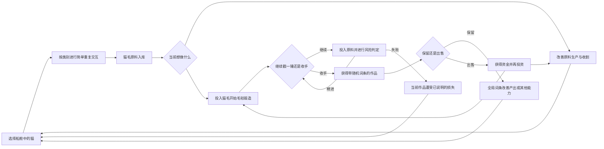

# 《Purr Orbit》／《毛球计划》：猫毛锻造双循环与十猫交互方案

2026年10月13日｜新方向讨论稿｜本轮重点：猫咪分类与重复收割交互

本稿整理用户本轮提出的改动，并提供选猫、操作和系统衔接建议。猫种选自本轮20种备选图，保留原编号用于核对；截图中的阶段说明是参考资料，不自动作为解锁顺序。新方案不再采用上一轮的猫咪强化与太空打捞，旧讨论与视频脚本保留历史。本轮不修改正式策划、不登记实装任务、不改游戏代码。

## 1. 核心变化

**让猫负责稳定、直接的原料生产，让毛毡锻造承担主动投资、风险与发现。**

玩家在船舱照顾各种奇怪的猫，收集猫毛。想继续生产时就摸猫，想尝试一次带风险的收益时便把猫毛投入毛毡锻造。每次继续加工都有变得更好或功亏一篑的可能；玩家可及时收手，保留带全局词条的作品，也可出售作品获得资金，继续投资。

日常猫咪交互不再随机弹出另一套小游戏。目前并列保留两套预选项：方案一通过点击、长按、按住拖动区分操作；方案二统一点击，通过固定反馈、积累爆发和正确位置高效产出区分。猫种负责各自的体态、声音和产出表现，同类规则一致，尚未选定最终方案。

## 2. 用户方向与补充提案

| 项目 | 用户提出的方向 | 本稿补充建议 |
| --- | --- | --- |
| 日常主玩法 | 养猫产猫毛，交互可迅速重复 | 基础收入不需要解谜、反应考核或匹配节奏 |
| 猫咪分类 | 选10种分3组；本轮追加全点击方案作为并列预选项 | 同一批10种猫，分别比较输入差异方案与点击反馈方案 |
| 副玩法 | 用猫毛原料进行类似戳毛毡的锻造 | 把每次继续投入与收手都做成明确选择 |
| 风险 | 每一锤有失败率，可能精进或功亏一篑 | 风险限定当前加工中的作品，不损坏猫或已有收藏 |
| 结果 | 3D资产物件和消耗型道具 | 作品外观、系列与词条形成长期发现目标 |
| 词条 | 随机生成，对全局加成 | 在收下或出售前展示明确效果与价值 |
| 用途 | 自由出售换金或保留享受加成 | 出售移除该物件的持有加成，避免两种收益重复拿 |
| 差异 | 猫侧可采用输入方式差异或全点击反馈差异；锻造系列不同加工与演出 | 两套猫侧方案并列，不要求同时叠加进一版游戏 |
| 新猫来源 | 本轮取消打捞，未另行指定 | 先提供初始猫；其他猫的获得方式继续讨论 |

锻造风险的具体后果、猫咪获取、资金与原料是否分账、全局词条叠加规则仍未确定。本稿不将这些补充写成最终规则。

## 3. 双循环与玩家目的

两个循环提供不同的心理体验：

| 循环 | 玩家做什么 | 当下的乐趣 | 为什么愿意继续 |
| --- | --- | --- | --- |
| 猫咪原料循环 | 选择猫，按所选预案进行重复交互，积攒猫毛 | 简单有反馈，看奇怪猫的反应，感受产量变强 | 为下一件作品准备原料，或改善现有生产 |
| 毛毡锻造循环 | 选择系列，逐次加工，决定继续还是收手，再决定保留或出售 | 看作品变化、承担已知风险、揭晓词条 | 追求想要的3D作品与更适配的全局加成 |

摸猫必须自身具备即时反馈，不能只成为锻造之前的体力劳动。锻造需要给玩家“我正在做什么、这件东西有什么用”的可见目标，也不能只是付费播放随机结果动画。

玩家可以自行决定什么时候切换。锻造不从摸猫过程中突然弹出、不强制抢走镜头、不要求处理完才能继续产毛。

## 4. 共用的十猫推荐与方案一分组依据

推荐保留原图编号1、2、3、4、5、8、11、12、15、16，共10种：

- 有最普通的起点，也有外观与动作足够异常的对象。
- 覆盖普通猫形、表情包化与荒诞生物，不完全依赖一种美术尺度。
- 能归入方案一的三套简单输入，也能归入方案二的三类点击反馈，无需为每只猫做独立小游戏。
- 长尾、长毛、猫猫虫适合连续手势；良子、思考、太空适合持续触摸；其余适合短促触发。
- 两套各自的三组都不是强度梯度或三个阶段。高级猫不必全部使用同一组交互。

方案一推荐分组名称：**拍一拍、按一按、捋一捋**；方案二为**稳定反馈型、积累爆发型、位置效率型**。两套都不另设三种生产货币。

## 5. 方案一：十猫分类与反馈总表

以下反馈均为提案。保持猫咪安全，不使用受伤、疼痛或死亡来制造幽默。

| 原图编号 | 猫种与原形象 | 操作组 | 玩家怎样快速重复产出 | 交互过程的明显反馈 | 完成一次的反馈 |
| --- | --- | --- | --- | --- | --- |
| 1 | 普通猫：胖胖的普通猫 | A 点击：拍一拍 | 点击身体一次，完成一次有效收割；后续重复点击 | 被点的部位短促凹一下，身体像软团子回弹 | 一小撮毛弹起，跳产出数字；猫恢复平静 |
| 5 | 静电猫：炸毛、浅蓝描边 | A 点击：拍一拍 | 点击身体，与普通猫相同，不找电极、不等放电时机 | 全身轮廓短亮，毛突然竖得更直 | “啪”地抖出一团毛，电弧迅速消失；不自动增加连锁收益 |
| 11 | 橘子猫：身上套着橘子 | A 点击：拍一拍 | 点击橘子外壳或露出的猫身，均算同一目标 | 橘子壳像橡皮球一样被按扁又回弹，猫脸仍然平静 | 壳缝“噗”地挤出毛团，毛不是果汁，不生成新原料 |
| 15 | 招财猫：金属光泽、铃铛 | A 点击：拍一拍 | 点击身体，执行同一点击收割，不玩抛币或拉杆 | 举起的爪子短促摆一下，铃铛响一下，金属身体略抖 | 毛团与短促金光同时弹出；本稿不加入代币或另一种掉落判定 |
| 4 | 良子猫：特别胖、肚子垂地、走得慢 | B 长按：按一按 | 按住身体，完成一个周期产出；持续按住可继续下一个周期 | 肚子像缓慢充气的软团子鼓起来，脸很淡定 | 身体“噗”地松回去，毛团弹出；按住时继续循环 |
| 8 | 思考猫：思考表情包形象 | B 长按：按一按 | 按住身体，让它思考完一轮；不回答问题、不猜词 | 维持严肃思考姿势，头上小点依次变亮，眼睛微眯 | 一团猫毛顶替“想法”冒出来，猫像什么都没想明白一样继续下一轮 |
| 12 | 太空猫：两根触角、身体发光 | B 长按：按一按 | 按住身体持续触摸，不调频道、不匹配频率 | 两根触角像接通电源一样逐渐变亮，身体轻微浮起 | 短促广播怪声，光圈收束并弹出毛团；松手或持续下一轮 |
| 2 | 长尾猫：巨大而很长的尾巴 | C 拖动：捋一捋 | 按住有效身体区域来回拖动，累计一轮手势量即可产出 | 长尾随手势摆动，像擦过地面的软扫把；身体位置固定 | 尾巴一甩，毛沿一个清楚的方向弹出；不要求追着尾尖点击 |
| 3 | 长毛猫：长毛拖在身后像拖把 | C 拖动：捋一捋 | 同样按住来回拖动，不要求逐束梳理或解结 | 毛帘被手势短暂捋开，整个轮廓由蓬松变顺再恢复 | 一团毛从毛帘里弹出来，头抬起一下，继续下一轮 |
| 16 | 猫猫虫：像毛毛虫一样移动 | C 拖动：捋一捋 | 按住身体来回拖动，操作量与同组同规则 | 身体沿手势像手风琴般短促压缩、伸展，猫脸保持不动 | 身体分段鼓起再一口气回缩，弹出毛团；不点击分节或完成路线 |

太空猫沿用本轮图片的触角、发光设定，不自动将此前绿色外星猫的所有技能写入本稿。长尾猫不是此前全身无限拉长的长猫；猫猫虫也不直接替换成旧黑色长猫。猫种名称和形象以本轮候选为准。

## 6. 方案一：三组输入的完整规则

### A组：点击一次，获得一次

目标：让玩家看到猫就能点，形成短促、密集的操作反馈。

- 左键按下并释放在同一猫的有效区域内，计为一次有效输入。
- 该次输入给一轮清楚的压缩／抖动反应，结算一次产出。
- 猫的特效可以不同，但不增加“必须点头、连续三下、等到某一帧”的要求。
- 连续输入如何限制频率仍需调试；应在画面上可理解，不隐藏很长的反应锁或用手速无限放大奖励。
- 开始拖走猫的操作不同时算一次点击收割。

主体验是“点一下它反应一下、给一份毛”。不用点击条、指针或结果轮盘包装普通收割。

### B组：按住就持续处理

目标：降低连续点按的负担，提供连续、稳定的产出手感。

- 左键在猫身上按住，持续触摸进度积累，满足一个周期自动产出。
- 仍保持按住时，进入下一周期；无需先松手再按下，也不要求在某个窗口松手。
- 松手立即暂停交互，尚未完成的进度短暂保留；保留时长为后续试玩参数。
- 鼠标离开有效猫身或切到另一系统后停止输入，不让按住操作留在后台无限工作。
- 长按完成的每一周期分别有一个身体反应和一次结算，不一直播放循环光效却没有到账反馈。

“思考完”“触角充亮”只是同一周期的视觉语言，不额外引入答题或充电调节。

### C组：按住拖动，够一轮就产出

目标：保留鼠标在猫身上来回移动的直接手感，与点击、长按形成区分。

- 左键按住有效猫身并拖动，累计有效移动量，达到一轮阈值后结算一次。
- 前后、左右或小范围往返都有效，不要求精确沿一条线描摹。
- 不要求每轮必须反转固定次数、不设置路线评分、不在猫身突然弹出解结任务。
- 累计完成后仍按住拖动，可以继续下一轮；手停止移动则进度暂停，不能静止长按自动产出。
- 有效区域采用可读的身体整体判定，猫身体变形只影响表现，不迫使玩家追着尾巴、长毛或分节重新找目标。
- 移开或松手短暂保留未完成进度，不立刻清零；明确的容错参数随后再定。

长尾、长毛、猫猫虫共享相同操作判定，仅体态反馈不同。这样新增同组猫时主要制作新外观与动作，不为每只猫增加一套新系统。

## 7. 方案一的操作衔接与两套共用的可读性原则

### 同一只鼠标如何判断操作

方案一建议鼠标悬停时显示名字、种类和一个简单输入图标：点击、按住、拖动。方案二显示点击与类别提示，必要时轻量提示高效区域。主界面不同时摆满教程和十张资料卡，第一次遇到某类时提示一次即可。

当前被交互的猫暂时停止自主移动，保持有反应的待机，玩家不用追着猫生产。其他猫继续正常活动。猫的身体变形不让目标区域随机漂走。

同一时刻只让一个前景目标猫接受当前输入，防止一只猫的拖动手势顺便结算多个重叠猫。背景猫不会仅凭走路自动给资源；所有已结算产物直接入库，不再追加拾取操作。

### 区分收割拖动与搬猫

C组用左键拖动收割，因此不能同时把“左键一拖就搬走猫”作为默认操作。建议统一为：

- 左键：按猫所属组进行生产交互。
- 右键按住拖动：搬动猫；搬动不产出。
- 或采用明显的布置模式来搬猫，作为可替代方案。

首版选一种，不同时用两种含混输入。此为操作衔接提案，尚未修改当前工程按键。

### 相同收益、不同手感

三组不是“点击低级、长按高级、拖动最强”。应按合理劳动与投入比较，而不是把某种输入永远设成最优。

| 组别 | 玩家投入 | 需要补偿的因素 |
| --- | --- | --- |
| 点击 | 连续短动作，方便切换目标 | 不鼓励无休止高速连点；单次反馈与收益要明确 |
| 长按 | 持续占住鼠标，输入较省力 | 不能既最省力又无条件最高收益；切换关注有机会成本 |
| 拖动 | 持续移动，操作量较大 | 回报应合理补偿操作量，判定宽松且不要求追目标 |

可先试算三组在普通操作下每10秒的收入，再根据反馈与疲劳调整。不要直接用旧165像素、10秒长毛或强化视频里的+3／+13来认定新交互已经平衡。

## 8. 方案二：全部点击，按反馈与命中区域分成三类

本方案由用户要求作为预选项并列收录，不替代方案一，不代表已选定最终玩法。所有猫的基础输入都是左键点击，差异主要来自动画演出、反馈积累与判定区域。

三类为：**稳定反馈型、积累爆发型、位置效率型**。沿用同一批10种猫和4／3／3的推荐分配，方便与方案一对照，而不是新增另一批猫或要求玩家同时掌握六组操作。

### 8.1 三类的核心规则

| 类别 | 点击后怎样反馈 | 怎样产出 | 玩家需要关注什么 |
| --- | --- | --- | --- |
| 稳定反馈型 | 每点一次，给一次相同主题的短反应；重复点击不改变收割规则 | 每次有效点击持续给基础产出 | 直接点猫即可，不需要等爆发或找部位 |
| 积累爆发型 | 点击逐次累积身体或表情变化，到一个明确节点释放大反应 | 每次点击给基础产出，达到积累节点再追加爆发收益 | 看猫逐渐鼓起、亮起或越来越认真，期待下次爆发 |
| 位置效率型 | 不同区域被点时有不同反应，正确区域的反馈更强 | 点对位置获得高效产出；其他身体区域建议仍给较低基础产出 | 从猫的形象和简单提示识别该点哪里 |

稳定反馈型的“持续产出”指连续点击就持续结算，不是点一次启动后猫永久自动产出。积累爆发型不要求高速连打、限时完成或点击指定节奏。位置效率型的高收益必须与命中区域挂钩，不能只换动画却给完全相同收益。

### 8.2 方案二十猫分组与反馈

| 原图编号 | 猫种 | 类别 | 点击表现 | 产出判定 |
| --- | --- | --- | --- | --- |
| 1 | 普通猫 | 稳定反馈型 | 每点一下身体凹一下再弹回，重复过程不逐步膨胀 | 有效身体点击就给一份基础毛 |
| 5 | 静电猫 | 稳定反馈型 | 每次短促电弧、炸毛、抖出毛团，之后恢复 | 不找电极、不等放电窗口，每次规则相同 |
| 11 | 橘子猫 | 稳定反馈型 | 橘子外壳按扁又回弹，壳缝挤出毛团 | 外壳和露出的猫身都作为同一宽目标 |
| 15 | 招财猫 | 稳定反馈型 | 每点摆爪、铃响、金光与毛团短促弹出 | 直接收割，不额外抛币、不新增另一货币 |
| 4 | 良子猫 | 积累爆发型 | 每次点击肚子鼓一点，到节点突然瘪回去并喷毛 | 每次有基础收益，爆发那次另有追加收益 |
| 8 | 思考猫 | 积累爆发型 | 表情逐次严肃，思考点累积，到节点冒出大毛团，表情复位 | 不答题，点击数或累计量达到节点即可爆发 |
| 12 | 太空猫 | 积累爆发型 | 触角与身体光纹逐次亮起，到节点浮起、广播、弹毛 | 不调频，不做信号小游戏，达到节点就释放 |
| 2 | 长尾猫 | 位置效率型 | 点身体普通抖毛；点尾巴的宽大中后段，整条尾巴像波浪甩动 | 尾巴中后段为候选高效区；准确边界后续再定 |
| 3 | 长毛猫 | 位置效率型 | 点脸普通反应；点背部厚毛帘，整片毛被掀起并弹出更多毛 | 厚毛帘为候选高效区，不要求找被毛盖住的隐藏皮肤 |
| 16 | 猫猫虫 | 位置效率型 | 点头普通抖动；点鼓起的身体中段，分节反应传遍全身并爆出毛团 | 明显的身体中段为候选高效区，不按分节顺序解题 |

同类共享判定框架，各猫依靠形象与演出区分。表中高效位置是建议，不是用户已经指定的最终命中框。

### 8.3 积累与位置的具体边界

**积累爆发：**

- 每次有效点击只结算一次基础收益，爆发收益作为额外部分清楚显示，不能重复结算前面已发过的资源。
- 到节点后，积累状态复位并开始下一轮；猫恢复原样，不永久越点越大。
- 玩家停手、换猫或进入锻造时保留已经积累的状态，不用倒计时强迫玩家做完。
- 累积几次、基础与爆发各给多少仍待定；不把前次对话的示例次数当作定值。
- 优先通过肚子、思考姿态、触角与光纹表现积累，不再加遮住猫的巨型进度圈。

**位置效率：**

- 正确位置先做成固定、宽大且符合猫形态的区域，通过毛量、姿态或轻量提示帮助识别。
- 不采用每隔几秒随机移动的小弱点，不安排限时追点或正确顺序。
- 当前被交互的猫停步，形变不让有效区突然漂移；放大尾巴或毛帘不能遮住整只猫。
- 点错身体位置的后果建议是效率较低，而非扣库存、清空进度或触发惩罚。是否完全无产出留待讨论，不默认采用。
- 身体外空点不产出。正误区域的动画、声音与数字应容易区分，让玩家知道效率变化来自哪里。
- 高效区倍率、面积与玩家实际命中率一起核对，避免宽目标和高倍率使这类猫无条件压倒另外两类。

这里的部位选择就是日常点击的一部分，不弹新界面、不要求先通过小游戏才允许生产。

### 8.4 两套方案并列比较

| 对比 | 方案一：输入方式不同 | 方案二：全部点击、反馈与区域不同 |
| --- | --- | --- |
| 玩家动作 | 点击、长按、按住拖动 | 全部左键点击 |
| 分类依据 | 不同输入手感与劳动方式 | 固定反馈、积累爆发、正确位置高效产出 |
| 学习内容 | 学会3种基础输入 | 学会3种结果组织方式 |
| 美术重点 | 输入持续时间与动作形变对应 | 一击一反馈、逐次蓄势、不同部位强弱反应 |
| 判定重点 | 点击事件、按住时长、有效移动量 | 点击次数或累计量、命中区域、收益档位 |
| 主要风险 | 频繁切换输入或拖动与搬猫冲突 | 连点疲劳、积累不清楚、部位过小难点 |
| 自动化衔接 | 接管不同输入的收割 | 如何处理爆发积累和高效命中需要另定 |
| 与锻造的关系 | 提供稳定原料，主动去锻造 | 同样提供原料，不改变双循环 |
| 当前状态 | 预选项 | 预选项，尚未替代方案一 |

若采用方案二，研究和作品词条可候选支持基础点击产量、爆发追加收益、积累门槛、高效命中加成及提示便利；不继续强套长按或拖动专属节点。自动化不默认每次都完美点中高效区，也不能绕过积累直接无限发爆发收益，具体能力仍需设计。

### 8.5 对照验证建议

两套先用同一批猫、相近平均收入和相同锻造入口比较，避免因为某一套奖励更高就误判它更有趣。

方案一观察输入切换是否自然、长按与拖动是否疲劳；方案二观察猫的累计状态是否看得懂、命中位置是否容易理解，以及纯点击能否持续吸引玩家。两套都要验证玩家是否愿意为锻造准备原料，而非只想尽快绕过猫咪环节。

首批可各用普通猫、良子猫、长毛猫：同一三只猫在两套方案中承担稳定、持续或位置差异的不同样本。此为测试建议，不启动开发。

## 9. 两套方案共用的猫咪增量方向

取消猫咪个体强化后，猫仍有持续成长空间，但不再拖猫进机器赌它的等级。

| 成长来源 | 可以改变什么 | 玩家看得见的变化 |
| --- | --- | --- |
| 猫咪数量与新类型 | 生产对象、操作偏好与场景内容 | 房间有更多不同的猫，玩家能选择自己喜欢的操作 |
| 常规升级研究 | 基础产量、处理效率、交互容错 | 同一手法得到更多原料，更容易保持连续处理 |
| 锻造作品词条 | 全局或明确类别的产出加成 | 留下的作品让现有猫更能生产 |
| 自动收割能力 | 接手基础重复劳动 | 玩家去锻造时有稳定原料供给 |
| 场景加成设施 | 改善生产或配置 | 不同设备与作品在船舱中有可见来源 |

采用方案一时，升级树可分段提供点击产量、长按周期、拖动产量；采用方案二时，可改为基础点击、积累爆发与位置效率主题。共用基础收益与自动收割保持，不为10只猫各做一整套独立操作树。价格与树节点待后续讨论；本方案取消猫咪升级，不因旧演示中显示过等级便继续沿用风险升猫。

新猫来源是当前缺口：打捞取消后不能仍用“再打捞一只”推进教程。建议先评估猫舍招募、生产里程碑到访等简单形式；若让作品吸引新猫，应保证早期不依赖某条稀有随机词条才能获得下一只。本文不选定最终来源。

## 10. 毛毡锻造只完善到与猫咪的接口

本轮主要负责猫咪交互，锻造暂明确循环与基本选择，不细化所有系列、操作和概率表。

### 一次加工的建议流程

1. 选择一个作品系列，界面展示需要的猫毛原料与可能的作品方向。
2. 投入原料形成当前毛坯。
3. 每次继续加工之前，显示投入、失败风险和可能提升。
4. 玩家主动戳一次／敲一次，完成该系列的短动作与结果。
5. 结果变好后可继续，也可立即收手取得作品。
6. 收下后在保留加成、出售换金之间选择；消耗型道具另有使用入口。

风险本身不是强制弹出的考核小游戏。玩家来锻造就是为了承担风险与决定是否继续，不需要再用隐藏时机规则解释所有失败。

失败导致当前作品报废、回退或降低品质，需要单独决定。本稿建议首先验证损失当前未收下作品，不扣除已有收藏、全局研究和猫；不沿用猫咪强化失败回一级或猫离船。

### 作品类别与用途

| 结果 | 玩家用途 | 需要补足的边界 |
| --- | --- | --- |
| 3D收藏作品 | 保留获得随机词条与展示内容，或出售换资金 | 词条如何生效、重复作品如何处理、系列如何收集 |
| 消耗型道具 | 主动使用取得临时效果，或按规则出售 | 使用消耗、持续时间、叠加与售价 |
| 加工中的毛坯 | 继续冒险或收手 | 哪一步形成可收下作品，失败损失多少 |

永久收藏与可出售作品的关系需要明确。建议作品出售后停止提供其持有词条；图鉴可以保存“曾经做出过”的记录，但不能默认卖出后仍享同一件物品的持有加成。若以后另设永久图鉴奖励，要与持有词条分开说明。

### 原料与货币

猫毛是材料，售出作品提供资金。两者是否使用同一钱包仍未确定。

为了延续操作简洁，可候选沿用毛球作为猫毛材料的统一计数与主要支付单位，出售折算返还毛球；也可以材料和资金分账。正式选择前不编造金币汇率、不增加手动搓毛球的加工链，也不直接改动既有升级树的毛球支付规则。

## 11. 作品词条怎样反哺猫咪分类

词条可以支持不同交互偏好，让作品不仅是更贵的随机数字。下表按方案一列举；若选方案二，长按与拖动主题应改为积累爆发与位置效率，不同时强加两套操作要求。

| 词条方向候选 | 对猫侧的作用 | 玩家可能作出的选择 |
| --- | --- | --- |
| 共用产量 | 所有基础收割获得更多猫毛 | 稳定留下一件广泛适用的作品 |
| 点击加成 | A组单次有效点击收入提高 | 多照顾点击型猫，选择更适配的自动化 |
| 长按加成 | B组产量提高或周期适度缩短 | 喜欢较轻松持续操作的玩家愿意保留 |
| 拖动加成 | C组完成一轮产量提高、有效判定更宽 | 手势操作更顺，不把收益只绑定手速 |
| 生产便利 | 进度容错、基础积累或收割效率 | 减少切换时的损失，方便往返锻造 |
| 锻造辅助 | 与后续锻造成功率或消耗有关 | 在稳定猫毛收益与追求更好作品之间配置 |

这些只是词条接口，不是已确定清单。需要核对同类叠加、乘区和上限，尤其不能让低成本重复作品无限堆加成、再出售回本，形成无成本刷全局收益。

可选择有限生效位、同类递减或取高值等方案，但这些会改变“保留就享加成”的使用体验，必须明确后再采用，不暗中限制库存。

## 12. 演出可拓展性

方案一保持三套输入固定，方案二保持统一点击与三类反馈框架固定，更多猫主要增加新的反馈素材：

| 可扩展部分 | 怎样扩展 | 不增加什么 |
| --- | --- | --- |
| 外观 | 颜色、体型、meme脸、配件与名字 | 不自动新增按键或操作判定 |
| 动作 | 点击后的压扁、长按中的蓄势、拖动中的形变 | 不强制新的事件窗口 |
| 声音 | 疑问、杂音、金属铃、短促噗声 | 不要求听音考试 |
| 产出 | 毛团数量、爆发形态、数字表现 | 不凭特效自动增加隐藏奖励 |
| 作品 | 更多3D系列、随机词条与可展示内容 | 不要求猫为每个系列提供一种新货币 |
| 自动化 | 接管这三类基础收割，配置保持清楚 | 不自动消费、自动冒险锻造或替玩家收手 |

点击猫缩一下、长按猫缓慢鼓起、拖动猫像软条伸缩，一眼就能识别操作差异。不同猫的脸和身体负责幽默，不靠十张不同小游戏页面制造内容量。

仍可沿用伪3D船舱和纸片猫的展示方向。锻造作品可以是实际3D物件，与纸片猫区分；具体摆放、光照和统一美术处理后续再定。

## 13. 未入选的10种及原因

这里是首批内容筛选，不表示永久删除。原图还有10种，避免本轮不知不觉超出10只或添加图外猫种。

| 原图编号 | 未入选猫 | 暂缓理由 |
| --- | --- | --- |
| 6 | 高猫 | 目前主要差异在高度，与长尾等轮廓型猫相比新增交互反馈不足 |
| 7 | 无毛猫 | 如何持续提供猫毛需要新的反常识解释，可留给后续而非先制造材料规则例外 |
| 9 | Gigachad猫 | 强壮形象有表现力，但短期与良子等大体态反馈共享较多，可作同组扩展 |
| 10 | Nerd猫 | 可归长按组，但不要为了书呆子主题又加入考试；本轮已有思考猫承担这类笑点 |
| 13 | 机械猫 | 需要额外明确“机械为什么产毛”和配套素材，不是基础三组必须 |
| 14 | 机械猫（猫和老鼠） | 与另一机械猫重复，首批无需并列占用名额；改编形式以后另议 |
| 17 | 巫术布偶猫 | 形象与毛毡主题很适配，但避免把猫和可失败的锻造作品混为一谈；可作为后续联动 |
| 18 | 遗迹猫 | 石块拼接的互动形变与产毛解释需要额外设计，留作更荒诞的扩展 |
| 19 | 植物猫 | 容易引出浇水、种植等新的照料循环，本轮先不增加 |
| 20 | 克苏鲁猫 | 可后期扩展奇异反馈，但不把恐怖事件或惩罚塞进当前基础收割 |

图中的“三阶段”是形象由普通到荒诞的参考，不据此强制8—12全是中期、13—20全是后期，也不将同组操作限定为一个阶段。

## 14. 两套预案与双循环的验证重点

建议先按第8.5节比较两套交互预案，不一开始制作10套完整专属系统。

| 需要观察 | 通过的方向 | 失败信号 |
| --- | --- | --- |
| 上手 | 看图标或试一次就能操作同组所有猫 | 玩家每遇到一只新猫又要读完整教程 |
| 重复产出 | 反馈与手势直接相连，操作数轮仍顺畅 | 等待动画比操作更久，老是需要追猫 |
| 差异 | 三类手感明显、各猫看起来好笑 | 改了输入却没有新的身体反馈 |
| 双循环 | 玩家主动积攒材料去做想要的作品 | 摸猫只是被迫攒抽奖次数，毫无自身吸引力 |
| 风险 | 玩家能决定收手，知道下一次会损失什么 | 失败规则不透明，一次失误让全局经营停摆 |
| 作品选择 | 玩家能比较出售与保留的价值 | 每件都无脑出售或无脑堆库存 |
| 后期 | 自动化提供稳定原料，玩家仍在配置与制作 | 自动化一开，剩下只是机械点击锻造结果 |

方案一可用普通猫验证点击、良子猫验证长按、长毛猫验证拖动；方案二用同三只猫验证稳定反馈、积累爆发与位置效率。先比较基本输入与反馈，再扩展其余猫。这里只是验证建议，不启动原型或新待办。

## 15. 与上一轮讨论的关系

| 上一轮内容 | 新方向如何处理 |
| --- | --- |
| 猫咪拖入强化机器 | 取消对猫的风险升级，机器改用于猫毛作品加工 |
| 猫强化失败回一级／消耗猫 | 不进入新方案；风险属于加工中的作品 |
| 太空打捞获得猫与收藏 | 取消，猫来源另定；作品收藏来自毛毡锻造 |
| 投喂8次、Fever指针、白光变外星猫 | 是旧方案的视频剧本，不作为新猫咪采集机制 |
| 全场统一来回抚摸 | 并列比较三类输入方案与全点击三类反馈方案，同类规则一致 |
| 普通抚摸中随机插入小游戏 | 不采用强制新界面或另一套考核；新增哈气风险状态沿用原输入，详见第17节，仍需检验注意力负担 |
| 表情包猫与荒诞反馈 | 保留，集中于猫的外观、体态、声音与短动作 |
| 船舱、纸片猫、个体名字 | 保留讨论方向，资料卡改重在类型与产能 |
| 毛球主货币、自动入库 | 支付单位待与新材料系统衔接，结算后直接入库保持 |
| 盲盒收藏式目标 | 改由作品系列、3D内容和词条驱动；旧奖池、代币与补货不直接迁入 |

本稿是当前新方向的独立入口，旧文件不覆盖或删除。讨论方案中的保留与取消不表示工程已经完成迁移。

## 16. 下一步需要明确的边界

1. 是否采用推荐的10种猫与4／3／3分配，以及最终选择哪套交互预案。
2. 方案一的输入成本与容错，或方案二的爆发门槛、高效区域与收益差异；共同核对平均产量和反馈时长。
3. 搬猫输入如何与选定方案区分；方案一尤其避免与拖动收割冲突。
4. 取消打捞后，猫如何稳定获得；是否存在总量、种类或显示空间限制。
5. 猫毛材料与出售资金是否同一钱包，升级树如何支付。
6. 锻造失败究竟报废、回退还是掉品质；何时能收手。
7. 3D作品的持有加成、出售、图鉴、重复与词条叠加规则。
8. 自动化如何接管选定方案的分类收割，怎样处理爆发积累或高效命中，仍给玩家留下哪些主动选择。
9. 每个锻造系列需要什么操作与演出，不能重新变成重复开锁式流程。
10. 低概率哈气风险状态的触发、隐藏怒气、收手、自动化与停产CD，见新增机制文档。

目前负责猫咪交互的结论是：**并列保留“输入方式不同”与“全部点击、反馈和命中区域不同”两套预选项，暂不替代或叠加采用；两套都以十种猫的荒诞反馈提供快速重复生产。主要作品追求与投资风险放在锻造循环，猫侧另加入低概率哈气风险状态，不把它做成强制弹出的小游戏。**

## 17. 新增：低概率哈气风险状态

任意猫在正常收割时可小概率进入高产风险状态。继续互动会得到大量毛球，同时积累隐藏怒气并进行随机惹怒判定；玩家看不到怒气值或成功失败概率，只能从猫身上飞出的怒气标识数量猜测是否值得再摸一次。爆发后猫哈气，进入较长CD，该猫所有产出停止，其他猫正常工作。

此机制叠加于所选基础交互，不是第三套预案或外星猫专属技能。是否允许收手后保留状态、自动化如何参与、爆发操作奖励、触发率与CD时长均待决定。建议不弹新界面、不要求安抚考核才能离开，并检验它是否仍造成过度干扰。

完整机制与边界：[低概率哈气风险状态](02_毛球计划_低概率哈气风险状态.md)。已制作同构图的绿色外星猫普通／哈气两张参考图，供后续视频使用；未生成视频或实装。
