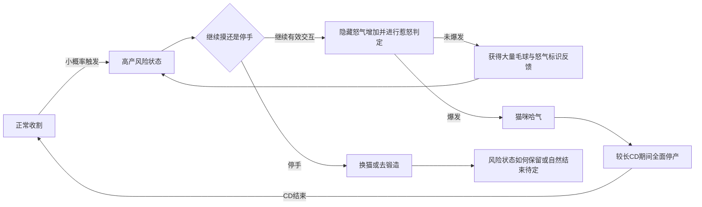

# 《毛球计划》：低概率哈气风险状态

2026年10月13日｜玩法讨论新增机制｜未实装

## 1. 玩家会经历什么

玩家照常与猫互动时，任何一只猫都有小概率进入一种高产但危险的状态：继续摸它能得到大量毛球，同时会积累看不见的怒气，并有随机概率惹怒它。

玩家看不到怒气数值、成功率或失败率，只能根据猫身上飞出的“怒气”标识数量，猜测下一次交互是否会让它爆发。爆发后猫哈气，随后进入较长停产CD，期间该猫无法通过任何途径产出。

这种机制的核心是“已经赚了不少，要不要再摸一次”，而不是解锁、考试或完成另一套小游戏。

## 2. 用户已提出的机制与待设计参数

| 内容 | 本轮记录 |
| --- | --- |
| 出现对象 | 任意猫，小概率触发，不是某一种猫专属技能 |
| 出现时机 | 玩家正在进行正常收割交互时可能进入 |
| 状态收益 | 毛球产量激增 |
| 继续交互的代价 | 隐藏怒气积累，并进行随机惹怒判定 |
| 风险提示 | 猫附近飞出的怒气标识数量 |
| 不向玩家展示 | 怒气数值、成功率、失败率或精确安全阈值 |
| 爆发反馈 | 哈气、炸毛等明显猫咪反应 |
| 爆发后果 | 较长CD，期间该猫任何产出停止 |
| 参考方向 | 借用用户所述《forgetax》锻刀的“赌下一次”感觉，不据此推定原游戏规则 |
| 尚未指定 | 触发率、增产倍率、怒气增长、惹怒函数、CD时长与自然恢复方式 |

参考图中的绿色外星猫只用来演示两种状态，不使事件变成外星猫专属，也不改动首批十猫的种类名单。

## 3. 状态流程

“爆发这一次操作是否仍结算奖励”尚未确定。图中只表达未爆发时正常兑现高产，不能据此虚构已选定的失败收益规则。

**建议允许玩家直接停手、换猫或进入锻造。** 不弹一个必须完成的窗口，不要求先安抚、连点击败或支付费用才能离开。停手后的怒气与状态怎么变化仍需设计，不能默认离开再回来就免费清空风险。

CD结束恢复正常收割是本稿的循环衔接建议；怒气是否归零、风险状态是否重新抽取，应随后明确。

## 4. 怒气标识应怎样表达

- 标识采用短促的红色怒气交叉符号，从猫头或身体周围向外飘散，不遮住眼睛、嘴与操作位置。
- 数量体现危险感，不显示怒气数字，不把图标凑成一条精确分格进度。
- 建议标识数量与内部危险程度保持大致对应，让玩家能作判断；具体映射尚未选定。
- 没有标识或标识较少时是否仍可能爆发，要根据最终概率规则确定，不以画面暗示必定安全。
- 图标是风险线索，不是可点击目标；点击图标不能免费消除怒气。
- 不加入隐藏位置、正确节奏、倒计时点击或必须反应的指针，风险来自是否继续收割。

玩家可以逐渐熟悉同一只猫的反馈，但界面不会直接告诉“下一次只有多少百分比会哈气”。

## 5. 与两套基础交互并行

哈气是叠加在正常收割上的稀有状态，**不是第三套完整交互方案，也不是第十一种猫**。现有两套预案仍并列保留。

| 基础交互 | 建议的风险判定单位 | 应避免的问题 |
| --- | --- | --- |
| 点击／稳定反馈 | 每次有效点击对应的收割 | 按住鼠标时每帧都算一次赌博 |
| 长按 | 每完成一个收割周期 | 把持续按住演成同一帧触发大量怒气 |
| 拖动 | 每完成一轮有效移动量 | 按鼠标事件数量算风险，导致高采样率鼠标更容易惹怒 |
| 积累爆发 | 每次有效点击；基础与额外爆发怎样叠高产另定 | 同一次点击因发基础与追加收益而重复惹怒判定 |
| 位置效率 | 每次有效区域点击；部位是否影响怒气另定 | 点错位置自动触发未说明的额外惩罚 |

该表是公平性与操作衔接提案。最终可以采用其他判定方式，但要明确“下一次交互”在各输入类别中指什么。

不因为进入风险状态就强制将所有猫改成连打或其他特殊操作。玩家继续使用原本熟悉的基础输入，变化来自高产、危险反馈和是否继续。

## 6. 停产CD与收益边界

用户指定CD期间该猫无法进行任何产出，需覆盖：

- 人工基础收割。
- 积累爆发追加收益。
- 高效部位加成收益。
- 自动收割和被动产出。
- 设施或其他猫效果试图触发的该猫额外产出。

其他猫正常生产，不因一只猫哈气暂停整个船舱。既有库存不因爆发被扣除；是否另有资金惩罚未提出，本稿不增加。

建议爆发前已经有效结算的毛球保留，正在飞向资源栏的动画可以完成，不能因为它们还没抵达图标就追缴。爆发操作尚未结算部分另行决定，避免同一事件重复发奖。

CD期间猫毛是否自然积累、其他进度是否冻结，以及CD结束后的第一笔收入如何处理仍待定。即使有积累，也不能在CD期间结算产出或让显示层假装赚钱。

CD可以显示简单冷却状态，隐藏的是怒气和惹怒概率，不必连“现在不能生产”也让玩家猜。是否显示精确剩余秒数后续确定；当前参考图只用灰色时钟与CD标记，不指定时长。

## 7. 自动化与收手的选择

建议该风险状态先由玩家有效互动触发。猫进入风险状态后，自动化是否继续工作需要专门决定，不能默认工人会自行持续赌到猫哈气。

可优先验证“工人避开风险状态、等待玩家决定是否继续”，以确保赌下一次是玩家的主动选择。此项为提案，不等于已削减工人能力或已修改工程。

若最后允许自动化处理，需要有明确的停止策略与配置，避免玩家正在锻造时，一只重要产出猫被自动化连续操作到长CD，而玩家不知道原因。

## 8. 与原先减少小游戏干扰的方向如何共存

此前担心的是日常生产突然被另一个界面或另一套操作考核打断。本事件沿用原输入、不弹强制界面，并建议允许直接停手，所以它可以作为同一收割中的风险变化来讨论。

但它仍会增加注意力负担，并带来长时间停产。不能仅因为“不是小游戏窗口”就认定它没有干扰。需要观察：

1. 玩家进入状态后是否真正愿意继续赌，而不是只感到被威胁。
2. 怒气标识是否足以形成有意义的判断，而不是完全不可读的随机惩罚。
3. 高产收益是否足以补偿进入CD的机会成本。
4. 多猫场景是否频繁出现事件，让玩家疲于查看每只猫。
5. 风险状态是否抢走毛毡锻造的主要期待；两者应形成取舍，而不是重复同一种赌法。

触发必须保持低概率的方向，但具体多低需要试玩，不直接在文档填一个固定百分比。

## 9. 视频参考图

| 状态 | 文件 | 用途与限制 |
| --- | --- | --- |
| 普通 | [外星猫普通状态](哈气事件参考/01_外星猫_普通状态.png) | 中央蹲坐、嘴闭合、眼睛正常、无怒气或冷却提示 |
| 哈气 | [外星猫哈气状态](哈气事件参考/02_外星猫_哈气状态.png) | 同猫同场景、炸毛压耳张嘴、怒气标识、CD提示，无产出效果 |

两张采用同一伪3D关门船舱与统一纸片猫表现，保留绿色身体、大黑眼和球头触角。图中资源120、3个怒气图标与CD徽标是展示元素，不是怒气阈值或精确参数。

普通图与哈气图用于视频的起止状态或角色状态参考。中间的高产、怒气递增、继续互动和爆发需由视频演出，单张哈气图不能表达完整随机逻辑。本次未生成动态视频。

图片生成方式与提示词见[生成说明](哈气事件参考/00_参考图生成说明.md)。

## 10. 待决定内容

1. 事件按何种有效交互触发、发生频率怎样控制。
2. 进入后如何告知高产与风险，增产从本次还是下一次开始。
3. 怒气怎样增加、图标数量怎样对应，惹怒概率怎样变化。
4. 玩家停手后状态多久保留、怒气是否自然减少，如何避免反复切换清风险。
5. 爆发那次是否仍给奖励，以及爆发动画与CD的先后关系。
6. 停产时长、自然积累、恢复进度与其他加成如何处理。
7. 自动化是否参与、会否自行触发、停止策略如何让玩家掌控。
8. 多只猫同时发生的数量与提示，不使正常收割沦为频繁救场。

本轮只记录讨论机制与生成两张状态参考图，不更新正式数值、实装日志或引擎。
