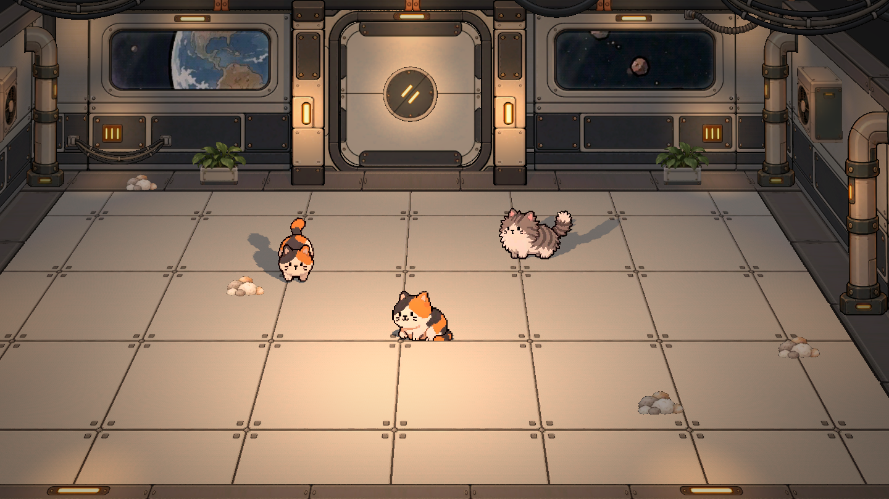
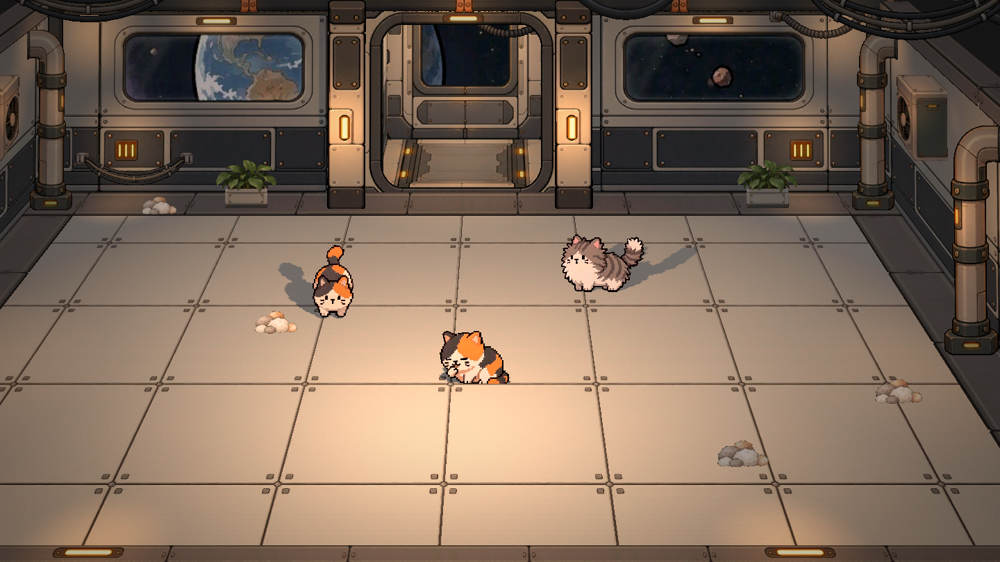

# 09｜2026-10-12 场景美术收尾、舱门与装饰整合

当前独立空间站场景的美术完成度约 **80%—90%**（按本次汇报口径），主体结构、配色和主要资产已经成形，进入摆位、衔接与光照细调阶段。该比例仅指当前场景美术，不代表全游戏或玩法开发完成度。

## 今日美术内容与进度

1. **宇宙背景与窗户。**替换为勾线风格的地球宇宙图，保留旋转，背景整体缩小20%。制作主反光、边缘亮线及边缘向中心透明的玻璃层次；比较新版后恢复旧反光素材，保留柔和的窗面表现。
2. **墙面灯具与光照。**完成深色框架横灯、三条平行灯、小型单灯三种贴片。根据用户手调的左侧位置复制右侧灯具和灯光；最终包保留当前保存的光源与资产位置。
3. **模块化地面。**整体仍为4×7，中间3×6完整浅色地板，四周用半格、四角用四分之一格补齐。上下半格调整方向，使完整边朝内衔接、切割边朝外。深色外部结构边框继续保留。
4. **重做中央舱门。**按门框内部轮廓对齐门扇，修正高度拉伸与倒角不匹配；去掉多余侧内构件和操作台。门扇采用上下对称、上下分开的结构，暖米灰底色配勾线、少量铆钉与结构分割，统一主场景风格。
5. **圆形锁与开合表现。**中央结构先制作完整圆图，再在场景中裁为两半。关闭时接缝竖直，旋转90°后与门的水平接缝对齐，上下门扇分别移开，关闭时反向复位。复用第三种小灯，放大、居中并缩短两灯距离，灯随圆形结构旋转，随后随各自门扇移动。
6. **门后舱室。**加深后方空间，组合两侧墙面、独立地板和后舱壁，后墙的大窗继续显示宇宙。开门后能清楚看到舱室纵深，维持面片搭建的表现。
7. **新增悬垂线缆。**制作平滑线缆、成束线缆、波纹线缆三种透明素材，两端高、中间下垂。作为独立2D面片放入场景，用户随后调整和复制摆位；当前截图与运行包记录最新保存结果。

## 当前效果

## 交付与检查

- Windows 64位独立场景包：`PurrOrbit_ArtScene_20261012_Windows.zip`，解压运行EXE，无需安装Godot。仅包含美术场景、猫咪动画预览、镜头与舱门展示，不移植经营、采集等玩法。
- 保留左右鼠标移动镜头、P切换自由视角，以及O／点击舱门开合；详细操作随包附带。
- 使用Godot4.7.1完成资源导入和导出，实际EXE图形启动并正常退出，启动日志无报错。
- 场景检查通过：90°旋转、上下分离与移动、重复输入保护、关闭及复位。1440×810闭门、旋转、开门截图已归档。
- 未重跑完整玩法流程。本次Git上传为日志与验证附件；当前工程及新增素材的完整源码不随此次日志提交上传，运行资源已包含在本地交付包。

## 后续收尾（约10%—20%）

- 继续细调线缆、灯具、装饰的最终摆位与疏密。
- 检查墙柱、门框、地面及管道的衔接，统一边缘、倒角与描线观感。
- 细调局部受光、阴影强度和玻璃反光，在左右镜头边界与自由视角下复核穿插、遮挡。
- 完成最终美术验收；玩法接入另行安排，不计入此次场景包。

## 本地制作入口

- 场景：`毛球满屋/scenes/Concept Whitebox.tscn`。
- 舱门：`scenes/props_2d/ArtAirlock.tscn`、`scripts/art_airlock.gd`、`Asset/Airlock/`。
- 线缆：`Asset/Cables/`，含三种透明PNG与中文提示词。
- [资源快照清单](09_附件_20261012/source_manifest.json)、[开合验证](09_附件_20261012/scene_check.log)、[运行包启动记录](09_附件_20261012/startup.log)。

交付ZIP大小：49,291,916字节。SHA256：`3a438be3f8fc1408df4e9a7163929c5a3062256c1c0a5c298e2826d2475cac52`。
