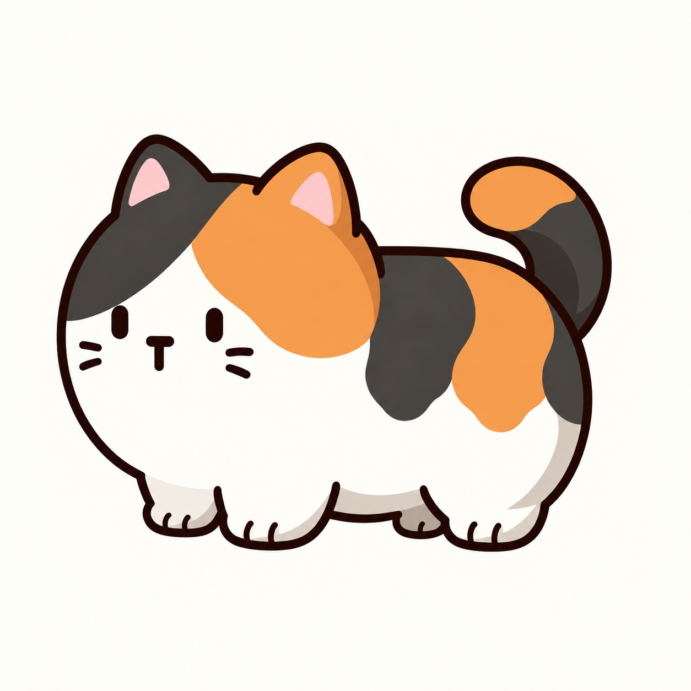
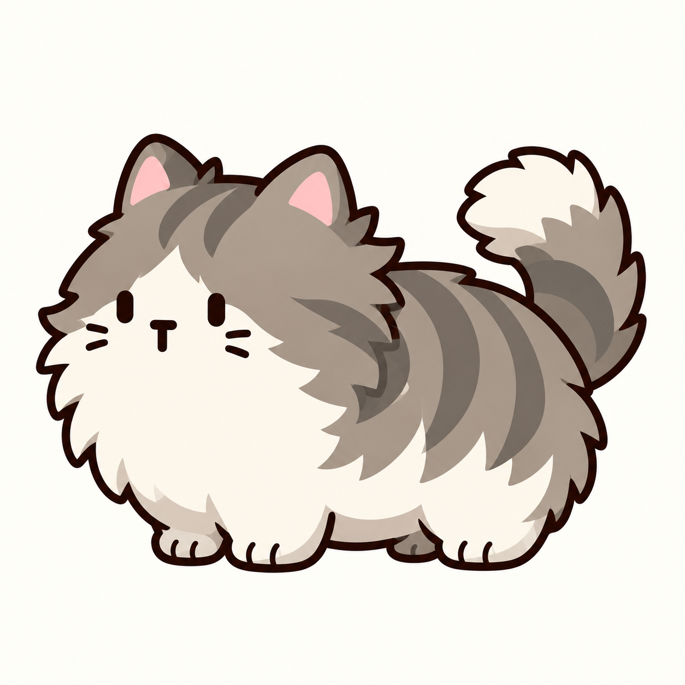

# 10｜2026-10-13 猫咪阵容与非像素形象设计

## 当前方向

游戏基调从温馨可爱转向抽象、直接、反常识。角色设计先以静态形象建立记忆点，让观众迅速识别“这只猫为什么奇怪”，后续玩法再根据视觉形象探索操作与收益的联系。本次仅整理角色美术与制图提示词，不改玩法蓝图、不实装技能。

共20种猫，分为三个阶段：

- **1–7（7种）：**还是猫的形象，但是越来越怪。
- **8–12（5种）：**表情包猫。
- **13–20（8种）：**越发荒诞，脱离现实。

## 20种猫总表

| 编号 | 猫种 | 形象设定 |
|---|---|---|
| 1 | 普通猫 | 胖胖的普通猫。 |
| 2 | 长尾猫 | 尾巴很大、很长的猫。 |
| 3 | 长毛猫 | 毛发特别长，拖在身后像拖把。 |
| 4 | 良子猫 | 特别胖，肚子垂地，行动缓慢但很可爱。 |
| 5 | 静电猫 | 炸毛，身边带有浅蓝色勾边。 |
| 6 | 高猫 | 四肢很长、很高的猫。 |
| 7 | 无毛猫 | 普通无毛猫，功能待定。 |
| 8 | 思考猫 | 参考思考猫meme，思考时可能产生神奇事件。 |
| 9 | Gigachad猫 | 很英俊、很强壮的猫。 |
| 10 | Nerd猫 | 书呆子猫，戴眼镜、有龅牙。 |
| 11 | 橘子猫 | 身上套着一个橘子的猫。 |
| 12 | 太空猫 | 头上有两个触角，身体发光。 |
| 13 | 机械猫 | 身体参考现有机械狗，搭配猫头。 |
| 14 | 机械猫（猫和老鼠） | 参考《猫和老鼠》中的机械猫。 |
| 15 | 招财猫 | 身体有金属光泽，挂着铃铛，形象类似招财猫。 |
| 16 | 猫猫虫 | 像毛毛虫一样移动的猫猫虫。 |
| 17 | 巫术布偶猫 | 布料拼接的猫身，以粗线缝合。 |
| 18 | 遗迹猫 | 数块圆钝石块悬浮拼成猫形，缝隙透出微光。 |
| 19 | 植物猫 | 由植物构成的猫。 |
| 20 | 克苏鲁猫 | 不可名状的猫形，行动诡异。 |

## 已有非像素基准

### 01 普通猫

当前形象基准：圆胖三花、低底盘和短脚；轮廓与花纹使用流畅曲线；清理重复胡须；背线趋平，后部稍收；耳后、臀部、尾巴和脚掌加入简洁块面阴影。不再沿用像素边缘，也不恢复繁琐毛丝和过多毛边。

### 05 静电猫

由原角色表第三排第二只转绘，保留灰色虎斑、炸毛轮廓、白胸腹和白尖蓬松尾巴，统一勾线与阴影。当前图为身体形象参考；总表要求的浅蓝色勾边尚未绘入，不标记为全部效果完成。

两张图均为本轮设计参考，尚未作为新的spritesheet替换到游戏中。旧运行素材状态不因此改变。

## 其余18种猫的制图提示词

见[18种猫完整中文Prompt](10_附件_20261013/18种猫_中文制图Prompt.md)。每种另存一份独立TXT，编号与本表一致。生成时上传上方普通猫作为第一张参考即可；特定meme或动画角色可追加第二张形象参考。

统一非像素勾线、简洁块面和少量遮挡阴影；各猫通过轮廓、结构、材质或脸部特征形成差异。具体配色和部分细节为首轮提案，等待生成与比较后确认。此次完成表格与提示词整理，没有批量生成剩余18种猫，也没有确定技能和收益数值。
