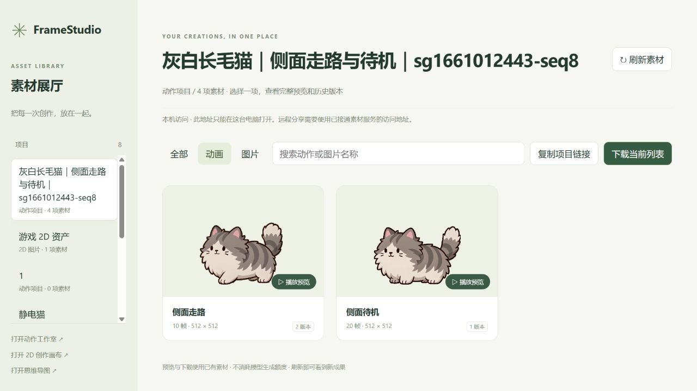

# 11｜2026-10-13 FrameStudio 制作规范与统一平台

本次围绕“需求方用日常语言提出制作要求，Agent 通过 FrameStudio 执行，再集中预览成果”完善工具流程。已完成制作 Skill、素材展厅和本机两套平台合并；不代表素材已经接入游戏或通过最终美术验收。

## 1. 建立 Agent 制作规范

- 创建并安装 `framestudio-production` Skill，htalk 的 Codex 资源扫描已能发现。复用现有 htalk 调用入口，没有重新部署多用户 Agent。
- 接单时主动给出可填写的需求表，预填用户已提供的信息，也允许直接用自然语言回答。内容包括制作对象、参考图、风格、动作与方向、是否循环、视频时长、帧数和单帧尺寸。
- 明确用户后续参与的决策：制作方案、实际参考图、视频生成方案、问题预览与重做、超额度和最终验收。填完表不等于批准尚未展示的提示词或付费生成。
- 默认非像素二维勾线卡通风格，允许需求方指定其他风格；支持猫以外的角色与道具。每个动作使用独立提示词与参考绑定，提示词保存到画布。
- 动作建议 5–20 帧，默认单帧 320×320，但帧数和尺寸均需确认；默认 10 FPS。视频时长另问，明确当前原片接口固定 4 秒，不能把截取时长当成生成时长。

## 2. 额度、质量与执行记录

- 每任务图片生成/编辑最多 15 张、视频最多 10 段；重做、AI 换绿幕及可能扣费的失败请求均计入。额度是上限，不是自动用完的授权；扩额和付费重试由原需求方确认。
- 增加事务式本地额度台账，记录批准版本、稳定步骤编号、任务编号和消耗。重复执行同一步骤不会再次获得提交许可；不确定请求先查询，避免重复付费生成。
- 交付前检查裁切、位置跳动、绿边和动作连续性；发现问题先做一轮本地算法修复，仍不合格则展示问题预览，由需求方决定修改哪些动作。不能把规则补充写成所有动画缺陷已经修复。
- 动画交付限定为视频、透明 Spritesheet PNG 和 GIF 预览，不默认发送逐帧 PNG、JSON、Godot 文件。新增交付脚本，统一最终帧组、尺寸及 10 FPS，并检查循环和帧数。

## 3. 根据实际反馈修正流程

**绿幕必须检查真实图片。** 视频接口只会追加绿幕提示词，不会自动替输入图换背景。Skill 增加前置检查：检查实际绑定图片，透明图本地合成绿底，复杂背景在批准后编辑；等待完成并核对结果，再提交视频。

**不同视频独立处理。** 每个视频分别记录自己的动作、透明帧处理和导出节点，处理前后核对视频来源；禁止把第二个视频接到第一个的处理节点来替代结果。同一参考图可以复用，视频之后的分支必须独立。检查最近的走路/待机任务时，原视频仍在；未把用户看到的覆盖现象误报为文件已删除。

**侧面动作直接使用原参考图。** “侧面走路/侧面待机”不再自动触发侧脸或侧视立绘制作。默认把方向写入视频提示词，直接使用需求方参考图；必要的绿幕处理只换背景，保留原图视角、姿态及外观。只有明确要求新视角参考图时才追加生图。

## 4. 新增素材展厅

- 自动读取动作项目和 2D 图片项目，不必每次任务重新构建平台。
- 支持项目切换、名称搜索、图片/动画筛选、原视频与精灵图对照、历史处理版本、浅色/深色/棋盘背景及播放速度调整。
- 支持单项下载和当前列表打包下载。卡片按需加载首帧，打开预览后才播放动画，减少同时播放大量素材的负担。
- 对处理节点冲突及来源不符的导出进行检查，避免把其他视频的结果展示到当前动作。
- 展厅展示的是画布中的实际版本和尺寸；512×512 母版不会被自动冒充确认后的 320×320 成品。任务目录中的最终交付包尚未自动登记到展厅，仍需核对版本和规格。

*10 月 13 日本机验证截图，画面仍为合并前的本机地址；实际使用入口已统一。图中为现有处理母版，不是新的角色定稿或游戏接入证明。*

## 5. 合并本机与内网平台

- 排查确认：原内网 8765 运行 `asset-canvas`，本机 8766 运行 `cat-studio`，两套服务和数据独立，因此新版功能没有出现在原内网入口，并非被删除。
- 合并到独立的 `output/framestudio-unified/`。相同项目去重；“公共平台”“猫咪制作”和灰白长毛猫等新增项目同时保留。“静电猫”存在不同视频和导出记录，分别保留为“内网版保留”和“新版保留”。
- 合并后保留 10 个可见项目、2 个归档项目、1 个 2D 制图项目和 2 张思维导图。保留两边原始数据目录，并保存数据库与代码备份，提供切换失败后的回退路径。
- 新首页提供原节点画布、角色动作工作室、2D 资产生成、思维导图和素材展厅五个入口。用户执行切换命令后，已核实 8765 返回 unified 状态、激活标记存在，素材可通过内网地址读取。
- 正式入口使用 `http://30.18.68.82:8765/`，素材展厅为同地址下的 `/library.html`。该地址需要公司内网访问，不属于公网服务。旧 8766 已退出日常制作入口，Skill 随激活标记切换到统一服务。

## 6. 验证结果与后续边界

| 检查 | 结果 |
| --- | --- |
| Skill 格式、额度台账并发/重复提交/扩额/修复次数 | 通过本地校验 |
| 交付脚本的帧数、透明通道、GIF 帧时长及循环 | 通过合成素材测试，无模型调用 |
| 展厅独立视频分支、导出来源、2D 结果及 ZIP | 通过；浏览器实际下载含 2 视频、2 精灵图、2 GIF |
| 合并页面、接口、节点引用及源数据快照 | 通过；迁移时未发现引用素材缺失 |
| 抽查媒体内容哈希 | 6 项一致，见附件验证记录 |
| 切换后内网地址读取 | 视频、PNG、GIF 均成功响应；本机通过内网地址验证，未冒称另一台电脑完成验收 |

本次规范编写、展厅开发、迁移和验证没有新增模型生成请求。已有素材制作任务的费用不据此记为零，仍以原任务台账和账单为准。导出素材仍须在游戏中检查尺寸、透明边、锚点、方向与播放速度，本次没有修改玩法或游戏运行图集。

## 记录与接手

- 本机工作区：`Gaming/tools/cat-studio/`；统一数据：`Gaming/output/framestudio-unified/`。
- 合并备份：`Gaming/output/framestudio-merge-backups/20261013-174337/`；两边原始数据目录保留。
- 本次数据库/文件验证摘要：[合并验证.json](11_附件_20261013/合并验证.json)。
- 入口规则与生成规范：本机 `~/.codex/skills/framestudio-production/SKILL.md`。
- 仓库中的“美术日志”目录更名为“美术技美报告”，保留既有编号、附件和历史内容并修正引用。原工作流代码快照仍是历史快照，本次报告未声称它已同步为统一部署源码，也未上传项目数据库、密钥或原始视频。
