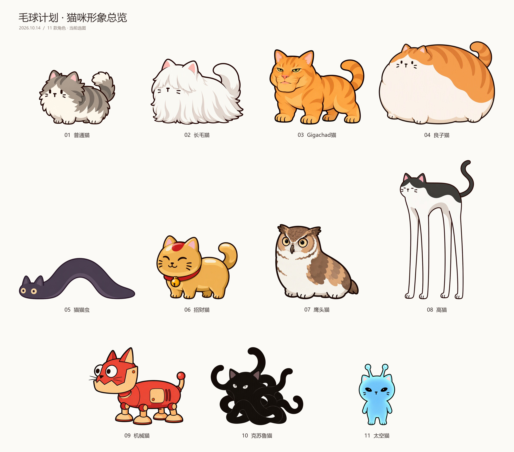

# 12｜猫咪个性化设计与阵容排版

日期：2026-10-14。完成本轮角色形象迭代、中文Prompt修订与11张用户当前选图的阵容总览。当前为静态美术设计与展示成果，未新增动画、未替换Godot运行资源，未修改玩法。

## 当前选图总览

来源为用户指定的“Downloads/猫”文件夹，共11张，编号1—11；此前提及14张，但当前目录实际11张，未擅自补入其他角色。本图序号是本次排版顺序，不覆盖10号报告的20种猫设计编号。命名按本批文件，8号按造型修正为高猫，11号去除文件名中的多余t。

| 本图序号 | 名称 | 当前选图特征 | 排版调整 |
|---|---|---|---|
| 1 | 普通猫 | 本批选图为灰色蓬毛猫，名称按用户文件“普通猫”保留。 | 缩小 |
| 2 | 长毛猫 | 白色长毛，长眉遮眼。 | 默认 |
| 3 | Gigachad猫 | 橘色肌肉猫，保留宽下颌与窄眼。 | 略放大 |
| 4 | 良子猫 | 极胖橘猫，饱满腹部与短腿。 | 放大 |
| 5 | 猫猫虫 | 深紫灰、无四肢、身体细长，中段拱起。 | 放大 |
| 6 | 招财猫 | 金色身体、红项圈、金铃铛。 | 略缩小 |
| 7 | 鹰头猫 | 猫头鹰头部与猫身融合，棕白配色。 | 略放大 |
| 8 | 高猫 | 上黑下白、极长四肢；原文件误名“8长毛猫.jpg”，展示名为高猫。 | 显著增高 |
| 9 | 机械猫 | 红色外壳、浅橘部件，复古大圆眼机械头。 | 放大 |
| 10 | 克苏鲁猫 | 近黑混乱团块与圆钝触手；本批选图含小耳，保留用户最新文件。 | 放大 |
| 11 | 太空猫 | 蓝色身体、黑色外星眼与圆头触角；本批选图为直立造型。 | 缩小 |

## 今天的造型制作与修订

- **Gigachad猫**：依据面部meme保留宽下颌、突出颧骨、窄眼与嘴部结构，结合全橘色肌肉猫身；随后转为系列横向站姿，并减少虎斑与肌肉碎阴影。
- **招财猫**：将原像素表第四排第一只转换为流畅勾线，保留金色、红项圈、金铃铛和少量金属高光。本次选图以用户文件为准。
- **外星／太空猫**：参考双触角meme，改为蓝色、黑色杏仁眼；本批用户最新选图为直立版本。
- **机械猫**：先试现代机器狗四足关节、放大的电子猫脸屏幕并调整横向朝向；随后制作复古版本，融合大圆眼机械头和横向胶囊机身、短腿，再从灰色改为红色主壳与浅橘部件。当前阵容采用后者。
- **克苏鲁猫**：从黑猫与多手臂演进为抽象黑色纠缠结构、较少圆钝无分叉触手；对话中曾要求去耳，本批用户选图重新含耳，排版忠实保留。是否最终去耳仍需以之后定稿为准。
- **猫猫虫**：Prompt修订为深紫偏灰、无四肢、连续细长身体，尺蠖式中部拱起；前后端接地，保留猫耳与浅色眼。本批已有用户选图。
- **思考猫**：修订并生成银灰白、圆眼、微张嘴、头向上抬、尾巴下垂版本；多轮修正头部朝向与头胸衔接。过程图单独归档，本次11张选图未包含思考猫，不擅自加入总览。
- **高猫与其他角色**：本批归档用户提供的长毛、良子、鹰头、高猫等最新图；原图来源与文件哈希见附件，不将用户提供的图冒称为本轮全部生成。

## 排版与交付方法

以原始图片抠除与外边缘相连的浅色背景，保留内部白毛区域；每张仅进行等比缩放和平移。三排分别1—4、5—8、9—11，各排按有效轮廓底部对齐脚底／接地基线，无脚的猫猫虫与克苏鲁按身体接地点对齐。高猫允许明显高于同排角色。比例遵循本次用户大小要求，具体展示倍数为排版选择，不代表游戏内尺寸。

输出4200×3700 PNG与独立图层SVG；SVG内嵌各角色图像，可单独移动、缩放，文字可编辑。同时保存原始JPG、独立透明PNG与layout.json，方便继续排版。避免整张图再次交给生成模型重画而改变角色轮廓。

已检查11张顺序、名称、无遮挡、无裁切、行内接地基线与相对大小。当前静态形象仍需继续统一细节密度与最终命名；历史空间站美术80%—90%进度不等同本批猫阵容完成度。

## 附件

- [高清总览PNG](12_附件_20261014/猫咪形象总览_20261014.png)
- [可编辑图层SVG](12_附件_20261014/猫咪形象总览_可编辑.svg)
- [原始图片](12_附件_20261014/原图/)、[独立图层](12_附件_20261014/独立图层/)、[排版数据](12_附件_20261014/layout.json)
- [思考猫衔接修订](12_附件_20261014/过程参考/思考猫_衔接修订.png)、[屏幕猫脸机器狗过程方案](12_附件_20261014/过程参考/机器狗结构_屏幕猫脸_过程方案.png)
