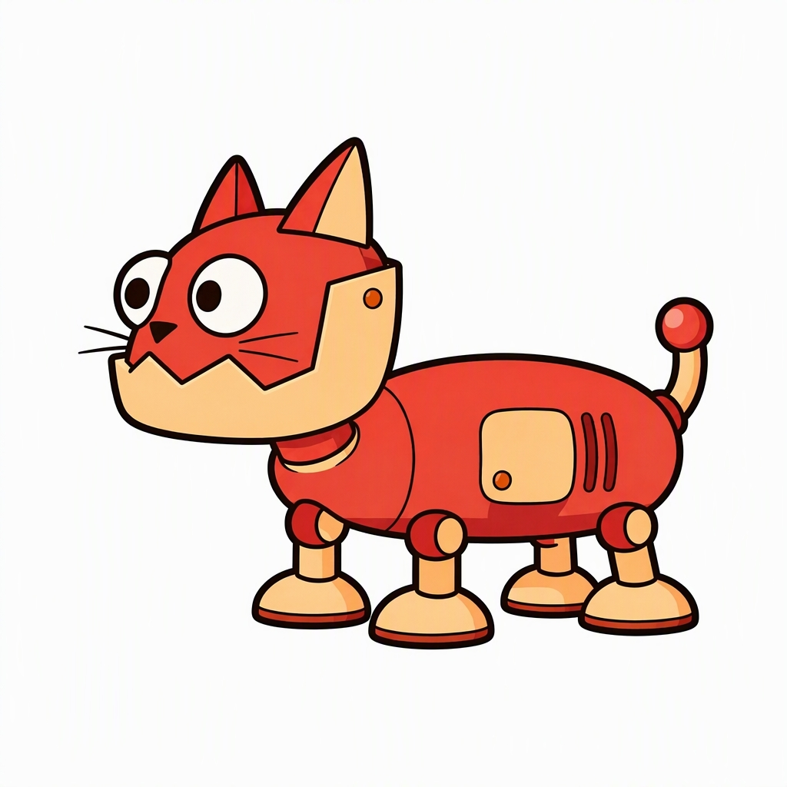
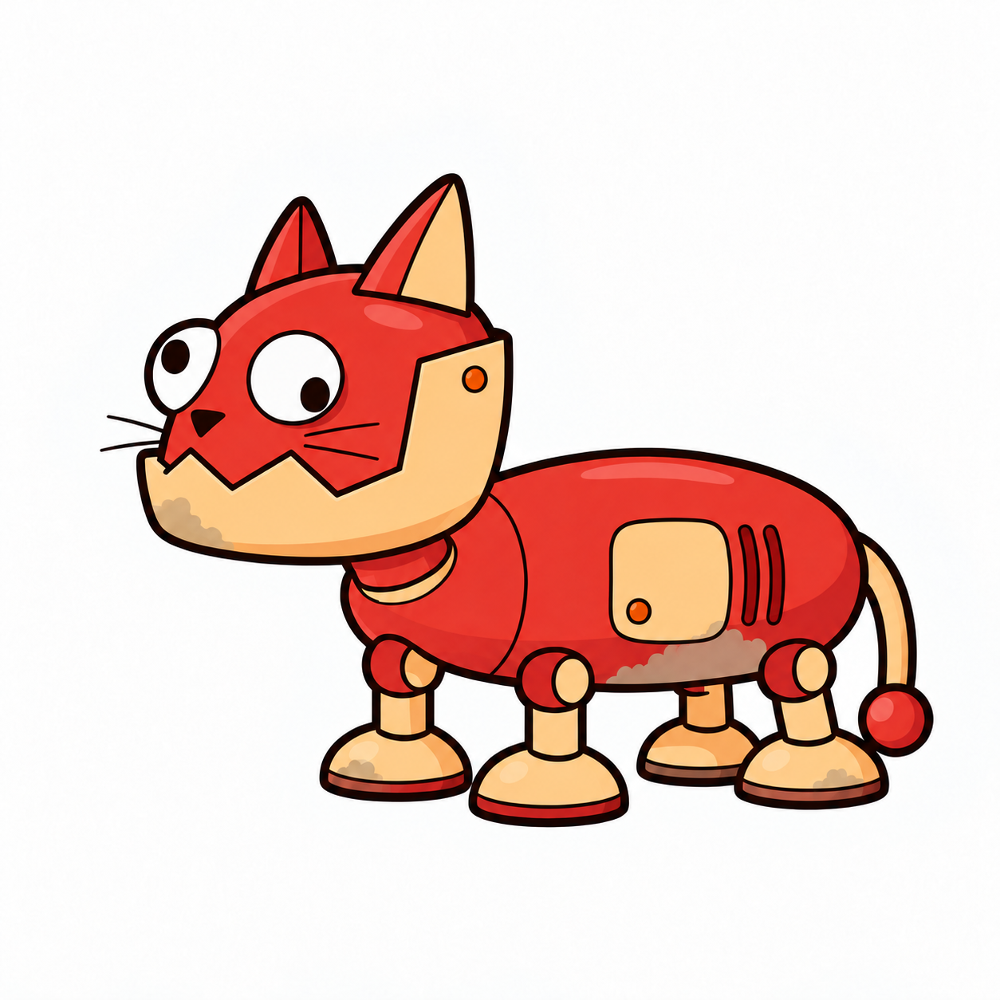
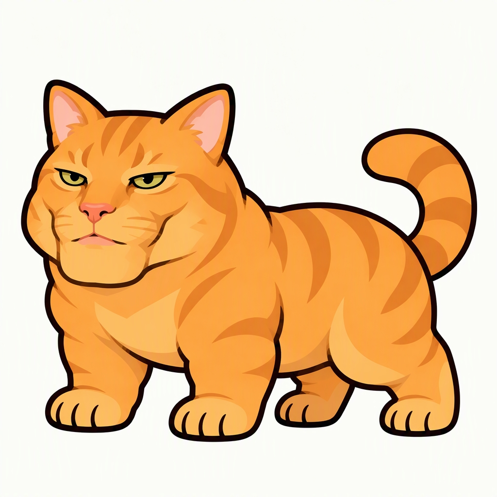
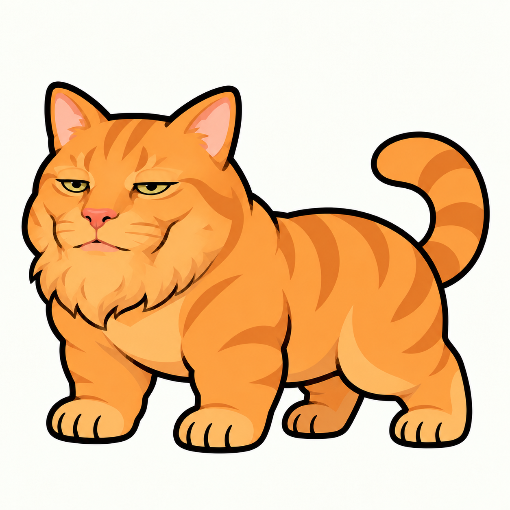
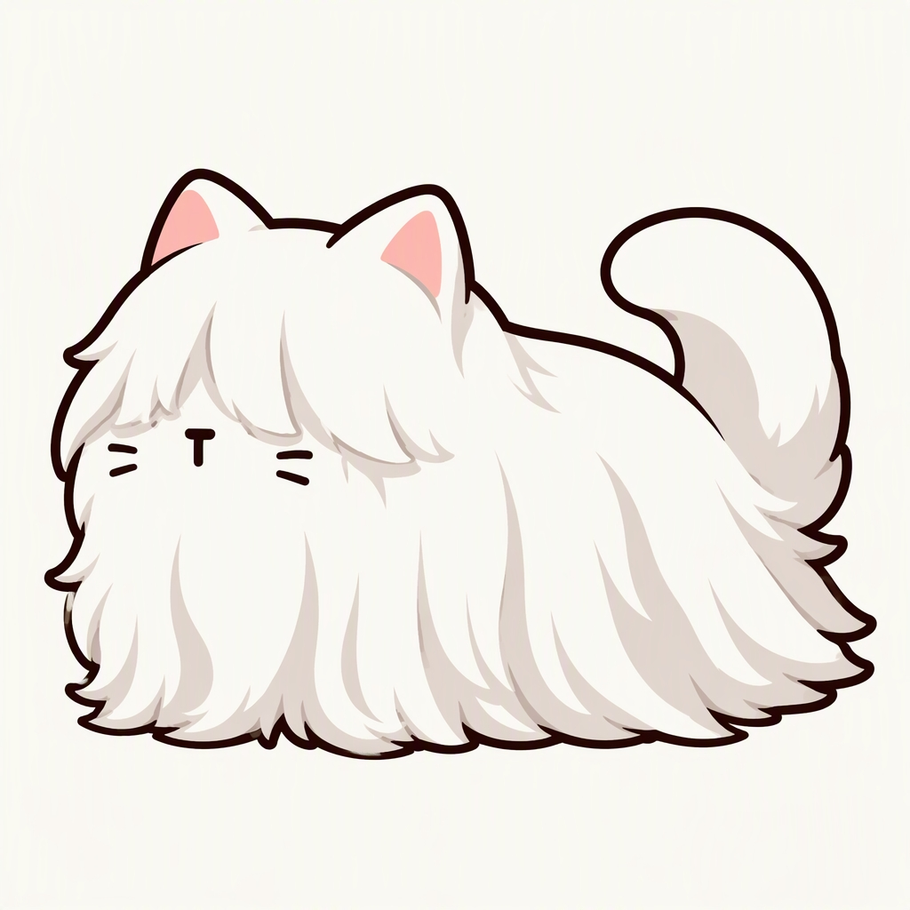
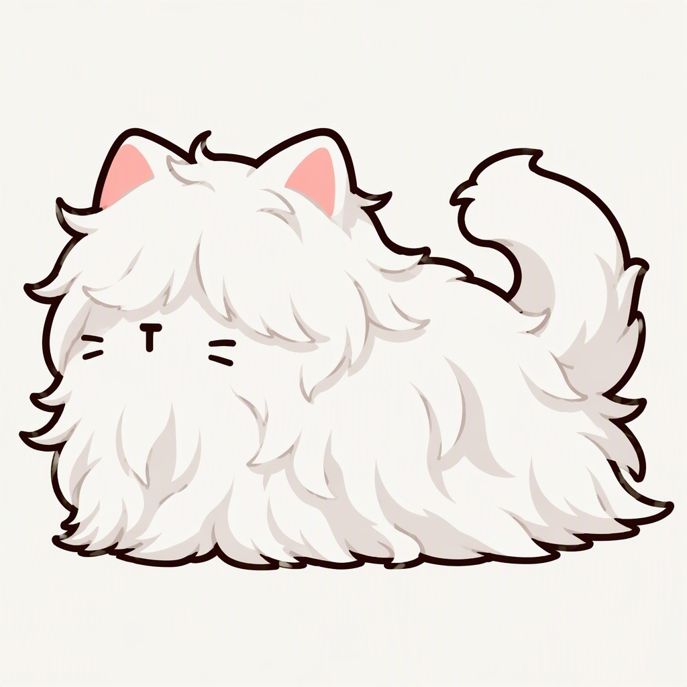

# 13｜猫咪美容舱室与猫咪双状态制作

日期：2026-10-15。今天的主要工作是搭建猫咪美容用的舱室近景，制作并放入操作台，同时推进猫咪常态与第二形态的视觉差异。

## 美容舱室：完成本地场景搭建与镜头整合

“新场景”是现有 `scenes/Concept Whitebox.tscn` 主场景左侧、正常主镜头看不到的位置，节点组为 `23_CloseupChamber`，没有另外创建新的 `.tscn`。以原门后舱室为基础复制素材，允许独立编辑墙、地面、框架、管道与灯光；新增 `CloseupCamera` 对准美容舱室。保留用户后续手动调整。

| 内容 | 今天的制作与调整 | 当前状态 |
|---|---|---|
| 舱室结构 | 墙体、地面与后窗重新布局；墙脚增加水平深色框架，墙顶加入方形管道；以左侧为准复制右侧墙体、框架、管道和侧灯 | 已在本地场景整合，后续布局由用户继续调整 |
| 后窗 | 主场景门后舱室与特写舱室均采用窗户素材左半边，再镜像拼右半边；修正分片后反光重复的问题，跨整窗连续采样 | 已加载与预览检查 |
| 门模块副本 | 复制可编辑门模块到近景入口；用户调整后保留框架与空节点，解除缺失门板／锁芯时的失效脚本绑定 | 用于美术编辑；副本未绑定开门动画 |
| 操作台 | 参考舱室视角减弱俯视与透视收缩；褐色台面、深灰框架，降低光泽和碎纹理，加高中间支撑柱；去底后以 `Worktable` 独立面片接入 | 已摆入特写舱室，普通猫站到台面 |
| 普通猫 | 01由三花换回灰白虎斑，复用去底PNG，保持独立面片与受光；总览同步恢复灰白01 | 已在本地场景整合 |

操作台与角色采用2D透明图片面片配合3D舱室视图，延续非像素勾线、大色块、低光泽与适量暖色光照。操作台素材：`Asset/Decor/Worktable_01.png`；普通猫：`Asset/Cats/01_NormalCat.png`。

## 开门与镜头过渡

- O键进入：开门动画总计0.8秒（解锁旋转0.2秒＋门板移动0.6秒）；第0.5秒开始向门推近，缩放持续0.5秒，开门与缩放的时间轴共1秒。
- 推近结束前0.2秒渐黑；全黑时切到美容舱室相机，保持黑屏0.2秒，再用0.2秒亮起。进入从按键到完全亮起约1.4秒，避免把开门／缩放的1秒误写为整个含淡入淡出的时长。
- O键返回：0.2秒渐黑、全黑切回主镜头并停留0.2秒、0.2秒亮起；画面亮起后等待0.4秒，再播放0.8秒关门动画，使关门在主镜头中可见。
- 推近目标按实际投影持续校正到门，避免落在中央地面；返回保留主镜头原位置。P键直接切镜头功能已删除。过渡中阻止重复触发。

本地检查包含场景加载、实际相机预览、进出与关门复位、黑屏覆盖及左／中／右镜头位置推近目标检查。这里只记录美术场景预览功能，不代表美容操作、状态切换或正式玩法整合已经完成。

## 猫咪双状态：以视觉差异为制作方向

| 猫种 | 常态 | 第二形态重点 | 进度 |
|---|---|---|---|
| 普通猫 | 灰白虎斑，毛流有序 | 原有大毛束歪斜、翻折、逆向交错，体型与毛量不变 | 基础图已恢复；乱毛Prompt迭代，最终第二形态待选定 |
| 长毛猫 | 白色长毛，长眉遮眼 | 眉毛、胸前、侧身、尾毛错向交叠与局部压塌，保持遮眼与原毛量 | 已有乱毛参考，用户认可方向并要求更乱；追加Prompt，进一步生成待定 |
| 机械猫 | 红色外壳、浅橘部件，上翘尾巴、正常视线 | 浅灰褐尘土与泥印、下垂尾巴，两只较大竖椭圆瞳孔朝不同方向 | 已生成单图；去掉过重掉漆／深划痕，避免呈现损坏感 |
| Gigachad猫 | 大头橘色肌肉猫，宽硬下颌、坚毅眼神 | 大一圈的圆润毛下巴，宽大尖毛束轮廓；微眯困倦眼神，身体不变 | 已生成单图；纠正早期误用小头版本，改以正式大头参考制作 |

### 机械猫形态对照

| 基础形态 | 当前第二形态 |
|---|---|
|  |  |

### Gigachad猫形态对照

| 基础形态 | 当前第二形态 |
|---|---|
|  |  |

### 长毛猫乱毛方向

| 基础形态 | 当前乱毛迭代参考（尚待进一步打乱） |
|---|---|
|  |  |

双状态制作遵循相同角色、相同体型与画风，以毛束形状／走向、表面脏污和眼神区分状态；避免靠增加细节改变风格。机械猫与Gigachad第二形态为当前单图成果，尚未制作动画或接入场景内状态切换。

## 更新的阵容总览

仅替换总览01，其他十只猫的素材、位置、尺寸和每排脚底基线保持不变。本图仍展示各猫基础形态，第二形态不替换阵容中的基础图。

## 附件、版本与后续

- [双状态当前Prompt](13_附件_20261015/猫咪双状态_当前Prompt.md)、[可编辑总览SVG](13_附件_20261015/11_猫咪形象总览_可编辑.svg)、[操作台透明素材](13_附件_20261015/02_操作台_透明素材.png)。素材生成与去底使用内置imagegen；总览采用已有透明图层直接排版。
- [本地场景与关键资源SHA256](13_附件_20261015/本地场景版本证据.json)用于核对本次截图与本地版本。此次上传为报告、截图与必要美术附件，不包含工程源码、EXE或存档。
- 今天较早导出的独立场景EXE已通过启动检查，但早于操作台接入、灰白01恢复、P键删除及窗户对称／反光修正；该旧包不代表当前最新画面。
- 后续继续微调美容舱室布局，确定普通猫与长毛猫最终乱毛形态，按实际玩法需要再制作动画及状态切换。本次不另报新的整体百分比，历史空间站80%—90%不等于美容功能完成度。
