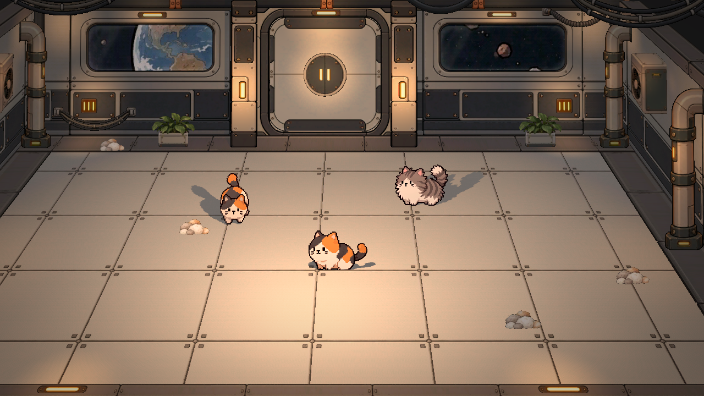
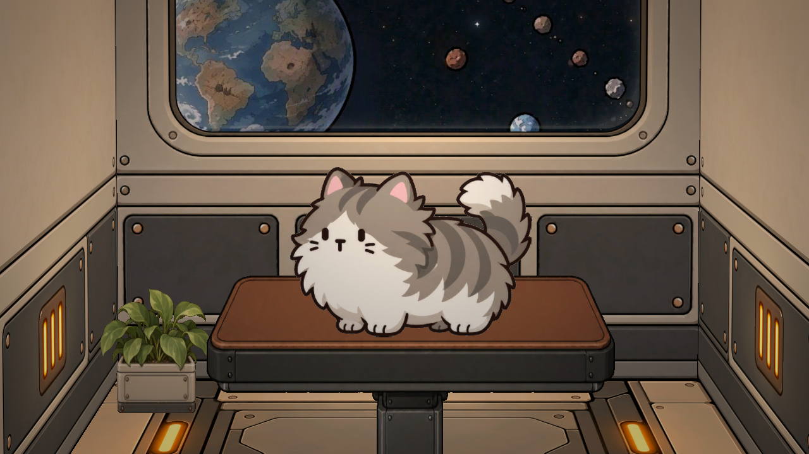

# 14｜主场景与猫咪美容室：Agent接手附件

更新：2026-10-16。此次已将最新美术场景及所需素材、脚本上传仓库。先读本页，再打开场景；完整依赖与SHA256见[场景依赖清单](14_附件_20261016/场景依赖清单.json)。10月15日制作过程见[13号报告](13_2026-10-15_猫咪美容舱室与双状态制作.md)。

## 如何打开

使用 Godot 4.7.1 打开仓库中的 [`毛球满屋/project.godot`](../毛球满屋/project.godot)，待导入后打开 [`scenes/Concept Whitebox.tscn`](../毛球满屋/scenes/Concept%20Whitebox.tscn)，按 **F6运行当前场景**。命令行入口：

```powershell
Godot_v4.7.1-stable_win64.exe --editor --path "<仓库>/毛球满屋" "res://scenes/Concept Whitebox.tscn"
```

项目默认启动场景仍为 `scenes/3D scene.tscn`，F5不等于运行本美术场景。稀疏检出时需包含 `毛球满屋/scenes/`、`scripts/`、`Asset/`、`Art/`，或按依赖清单取齐文件。不要移动素材或丢失中文文件名、`.uid`、`.import`；`.godot/` 缓存由本机首次打开时生成。

## 两个区域都在同一个TSCN里

| 区域 | 节点／文件 | 位置与定位 |
|---|---|---|
| 主场景大厅 | 根 `ConceptWhitebox`，相机 `GameCamera` | 原点附近；墙、地板、门、灯、装饰为根节点下的编号组 |
| 主场景门后小舱室 | `21_ArtAirlock`；实例源 `scenes/props_2d/ArtAirlock.tscn` | 入口约 `(-0.054, -0.657, -9.474)`；门后空间沿负Z方向 |
| 美容室近景 | `23_CloseupChamber`，同一主场景中的独立可编辑素材组 | 根变换位置约 `(-40, -0.657, -9.474)`，比例约 `(1.342,1.309,1)`；选中后按F定位 |
| 美容室相机 | 根节点下 `CloseupCamera` | 约 `(-40.045,4.316,-1.805)`；选中后开启相机预览，保留已编辑的镜头参数 |





美容室没有单独的 `Airlock Closeup.tscn`。它是美术展示／布景区域，**不要与另一个开发任务的 `scenes/prototype_grooming/main.tscn`、`fur_demo.tscn` 美容玩法测试混淆**。本次未把那些玩法移植进大厅或美容室，也未更改默认启动入口。

## 节点和素材速查

以下素材路径均相对于 `毛球满屋/`；节点名以本次提交场景为准。

| 内容 | 节点入口 | 素材／脚本 |
|---|---|---|
| 大厅地面、边框、墙面 | `01_Floor`、`01_FloorBorder`、`02_SideWalls`、`03_BackWall_Windows` | `Asset/Modular/Floor_Tile_01.png`、`Floor_Border_01.png`、`Wall_Plain_01.png`、`Wall_Window_02.png` |
| 原门及动画 | `21_ArtAirlock` | `scenes/props_2d/ArtAirlock.tscn`；`scripts/art_airlock.gd`；`Asset/Airlock/Frame_02.png`、`Leaf_Upper_06.png`、`Lock_Full_04.png` |
| 美容室地面与两侧墙 | `23_CloseupChamber/VestibuleFloor`、`LeftInnerWall`、`RightInnerWall` | `Asset/Airlock/Floor_01.png`、`Asset/Modular/Wall_Plain_01.png`；局部Mesh／材质在主TSCN内 |
| 美容室水平墙脚框架、顶部方管 | `23_CloseupChamber/FloorBorder`、`WallTopPipes` | `Asset/Modular/Floor_Border_01.png`、`WallTop_BackPipe_01.png`；保持用户现有位置，不依据节点名字猜测方向 |
| 大厅后舱室对称窗 | `03_BackWall_Windows/LeftWindowModule3_LeftHalf` 与 `_RightHalf` | `Asset/Modular/Wall_Window_02.png`；只采左半图，再镜像拼右半图 |
| 美容室对称窗 | `03_BackWall_Windows/LeftWindowModule2_LeftHalf` 与 `_RightHalf` | **它们不在23组内**，而在03组下，世界X约-40；调整美容室时也要一起处理 |
| 宇宙与玻璃反光 | 两半窗材质 `SymmetricWindowLeftMat/RightMat` | `Asset/Universe_Earth_Outlined_01.jpg`、`Asset/Modular/Window_Glass_Reflection_01.png`、`window_sky.gdshader`；墙图镜像，反光通过`glass_region`跨整窗连续采样 |
| 普通猫 | `23_CloseupChamber/01_NormalCat`，Sprite3D | `Asset/Cats/01_NormalCat.png`；当前为灰白虎斑透明图，站在操作台上，参与光照 |
| 操作台 | `23_CloseupChamber/Worktable`，Sprite3D | `Asset/Decor/Worktable_01.png`；透明图，褐色台面、深灰框架、加高中柱；用户后续缩放与摆位已保留 |
| 灯光与装饰 | 美容室的`InteriorSoftLight*`及主场景装饰组 | `Asset/Lights/`、`Asset/Decor/Decor_Planter_Front_01.png`；植被等可能放在其他根分组下 |
| 美容室入口门框副本 | `23_CloseupChamber/DoorModule/Frame` | 用户保留可编辑门框；TopLeaf/BottomLeaf/LockMount等仅余空节点，**未挂开门脚本**，不要误当成可播放的门 |
| 镜头与过渡 | `GameCamera` | `scripts/concept_edge_pan.gd`；引用`../CloseupCamera`和`../21_ArtAirlock`，改名或迁移节点需同步路径 |

## 当前操作与改动边界

- **O键**：开门0.8秒；第0.5秒开始推近门，持续0.5秒；推近最后0.2秒渐黑，全黑切镜头并停0.2秒，再亮起0.2秒。返回时渐黑／停顿／亮起后，再等0.4秒播放0.8秒关门。重复输入在过渡中被拦截。
- **P键切换已删除**。不要根据旧包或早期日志恢复P键自由视角／直接切镜头。主镜头鼠标靠左右移动仍保留。
- 角色和操作台是透明2D图片面片，不是白模贴图。双状态概念单图／Prompt见13号附件，尚未接入本场景内的状态切换或动画。
- 修改前重新读取最新主TSCN，保留用户手动调整；不要把美容室重建成独立TSCN。跨分组窗户、装饰与相机需要一起核对。
- 早前导出的场景EXE不代表此次最新源码；本次上传工程与交接附件，没有新导出EXE。

## 验证证据

已将场景依赖单独复制到无原项目缓存的目录，重新导入，并从该依赖集分别运行主相机和美容室相机截图；O键进入／返回、全屏渐黑停顿、延迟可见关门与主镜头复位检查通过。验收脚本：[verify_scene_transition.gd](14_附件_20261016/verify_scene_transition.gd)，可在项目路径下以Godot `--headless --script "<附件绝对路径>/verify_scene_transition.gd"`运行。默认项目入口、其他美容玩法原型及原有共享猫动画导入参数保持仓库版本。
