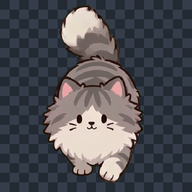
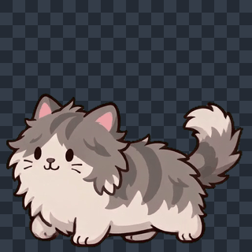
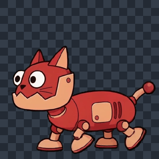
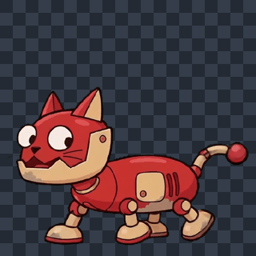

# 15｜双猫动画返修、提示词传输与透明边缘处理

日期：2026-10-16。记录本次普通猫／乱毛猫、机械猫／旧化机械猫的动画制作与技美处理；同日场景上传和美容室交接另见[14号报告](14_2026-10-16_场景上传与美容室接手附件.md)。本报告不把生成完成、指标改善或导出完成当作最终动作验收。

## 当前交付范围

普通猫与机械猫已分为两个 FrameStudio 项目：普通猫 `9e5710174ea845d7`、机械猫 `385bc031d8a54613`。当前项目素材目录为 `毛球满屋/Asset/Cat animation/`，按猫名→正常／乱毛／旧化组织。最终本地保留普通猫12动作，以及机械猫朝左的正常行走、正常待机、旧化行走、旧化待机4动作，共16动作。

机械猫向上、向下8动作被用户判定质量不足，已从项目导出目录撤出，备份保留在本机任务目录，暂不继续制作。前一步去绿曾处理24动作，最终交付范围已缩减为16；不能把24写成当前有效导出数量。

每动作提供单行透明PNG图集、GIF预览、MP4原片；文件名固定为“序号_猫名字_朝向动作”，方便同名替换。单帧320×320；行走6帧、6 FPS、1秒循环（1920×320图集），待机10帧、5 FPS、2秒循环（3200×320图集）。原片4秒；朝右由朝左镜像。48份本地媒体的复制哈希、PNG尺寸与透明通道检查通过，见[本地导出清单](15_附件_20261016/08_本地导出清单.json)。清单中的完整素材本轮未随报告上传，附件仅含下方代表性预览及检查证据；场景和脚本引用尚未切换。

## 提示词传输故障定位与修复

此前不能只将失败归因于提示词长短。实际服务在 Windows PowerShell 5.1 下运行 Seedance 桥接脚本，中文JSON字符串发送时出现问号替换；本地接收端对照记录中，修复前原217个中文字符发送后为0个中文、237个问号。PowerShell 7对照未复现该编码损坏。

实际工作副本 `Gaming/tools/seedance/seedance.ps1` 改为显式 `application/json; charset=utf-8`，并通过 `[Text.Encoding]::UTF8.GetBytes(...)` 发送JSON字节。修复后PowerShell 5.1／7本地传输对照均与原文一致。该证据确认编码传输，不表示模型已能可靠遵循所有动作约束。原脚本备份及完整传输测试留在本机；本次报告提交未更新仓库历史工作流代码快照。

## 动画返修与检查结论

普通猫沿用这次非像素2D卡通描边风格；动作节奏对照“静电猫（新版保留）”的三向行走和待机。现有生成接口仍以静态方向图为实际输入，旧动画用于观察对照，不能称为已输入模型的视频运动控制。

- 普通猫朝下：多轮出现头部逐渐变大、尾巴不连贯，以及前腿过度伸出、承重不自然。最后一轮重点改为短腿、小步幅、胸口下方交替落脚，后腿保持合理遮挡；抽帧区间改为原片2—3秒，输出6帧，避开眨眼。用户尚未确认最后一版步态通过。
- 乱毛猫朝左：先修鼻子消失，随后用户指出嘴部缺一侧；新版放大检查显示起始帧由T形过渡到双侧嘴线，约第3帧后双侧持续可见，选用六帧区间嘴线完整。原片仍有表情过渡，不能声称每帧与静态首帧完全相同。见[97帧嘴部检查](15_附件_20261016/05_嘴部逐帧检查.jpg)。
- 乱毛猫朝上：先扩大偏瘦的身体，并修正正常／乱毛背面爪子前后画错的问题；尾巴重做后轮廓和毛束更清楚，仍有小幅形变。
- 所有新提示词保留“尾巴始终保持在画面之内”、脚底为角色最低处；边界扫描作为提示，最终仍需视觉核对。

头部尺寸辅助检测根据暗色连通区域定位双眼，测量眼距及眼睛所在高度的横向主体宽度。首轮明显漂移版本眼线附近宽度178—228像素，范围约为首帧28.09%；最后一版可测帧宽度178—184像素，约3.37%，眼距范围约6.82%。最后一版仅88/97帧成功测量，眨眼等9帧未形成可靠双眼结果。此测量并非精确头部分割，也不能证明步态合理；见[逐帧测量数据](15_附件_20261016/07_头部尺寸测量.json)。

## 去绿过强与描边不流畅

用户反馈透明边缘切得过强。检查当前处理函数发现旧参数阈值5／柔化0使用二值Alpha，容易切掉被绿幕与压缩混色污染的描边；零柔化还启用硬Alpha处理。对四种形态在浅／深背景比较5/0、8/20、10/30、15/40后，本批采用阈值10／柔化30，并保留去绿溢色。参数只作用于本批动作，未修改共享默认规范。

[四形态参数对照](15_附件_20261016/06_四形态去绿参数比较.jpg)中每组分别显示浅、深背景。24动作均从原视频本地重新处理，逐项核对源视频、采样时间、选帧索引、帧数与FPS一致，未新增模型请求。透明边缘保留半透明过渡；随后按用户意见撤出机械猫非朝左8动作。算法不能恢复原视频已经缺失的嘴线、肢体或严重形变，也不能代替动作验收。

## 当前预览与接手

| 普通猫朝下（最后返修，待验收） | 乱毛猫朝左 |
|---|---|
|  |  |

| 机械猫朝左 | 旧化机械猫朝左 |
|---|---|
|  |  |

本机任务与历史版本：`Gaming/output/framestudio-tasks/cats-20261016-four-states/`；统一制作数据：`Gaming/output/framestudio-unified/`；制作服务8765。独立动作／处理／导出分支保留来源，防止互相覆盖。本轮未接入游戏动画资源引用、未验证Godot实机播放、未导出新EXE；用户反馈不通过即直接返工对应动作的偏好已记录，其他已通过动作保持。
